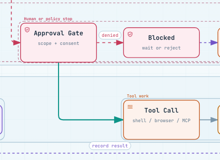
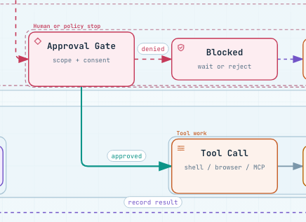
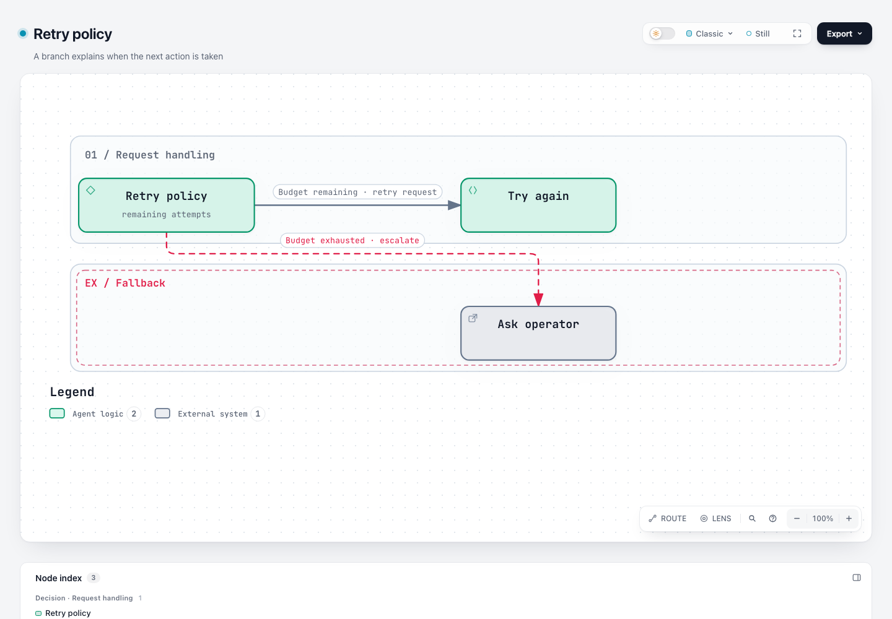

# Workflow decision markers and branch conditions — #312 evidence

This bundle documents a local implementation of the maintainer's proposed small first slice: explicit decision identity, visible branch conditions, and missing-condition warnings. It does not claim that new schema fields have already been approved, implement logical operators, or resolve all of #312.

- Base: `tt-a1i/archify@63c9263e84bd3993cab8e09b3d69888857858635` (`dev`, refreshed before publication).
- Candidate: `testikun/archify@fa80584a7db102a6abe2df0b2ed91fccc2a89643`.
- Evidence route: fixed-input compiler/CLI comparison and native browser/Viewer/export replay. No fresh source-to-diagram model generation sessions or authoring-speed claims.
- Runtime: official Node 22.23.2, bundled zlib `1.3.1-e00f703`, macOS and local Google Chrome.
- Accountability: @testikun explicitly confirmed personal review before publication. Codex (GPT-6 family; precise runtime variant unavailable) assisted investigation, design, implementation, tests, visual/code self-review and writing. This is not independent maintainer acceptance.

## Before and after

Same 1440×1000 viewport, light theme, Signal Flow preset, Still mode and 100% Viewer zoom. The two crops use the same viewport region. The candidate adds an explicit decision marker to Approval Gate and visible `approved` text to its outgoing edge; `denied` becomes an explicit condition with unchanged displayed text. All 12 node rectangles and 11 edge routes remain unchanged.

| Base | Candidate |
| --- | --- |
|  |  |

[Full before screenshot](screenshots/native-before-light-1440-still.png) · [Full after screenshot](screenshots/native-after-light-1440-still.png) · [Dark / reduced motion](screenshots/native-after-dark-1440-reduced.png)

Download [before HTML](artifacts/native-before.html) or [after HTML](artifacts/native-after.html) and open locally for native interaction. [After SVG](exports/native-after-light-1440-still.svg) was produced by the native export action. HTML files are self-contained; GitHub's source view does not execute them.

## Proposed authoring contract

Workflow schema versions 1 and 2 accept optional `nodes[].decision: true`, independent of `type`, and optional `edges[].condition: { "value": "Approved" }`. `value` must contain non-whitespace text. No `op` is accepted in this slice.

| Text fields | Visible text |
| --- | --- |
| Label only | Existing label unchanged |
| Condition only | Condition value |
| Exact same condition and label | Text once |
| Different condition and label | `Approved · run tool` |

The same composed string is measured, routed, rendered and used in relationship details and layout receipts. Authored input is not mutated. No text is silently truncated. Long text remains subject to existing layout constraints.

The existing diamond sigil is the default decision marker. An explicit icon, including `none`, retains precedence; decision identity remains in the existing Passport context, SVG title and accessible focus label. Type colors and legend membership are preserved. Decorative icons and outgoing-edge count never imply decision semantics.

Each outgoing edge of an explicit decision that omits a condition gets `workflow/missing-branch-condition`, with its original input path and repair guidance. Direct renderer stderr, compiler/layout receipts, `validate` and `deliver` expose the warning. It remains a warning in showcase. Empty/malformed supplied conditions are schema errors. Zero-outgoing, single-outcome and repeated-text cases do not receive a logical completeness failure.

## Generality and compatibility



The [retry input](inputs/retry.json) uses a backend node and retry-budget vocabulary rather than approval-specific IDs or strings. [Chinese conditions](screenshots/chinese-light-1440-reduced.png), a [long condition](screenshots/long-condition-light-1440-still.png), and a [partial showcase](screenshots/partial-dark-1440-reduced.png) exercise the same path.

- Six unchanged v1/v2 inputs produce identical SVG bytes and complete compiler receipts on base and candidate: four bundled Workflow examples, the frozen v1 baseline, and the explicit-coordinate v1 fixture. See [compatibility receipt](receipts/compatibility.json).
- New fields work in v1 and v2. Migration preserves authored conditions and reserves the displayed text in its automatic rank plan.
- [Single-outcome showcase](receipts/partial.json) succeeds. Its [missing-condition variant](receipts/missing-condition.json) also succeeds, with one warning.
- Existing keyboard node activation, Passport, mobile relation disclosure, Still/reduced motion and native SVG export were exercised. No new sidebar, player, or card component is introduced.
- Desktop condition labels are visible and fit their masks. On 390px wide screens, overview labels remain small: measured glyph bounding-box heights are approximately 7px in the official example and 9px in the retry example. These are not CSS font sizes or a claim of whole-diagram readability. Existing internal panning, zoom and relationship details remain necessary.
- Mobile relations keep their original default collapsed state: [collapsed Passport](screenshots/native-after-light-390-reduced-passport-collapsed.png), [expanded conditions](screenshots/native-after-light-390-reduced-passport.png). Full [browser observations](receipts/browser-observations.json) distinguish geometry/visibility from readability.

## Validation and reuse

The committed candidate's 22 changed files exactly match the final tested snapshot. [Source hashes](receipts/final-source.json) and [publication binding](receipts/publication-source.json) record this reuse. The source snapshot's `committed: false` describes when it was captured; the publication receipt binds those bytes to the candidate above.

| Check | Result |
| --- | --- |
| [Before implementation](tests-before.log) | Six feature tests failed because base rejected the new fields; invalid-shape rejection already passed |
| [Workflow/compiler/migration focus](tests-focused.log) | 88 passed; the later additional migration test is included in the next run |
| [Final feature + diagnostic boundaries](tests-diagnostics.log) | 34 passed |
| [Native browser + existing label contrast](tests-browser.log) | 4 passed, zero skips |
| [Core smoke](tests-core.log) | 19 passed |
| [Generated artifacts](tests-generated.log) | Viewer, brands, validators, release identity and golden checks passed |
| [i18n + showcase](tests-i18n-showcase.log) | 51 passed; one Windows-only test skipped on macOS |
| [Nine fixed-input deliveries](receipts/commands.json) | All succeeded, including the intentional warning case |
| [Package smoke](receipts/package-smoke.json) | Extracted ZIP delivered approval, retry and missing-condition cases outside the repository without dependencies |
| [ZIP freshness](zip-freshness.log) | Independent rebuild compared byte-for-byte equal to candidate archify.zip |

Counts overlap across suites and are not summed. The full local test suite, full browser inventory and three-platform matrix were not run. Required remote CI remains separate and must be evaluated on the PR head. The real-repository generation protocol is a scoped pilot; this bundle does not claim pilot completion or an agreed exemption. Scope/evidence expectations remain open for maintainer confirmation.

## Ablation and implementation cost

Temporarily disabling condition handling made the condition-only label disappear and broke the measured-text equivalence test: [failed ablation](ablation-visible-label.log). That behavior was restored. Removing the redundant `minLength: 1` constraint preserved empty/whitespace rejection with the existing `type: string` and `pattern: "\\S"`: [passing ablation](ablation-min-length.log); the redundant constraint remains removed.

One stateless text helper serves existing measurement/rendering paths; one diagnostic function serves compiler and CLI callers. There is no second mutable display-label projection, expression evaluator, predicate tree, runtime branch state or text cache. The test-value and simplify-codebase checks were scoped to these changed boundaries.

## Reproduce

In a checkout of the candidate, install the repository's declared development dependencies, then run:

```sh
npm ci
npm --prefix archify ci
npm run test:focus -- test/workflow-decision.test.mjs test/workflow-compiler.test.mjs test/workflow-migration.test.mjs
npm run test:focus -- test/renderer-diagnostic-boundary.test.mjs test/render-failure-diagnostics.test.mjs
npm run test:core
npm run test:generated
npm run test:browser -- test/workflow-decision-browser.test.mjs test/workflow-edge-label-contrast-browser.test.mjs
```

Set `ARCHIFY_CHROME` to a working Chrome/Chromium executable for the browser command. To replay a published input, use the checkout's `node archify/bin/archify.mjs deliver workflow /path/to/inputs/retry.json /new/output/retry.html --json`. Run `native-before.json` against both revisions for the unchanged-input comparison; `native-after.json` intentionally uses fields unsupported by base. View the HTML with `?theme=light` or `?theme=dark`, choose Still, then focus Approval Gate or Retry policy and expand relations on mobile.

## Provenance and retention

[manifest.json](manifest.json) lists original and published hashes. Local workspace/cache/temp paths in logs and receipts are explicitly redacted; inputs, screenshots, HTML and SVG bytes are unchanged. Only allowlisted task evidence is included, with no private conversations or hidden model reasoning. Evidence is stored separately from the product diff and retained through review and the resulting release cycle. Original unredacted evidence remains local.

The system ffmpeg binary could not load a local library; the showcase was rebuilt with an existing standalone ARM ffmpeg. Declared development dependencies were installed in the isolated checkout. No live Archify installation or system tool installation was changed.
