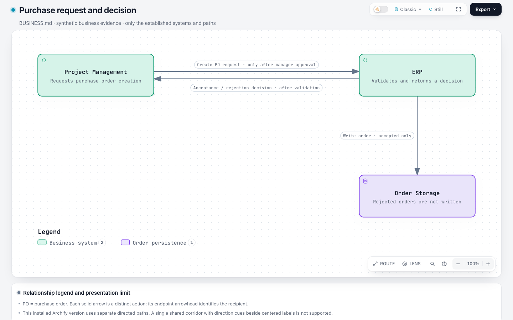
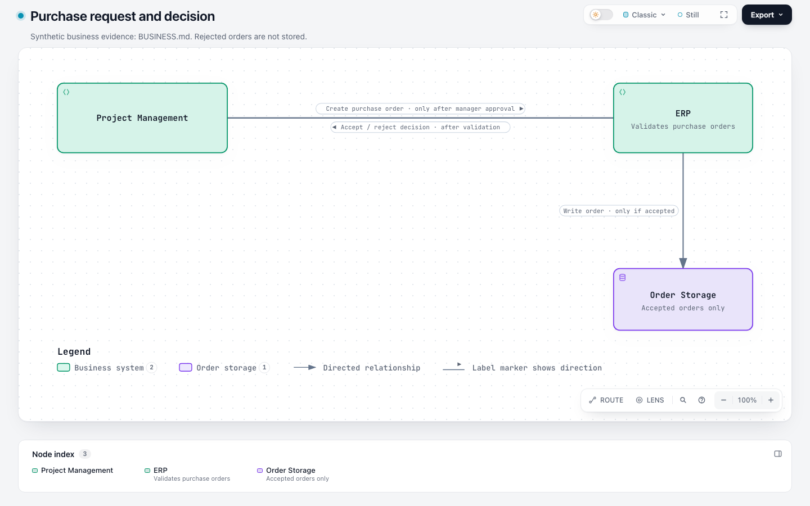

# Architecture relation directions and centered label arrows — PR evidence

This is a review-only evidence branch, separate from the product diff. Retain its immutable commit through review and the resulting release cycle. Base: `63c9263e84bd3993cab8e09b3d69888857858635`; final candidate: `c4f28b89e6ee39edb1e0a09db96998bda27670f1`.

The final candidate supports undirected associations and symmetric relationships in Architecture, with structural two-way traversal and static non-forward presentation. Different request/result meanings remain separate forward identities. The optional label-arrow presentation lets those separate actions share explicitly authored geometry with centered opposite-side labels and adjacent direction cues.

## Start here

- [Final-candidate five-project comparison](benchmark-label-arrows-20261104/REPORT.md): 10 fresh official sessions plus two synthetic shared-message sessions; all delivered, but known semantic/readability findings remain. Hive, MCO and Squad naturally adopted 20 label arrows; the supplement adopted two more.
- [Final-candidate issues and reproductions](benchmark-label-arrows-20261104/ISSUES.md): existing boundary-title occlusion, a Hive baseline factual error, and small SkillRoster context labels. These are not silently repaired in the generated outputs.
- [Final label-arrow implementation and tests](label-arrows-evidence/README.md): focused behavior/browser checks, affected-suite results, artifact refresh, package reproducibility and a failing ablation.
- [Earlier direction implementation and test history](implementation-evidence/README.md) and [scope/simplification review](implementation-evidence/LOCAL-REVIEW.md).
- [Earlier benchmark at 7ee304c5](benchmark-20261104/REPORT.md): 10 official plus six supplemental sessions, retained under their original revision. It includes the Squad `both` misuse. These are not relabeled as final-head sessions; [three semantic replays](benchmark-label-arrows-20261104/reused-semantic-replay/summary.json) verify unchanged output on the final candidate.

## Requested shared-message presentation

The synthetic prompt requested a shared corridor, centered labels and label-adjacent direction cues without schema or coordinate hints. Both arms preserve the actual request/decision conditions and accepted-only storage. Base honestly reports the requested presentation unsupported; candidate supplies it without merging edge identity. This is new capability, not a claim that base failed its existing contract.

| Base fallback | Final candidate |
| --- | --- |
|  |  |

Both primary captures are 1440×900, light/Classic/Still, zoom 100%, device scale 1. Full-page captures may reflow under a taller viewport and are labeled separately. A reviewer can download HTML artifacts to inspect interaction; GitHub's HTML source viewer is not the application.

## Provenance and limits

[manifest.json](manifest.json) records original and published SHA-256 for each copied file. Paths are consistently redacted: the investigation root becomes `/evidence/issue-1139` and the home directory becomes `/local-user`. Original receipts and prompt hashes bind original bytes; the manifest identifies redacted copies. Diagram facts, failures, revisions and native event order are retained. The manifest is an integrity inventory, not proof of model authenticity. There are no private maintenance-chat or hidden-reasoning exports.

Public source checkouts and repeated Archify package copies/ZIPs are excluded; reconstruct them from the pinned public source commits and plans. No live installation, product release or tag is made by this evidence branch. Reports are preserved as dated execution records: historical statements such as “not yet published” refer to when the local record was written; this index describes the publication copy. Local archive links are replaced with publication notes pointing to this tree.

The latest benchmark requested Codex CLI 0.144.0, `gpt-6.1-sol / medium`, a 20-minute budget and concurrency two. Gateway backend identity was not independently verified. Costs were deferred; no speed or token-saving claim is made. Author-side source and visual review is distinct from human contributor/maintainer acceptance and remote CI.
