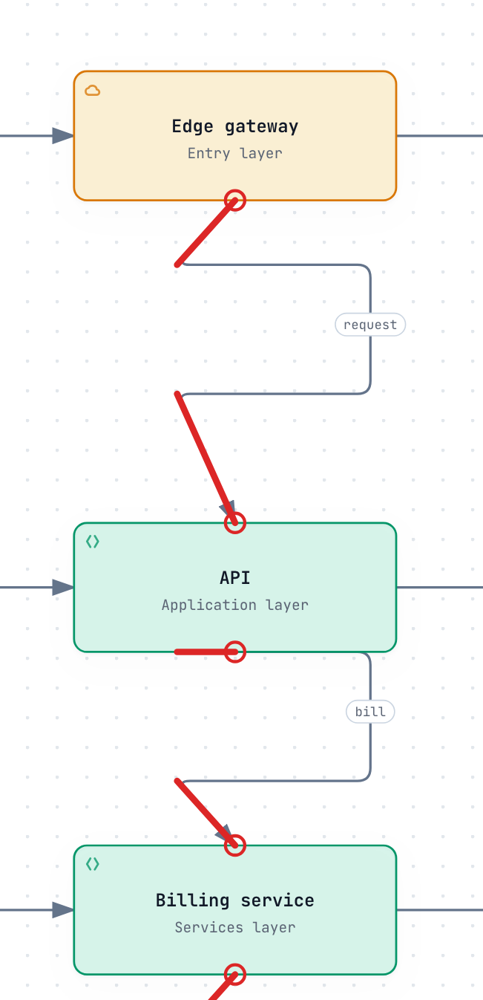
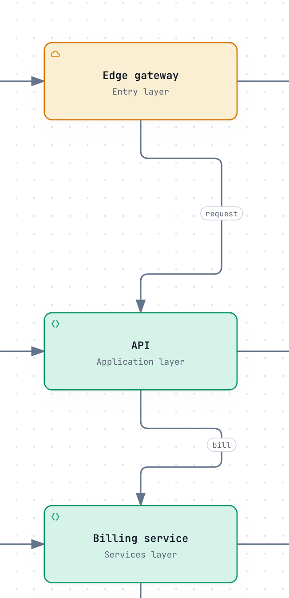

# Evidence for Archify PR #1184

[PR #1184](https://github.com/tt-a1i/archify/pull/1184) proposes Architecture endpoint-relative waypoint coordinates. This branch contains review evidence only; it is not a release or a product-source change.

Base: `63c9263e84bd3993cab8e09b3d69888857858635`. Final benchmark candidate: `e7174173cbbd134418a08155c6e1e4a0c8f398cd`. The candidate's renderer/schema/tests are identical to `41076efb`; the follow-up refreshes only `archify.zip`.

## Real repository benchmark

**Completed: 10/10 sessions and author-side reviews.** This uses the repository's own [real-repo-generation-v1 protocol and corpus](https://github.com/tt-a1i/archify/tree/63c9263e84bd3993cab8e09b3d69888857858635/benchmarks/real-repo-generation): OpenPI, Hive, MCO, Squad and SkillRoster, Architecture once per base/candidate. The [frozen plan](benchmark/plan.json) uses fresh Codex CLI sessions, `gpt-6.1-sol / medium`, sequential execution and 20 minutes each. [Protocol audit](benchmark/protocol-audit.json) verifies pins and exact task prompts; the local runner only orchestrates and captures the sessions.

[Read the full comparison report](benchmark/REPORT.md) for paired screenshots, pinned source checks, original first/submitted/final JSON, native sessions and cross-replays. All ten final artifacts have current matching delivery receipts; all ten frozen final JSON inputs pass on both versions with identical layouts and canonical SVG. No sessions timed out or reported a provider error.

This is **not an all-pass quality result**: Hive base contains an unsupported browser-entry relationship and title-mask occlusion; Squad candidate also has title-mask occlusion. Author review marks nine semantically correct and eight readable. MCO candidate and SkillRoster base retain natural first-submission failures and repairs; OpenPI base's first captured draft fails before the participant's first submission. All scheduled failures, including browser launch failures, remain in the evidence.

None of the ten final diagrams uses the new relative coordinates. The comparison supports compatibility observations, not natural feature adoption or stable repair/token savings. No speed or cost claim is made. [Integrity audit](benchmark/evidence-integrity.json) verifies retained snapshot and receipt identities; it is not an authenticity proof or human acceptance.

## Synthetic editing reproduction

The private input in [issue #359](https://github.com/tt-a1i/archify/issues/359) is unavailable. These are explicitly synthetic 14-node, 15-edge, five-layer inputs, testing an application-layer shift of +40 and node x stretch of 1.1 while preserving authored corridors, 40-unit endpoint clearance and segment-relative labels.

| Case | Input | Validation |
| --- | --- | --- |
| Original optimized numeric routes | [JSON](synthetic/best-initial/diagram.json) | [Pass](synthetic/best-initial/base.layout.json) |
| Numeric routes after changing nodes only | [JSON](synthetic/best-combined-nodes-only/diagram.json) | [Nine endpoint-direction errors](synthetic/best-combined-nodes-only/base.layout.json) |
| Relative routes after changing nodes only | [JSON](synthetic/relative-combined/diagram.json) | [Pass](synthetic/relative-combined/candidate.layout.json) |
| Numeric routes manually synchronized | [JSON](synthetic/best-combined/diagram.json) | [Pass, same target geometry](synthetic/best-combined/base.layout.json) |
| Relative routes with insufficient label segment length | [JSON](synthetic/relative-conflict/diagram.json) | [Typed rejection](synthetic/relative-conflict/candidate.layout.json) |

Keeping the same stale numeric input fails on both code versions; upgrading the renderer does not migrate old JSON. The capability becomes useful after the intended endpoint bindings are authored. The prepared relative case changes only 12 node-coordinate numbers, compared with 26 numbers in the optimized numeric version. Initial configuration cost is not included, and these counts do not establish natural Agent adoption or stable repair/token savings. Full bands layout remains outside this PR.

| Rejected geometry, diagnostic preview | Relative route at the same node positions |
| --- | --- |
|  |  |

The left image uses a separate diagnostic renderer to display rejected geometry, with original diagnostic segments marked red. Normal delivery rejects that input. This image is not a passing product artifact. [Preview provenance](synthetic/before-after/preview-provenance.json) · [full rejected image](synthetic/before-after/error-fullpage.png) · [same-input/version results](synthetic/before-after/summary.json).

## Reused checks

The following author-side checks ran at `41076efb`; their source paths are unchanged at the packaging-only follow-up:

- [Focused relative-via/routing/port/repair checks](checks/implementation-focused.log): 77 passed, 0 skipped.
- [Node 20 core](checks/implementation-core.log) and [Node 22 core](checks/implementation-node22-core.log): 19 passed each.
- [Real browser regressions](checks/implementation-browser-regressions.log): 12 passed, 0 skipped.
- [Generated artifacts](checks/implementation-generated.log): passed.

Final-head [CI run](https://github.com/tt-a1i/archify/actions/runs/41561163843) passed all executing jobs, including Node 18/20/22/24, browser regression shards, ZIP freshness and package smoke checks. Scope-based skips are retained in [ci.json](benchmark/ci.json). The initial stale-ZIP failure remains in PR history.

Screenshots and semantic reviews are by the maintenance Codex Agent, not human maintainer acceptance. Public artifact paths are redacted consistently; [manifest.json](manifest.json) records original and published hashes and explains any resulting receipt hash differences. Evidence stays available through review and the resulting release cycle. Source repositories are referenced by immutable commits rather than redistributed as checkouts.
