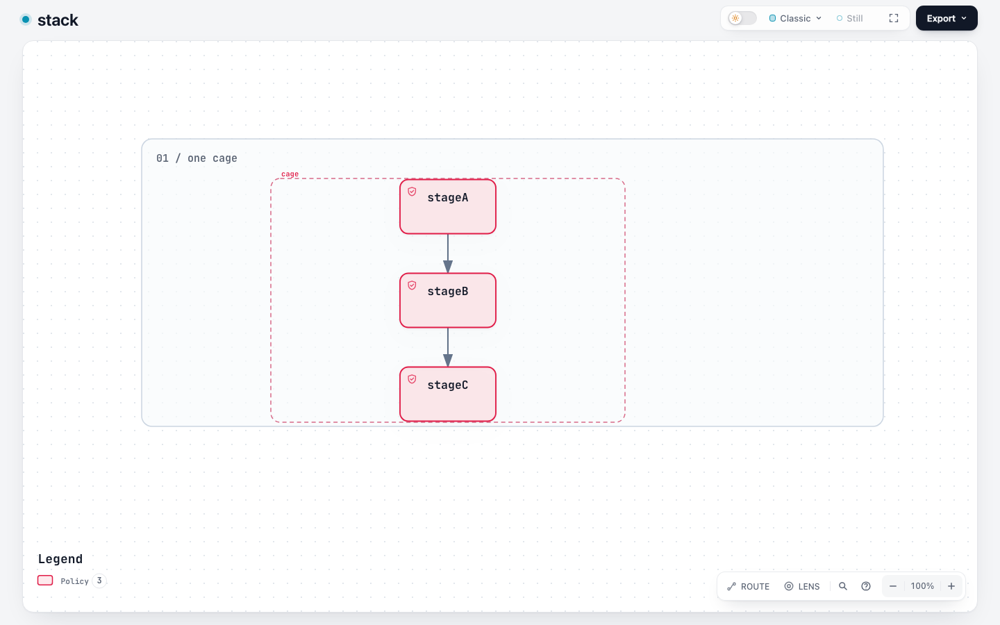
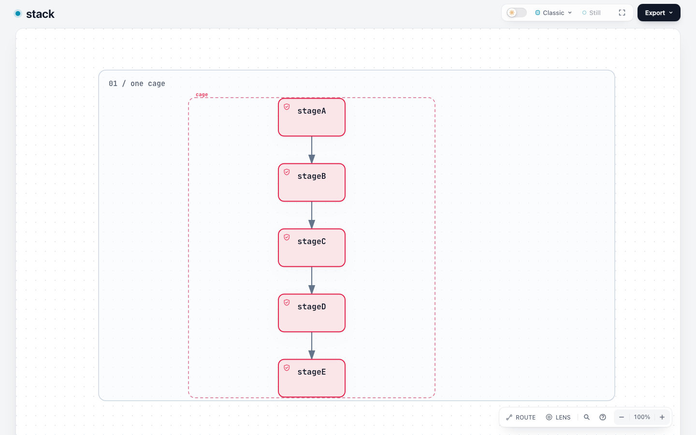
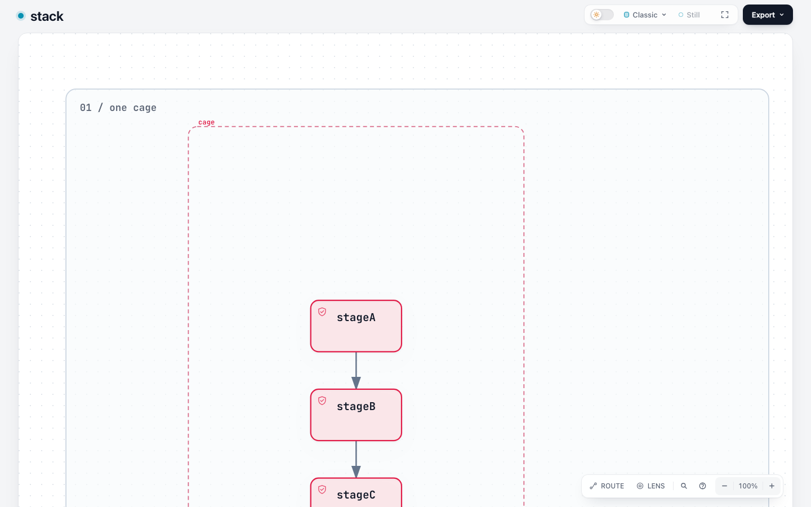

# Archify #250: current-dev verification, 2026-11-04

The one-container vertical-stack use case is supported by the existing Workflow v2 path delivered by [#255](https://github.com/tt-a1i/archify/pull/255). These are verification artifacts from **unmodified dev `63c9263e84bd3993cab8e09b3d69888857858635`**, not a new implementation or a before/after product patch. All 1,273 archived tracked source blobs matched the pinned Git commit.

Environment: macOS arm64, Node 22.23.2, Chrome 156.0.8078.80. The investigation used Codex for reproduction scripts, test execution, screenshots, source tracing and this explanation; it does not claim acceptance by the original reporter or maintainer.

## Recommended input and result

Starting with the issue's original JSON, add `meta.output`, use `schema_version: 2`, omit `meta.viewBox`, and center the three `yOffset` values at `-90 / 0 / 90`. Keep the original lane, group, node IDs/labels/types, main path and edges. This preserves the single-container meaning without adding `lanes[].height` or splitting it across lanes.

- [Exact three-stage input](inputs/v2-centered.workflow.json)
- [Five-stage synthetic extension](inputs/v2-five-stages.workflow.json)
- [Semantic preservation and input hashes](receipts/semantic-preservation.json)
- [Current upstream authoring contract](https://github.com/tt-a1i/archify/blob/63c9263e84bd3993cab8e09b3d69888857858635/archify/renderers/workflow/README.md#readable-v2)

Both `deliver --quality showcase` and the full desktop `visual-check --require-provenance` passed for the three- and five-stage cases. The current Viewer uses **width-first reading with normal vertical page scrolling** where needed; it does not promise that every stack fits one screen.

| Input | Result |
| --- | --- |
| Original v1 unchanged | Fails first on missing `meta.output` |
| v1 with only `meta.output` added | Reproduces b/c lane-boundary errors; fixed-v1 remains unchanged |
| Implicit v2, offsets 0/90/180 | Static delivery passes; canvas 768×627, lane height 451 |
| Implicit centered v2, offsets −90/0/90 | Static delivery and desktop visual-check pass; canvas 768×452, lane height 276 |
| Implicit centered v2, five stages | Static delivery and desktop visual-check pass; canvas 768×632, lane height 456 |
| Centered v2 with original 720×640 canvas | Fails `workflow/viewbox-capacity`; minimum 768×452 |
| Centered v2 with explicit 768×640 canvas | Static delivery passes; browser gate reports vertical `viewer/viewport-overflow` |
| Centered v2 with one absolute via `[334,162]` | This specific pin passes static delivery and native geometry sampling; not a general guarantee about pins |
| `lanes[0].height=400` | Rejected by the schema; unnecessary for this representation |
| Public migration output | Migration/static delivery pass; explicit 768×640 and original offsets remain; browser gate fails |
| Migration followed by removing viewBox and centering offsets | Canonical SVG exactly matches the recommended three-stage input |

The raw v1 failure produces no valid artifact, so there is no invented “before” screenshot for v1. The comparison below is between two valid outputs of the same current source: migration retaining authored geometry, and the documented v2 adaptation.

## Native screenshots

Three stages, 1440×900, light:



Five stages, 1440×900, light:



[Five-stage dark theme](screenshots/v2-five-stages-1440x900-dark.png) · [1366×768 after page scrolling](screenshots/v2-five-stages-1366x768-light-scrolled.png)

Migration retaining explicit geometry, 1440×900:



The last stage remains reachable by scrolling. The upper whitespace and failed browser gate are still real; migration success is not final visual acceptance. Automatically dropping the authored canvas or moving absolute pins would change a separate compatibility contract.

## Evidence and limits

- [Existing regression results](receipts/checks.json): **94 passed, 0 failed, 0 skipped** — 92 compiler/migration tests and 2 focused #250 desktop browser tests. The full repository suite was not rerun.
- [Compiler/migration log](receipts/compiler-migration-tests.stdout.txt) and [desktop log](receipts/desktop-stack-tests.stdout.txt).
- Official visual-check: four light desktop sizes (1440×900, 1600×1000, 1920×1080, 2048×1320), plus its required theme checks/captures. [Three-stage receipt](receipts/visual/v2-centered/v2-centered.visual-check.json), [five-stage receipt](receipts/visual/v2-five-stages/v2-five-stages.visual-check.json).
- Failures are retained: [migration receipt](receipts/visual/migrated/migrated.visual-check.json), [explicit-canvas receipt](receipts/visual/v2-explicit-capacity/v2-explicit-capacity.visual-check.json), [original geometry failure](receipts/v1-output-only.validate.stdout.txt).
- [19 native viewport/theme observations](receipts/browser.json), including 1366×768 and mobile emulation. Group containment and last-node reachability were measured separately from browser-gate acceptance.
- [Fresh-browser mobile interaction observations](receipts/mobile.json): at 390×844 the three-stage wide canvas initially shows only part of the cards; native horizontal scrolling reveals them at about 10.31px label size. The five-stage canvas initially fits to width at about 4.76px label size; native 250% camera zoom increases it to about 11.89px for **local reading**, not an all-stages one-screen view.
- [Mobile three-stage initial](screenshots/v2-centered-390x844-fresh.png) / [after horizontal scrolling](screenshots/v2-centered-390x844-adjusted.png); [mobile five-stage initial](screenshots/v2-five-stages-390x844-fresh.png) / [after camera zoom](screenshots/v2-five-stages-390x844-adjusted.png).
- Mobile default readability is not counted as a desktop-gate pass. No Safari, Firefox, real touchscreen, other OS, export/print, arbitrary stage counts or real-user preference study was performed.
- The five-stage case is a synthetic extension of the reporter's example. This is fixed-JSON replay, not evidence of Agent authoring efficiency.

## Reproduce

Use the [pinned upstream source](https://github.com/tt-a1i/archify/tree/63c9263e84bd3993cab8e09b3d69888857858635), Node 22 and Chrome. Install repository and `archify/` lockfile dependencies in that checkout. With this evidence directory accessible as `EVIDENCE`:

```sh
node archify/bin/archify.mjs validate workflow "$EVIDENCE/inputs/v2-centered.workflow.json" --quality showcase --layout-json
node archify/bin/archify.mjs deliver workflow "$EVIDENCE/inputs/v2-centered.workflow.json" /tmp/issue-250-repro/stack.html --quality showcase --json
node archify/bin/archify.mjs visual-check /tmp/issue-250-repro/stack.html --require-provenance --out-dir /tmp/issue-250-repro/visual --json
node scripts/run-tests.mjs --require-files test/workflow-compiler.test.mjs test/workflow-migration.test.mjs test/workflow-migration-semantics.test.mjs
node scripts/run-tests.mjs --require-files test/desktop-reader-browser.test.mjs '--test-name-pattern=issue #250'
```

Create the temporary output directory first. Repeat with `v2-five-stages.workflow.json`. [Recorded CLI arguments and exit codes](receipts/commands.json) cover all 11 cases. [Source identity](receipts/source.json), [source integrity](receipts/source-integrity.json), and [input ablation](receipts/comparison.json) bind the results to this run.

Native HTML artifacts and delivery receipts are included in `artifacts/` for downloading and opening locally. GitHub's source view does not execute the Viewer.

Local workspace, toolchain and temporary paths in nine text files were redacted for publication. Screenshots are unchanged. [Publication manifest](publication-manifest.json) records both original and published hashes; hashes already embedded in original receipts still describe the original local artifacts. Re-run the commands for fresh provenance in another environment.

The narrow disposition is to close the one-container stacking use case as covered by the existing v2 path. A requirement to keep the original v1 input unchanged, automatic post-migration rearrangement, or a new mobile default needs separate scope confirmation.
