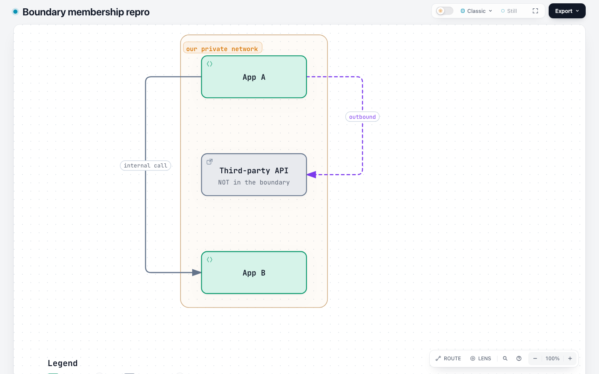
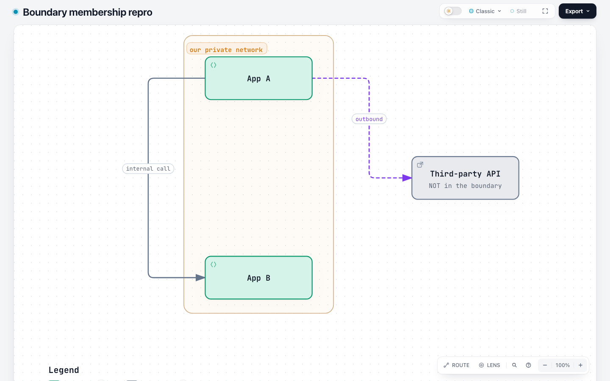
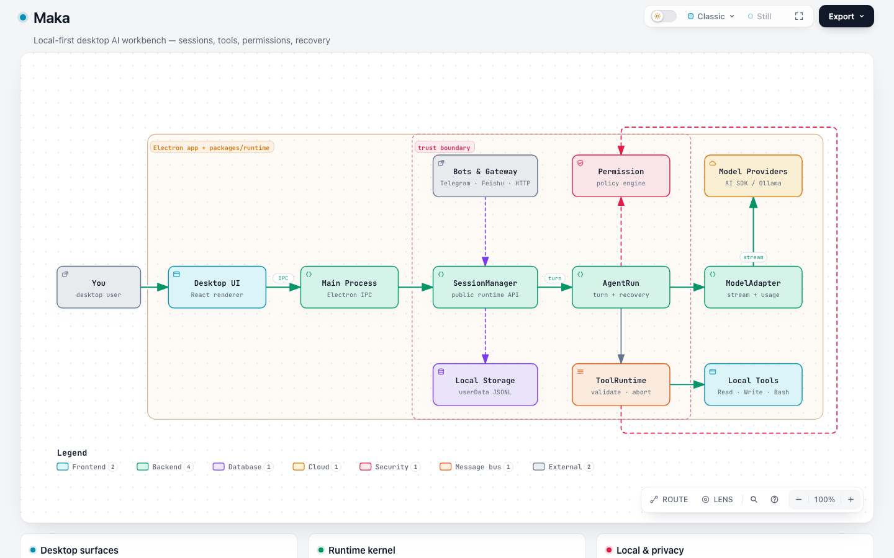
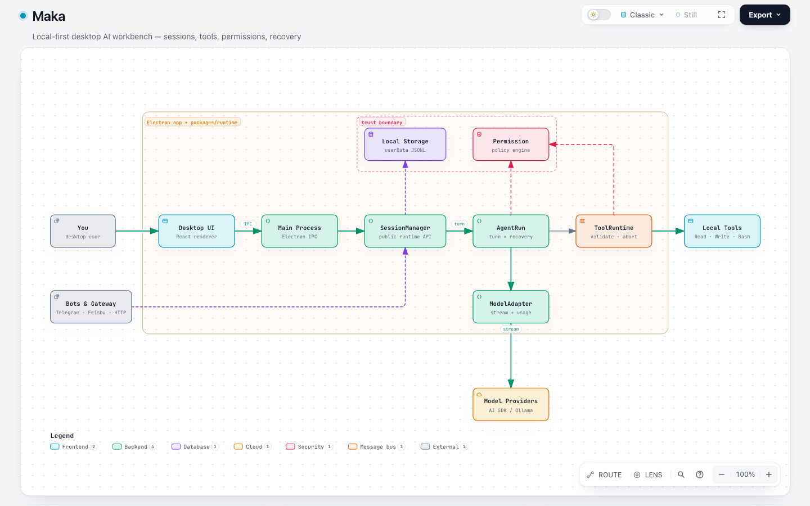
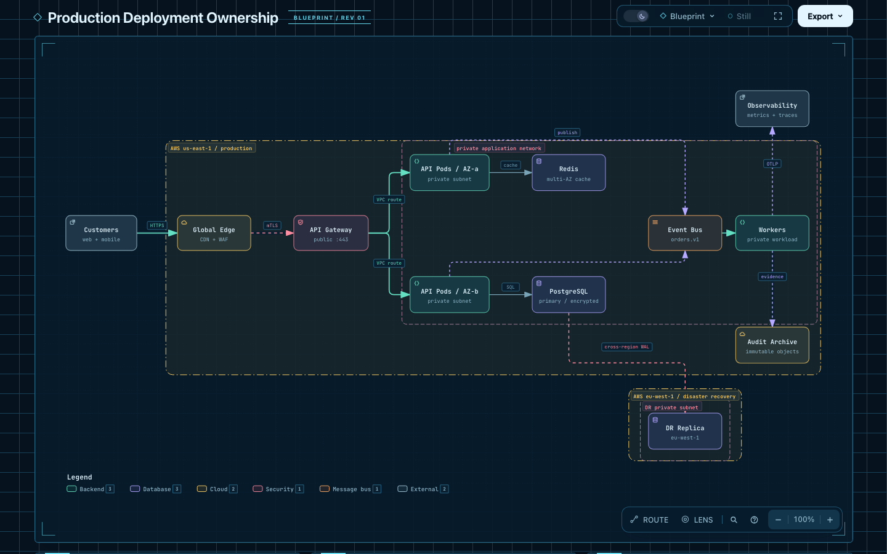

# #395: boundary membership on current dev

Base: `63c9263e84bd3993cab8e09b3d69888857858635`.
Candidate: `2ccc77bb73dcd233aad6e3bb41da879de257e6ec`.
Captured 2026-11-04 with Node 22.23.2, macOS arm64 and Chrome 156.0.8078.80.

This is a continuation/consolidation proposal for
[issue #395](https://github.com/tt-a1i/archify/issues/395), following the
[maintainer's agreed direction](https://github.com/tt-a1i/archify/issues/395#issuecomment-5758756059).
It adapts applesnort's [PR #501](https://github.com/tt-a1i/archify/pull/501),
head `5d8d9ad7a6083a53e19246722337ea03674fd6dd`, to current `dev`, with
co-author credit. That PR remains open; no author handover or closure is claimed.

## Observed behavior and fix

The source declares only App A and App B inside a private network. The original
geometry encloses Third-party API too. Current dev checks this only when the JSON
itself says `showcase`, ignoring the CLI override. Exported HTML lacks membership
facts, so checking it separately cannot recover the discrepancy.

The candidate applies the CLI quality override to source validation, emits
explicit membership on frames, and checks saved artifacts. It preserves the
existing source diagnostic and shares its geometric predicate with the artifact
checker. It does not automatically move nodes, change `wraps`, or alter the UI.

| Case | Base | Candidate |
| --- | --- | --- |
| JSON standard/omitted + CLI showcase, full enclosure | Accepted | Rejected before publication |
| JSON showcase + CLI standard, full enclosure | Rejected | Accepted with artifact warning |
| Full enclosure in standard | Accepted silently | Accepted with warning |
| Partial overlap in showcase | Accepted silently | Accepted with warning |
| Legacy HTML without membership | Accepted, indistinguishable from checked | Accepted; checked=0, unknown=1 |
| Clean nested boundaries | Accepted | Accepted |
| Compare overlay with moved nodes/frames | No membership analysis | Per-version membership; no cross-version false findings |

CLI source failures retain `layout/boundary-encloses-non-member`. Artifact
findings use `composition/boundary-membership`, with component/frame identities,
rectangles and containment evidence. Public `check` exposes actionable composition
diagnostics as `validate`/`deliver` do. Repairs preserve topology and membership:
move the non-member or compact members; change `wraps` only when factually true.

## Native before and after

Both images: light, Classic, Still, 1440×900, browser zoom 100%, device scale 1,
same explicit 800×520 canvas. The **before** is unmodified base output with
standard JSON and CLI showcase. The **after** uses candidate output with the
same profile combination and a known two-field repair: move Third-party API
right, and enter its left side. All semantic fields and the boundary rectangle
are unchanged. Minimum node text stays approximately 15.14px; primary labels
stay 18.51px. The candidate now rejects the original geometry under showcase.

[Original input](inputs/isolated-before.architecture.json) ·
[Repaired input](inputs/isolated-after.architecture.json) ·
[Native candidate HTML](artifacts/isolated-after-delivered.html)

## More complex diagrams and readability tradeoff

Maka reuses the original author's layout repair. Twelve components, twelve
connections and both `wraps` lists are preserved. Full enclosures fall from
seven to zero. ViewBox changes from 1200×608 to 1390×748. At 1440×900, minimum
node text decreases from 7.85px to 6.74px and primary labels from 12.34px to
10.60px; at 1920×1080 the repaired minimum is 7.81px. Browser gates pass, but
this is a readability tradeoff for human review, not an unconditional aesthetic
improvement. No automatic layout or text-size policy is introduced.

Production already includes the upstream `d3b560c2` repair (audit.y=492,
replica.y=640); this PR preserves it. A control restores only the old positions
to reproduce 37 units of partial overlap and now gets a warning. The shipped
example remains clean. Dark/Blueprint output and native PNG/SVG exports work;
all four exported SVG frames retain membership metadata.

## Validation and limitations

- 24 focused membership tests pass, including 18 CLI/profile combinations,
  standalone diagnostics, legacy/empty metadata, nested/sparse membership,
  markup parsing, zero-area/contact cases and native compare generation.
- All 13 checked-in Architecture JSON files were replayed on base/candidate
  under standard/showcase (52 validations). All standard cases remain accepted.
  The existing AI-agent/n8n showcase crossing rejection remains on both arms;
  no new unintended rejection was observed. The two deliberately repaired
  Maka/grid sources differ only in geometric controls.
- 21 native screenshot/DOM samples cover seven cases at light/dark 1440×900
  and light 1920×1080. All diagram bottoms are reachable. For identical JSON,
  measured fonts match the base. Five official `visual-check` runs pass.
- The extracted ZIP rejects the misleading showcase case, accepts standard,
  and reports its warning through provenance-checked standalone inspection.
- Removing compare isolation in a temporary copy reproduces false findings.
  Removing a single-use scope helper while retaining its condition passes all
  24 focused tests; that simplification is retained. The source gate remains
  because it protects pre-publication diagnostics; saved HTML has a separate
  validation owner.
- Initial full regression found one stale README motion-proof artifact hash.
  Its canonical rebuild initially hit a broken system FFmpeg dependency; a
  working task-local FFmpeg 7.1 executable completed regeneration. The corrected
  README suite passes (14 passed, one opt-in check skipped). Original failure
  logs are retained rather than relabeled as a passing run.
- Final `npm run test:full`: 3,563 passed, zero failed, 134 skipped (optional
  browser/platform gates); generated checks pass. Separate `npm run test:browser`
  with real Chrome: 337 passed, zero failed, zero skipped. See
  [validation-summary.json](validation-summary.json) and linked logs. These
  suites overlap and their totals should not be added as unique coverage.

The base screenshot receipts are reused from the pinned current-dev investigation.
Candidate screenshots were captured before the final CLI-only diagnostic
conversion and the equivalent predicate inlining; those edits cannot change
rendered geometry, fonts or exports. Final runtime tests cover both edits.
Receipts redact the local workspace prefix; original HTML/PNG/SVG bytes are
unchanged. [Manifest](manifest.json) records hashes and the candidate commit.

These are saved-input replays and agent visual inspection. No new independent
source-to-diagram Agent sessions, full authoring-time measurement, Windows run,
or human acceptance is claimed. Larger fresh real-project generation scope and
consolidation with #501 remain maintainer review items. The compare checker
judges geometry actually present in the overlay; the compare command validates
both source versions separately, including geometry omitted from that overlay.
