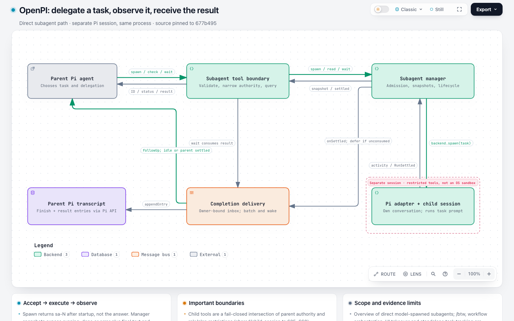

# Benchmark 中发现的问题

本文件收集可独立开 issue 的问题。保留原始生成产物，不事后修图；不把未确定的原因写成已证实的根因。发现时间：2026-11-04。官方 10 次和专项 6 次会话均已完成。记录 2 条待处理问题，另保留已修正的生成错误和采集工具异常。

## 1. Architecture 边界标题遮住连线，但校验与交付仍通过

**建议标题**：`Architecture: boundary title masks connection routes while validation passes`

**状态**：已复现；已有版本缺口，不是本次新增方向功能的已证实回归。

**影响**：标题下方的线段被不透明背景遮住，读者难以连续追踪关系。自动检查通过，生成 Agent 可能因此交付存在视觉问题的图。

### 复现版本

- 基线：`63c9263e84bd3993cab8e09b3d69888857858635`（本轮开始时最新 dev）。
- 候选：`7ee304c5d939f1e2194c9bbbffdf86d4d7683117`。
- 同一原始 JSON 在两版都通过校验和交付，布局结果与 canonical SVG 字节一致。
- JSON 中所有关系均为默认单向，没有使用新增 `both` / `none`。

### 最短复现流程

1. 使用原始 [OpenPI 候选 JSON](runs/openpi-candidate/workspace/output/openpi-subagent.architecture.json)，不要修改坐标或边界。
2. 对应项目是 OpenPI `677b4959108976b99fb63fb5029198b04aa51cb5`，提供给 `--repo-root` 用于源码引用校验。
3. 在任一上述 Archify 版本运行：

   ```sh
   node archify/bin/archify.mjs validate architecture openpi-subagent.architecture.json --repo-root /path/to/openpi --json
   node archify/bin/archify.mjs deliver architecture openpi-subagent.architecture.json openpi.html --repo-root /path/to/openpi --json
   ```

4. 打开 HTML，设置 light / Classic / Still、1440 × 900 CSS 像素、缩放 100%。查看 `Pi adapter + child session` 上方的边界标题。

### 预期与实际

- **预期**：`backend.spawn(task)` 与 `activity / RunSettled` 两条连接线在进入子会话节点前保持连续可见；标题避开线段，或自动诊断指出冲突并提供修复建议。
- **实际**：`Separate session · restricted tools, not an OS sandbox` 标题背景遮住两条垂直线；校验与交付均返回成功。
- SVG 证据：标题 mask 为 `x=806..1059, y=335..351`；两条线分别沿 `x=940.55` 与 `x=925.5` 穿过该区域，到达子节点的 `y=355`。



### 原始证据

- [最终 HTML](runs/openpi-candidate/workspace/output/openpi-subagent.html) · [完整截图](captures/openpi-candidate/fullpage.light.png)
- [原始完整会话](runs/openpi-candidate/evidence/session.jsonl) · [运行元数据](runs/openpi-candidate/evidence/run.json)
- [基线校验](replay/openpi-candidate/base.layout.json) · [候选校验](replay/openpi-candidate/candidate.layout.json)
- [基线回放 HTML](replay/openpi-candidate/base.html) · [候选回放 HTML](replay/openpi-candidate/candidate.html) · [交叉回放摘要](replay/summary.json)

### 不依赖 OpenPI checkout 的缩减复现

已从原图删去无关节点、卡片和源码引用，只保留 **2 个节点、2 条线、1 个边界**，未改动剩余对象的位置或关系含义。它不是另一次 Agent benchmark，也不计入会话指标。

- [最小 JSON](issues/boundary-title-mask/minimal.json)（954 字节）
- [最小图截图](issues/boundary-title-mask/minimal.light.png)
- [基线最小图](issues/boundary-title-mask/base.html) · [候选最小图](issues/boundary-title-mask/candidate.html)
- [基线交付诊断](issues/boundary-title-mask/base.delivery-log.json) · [候选交付诊断](issues/boundary-title-mask/candidate.delivery-log.json)：两版均为 9/9 checks，0 errors，0 warnings，但遮挡仍存在。

```sh
node archify/bin/archify.mjs deliver architecture minimal.json boundary-mask.html --json
```

缩减过程中最初漏填了必需的 `meta.output`，对应失败输入与日志也保存在同目录的 `initial-missing-output` 文件中；补齐后才得到上述复现。此准备错误不属于产品缺陷或正式 benchmark 失败。

### 后续排查与验收建议

**第二个自然案例（基线会话）**：SkillRoster 的 [最终 JSON](runs/skillroster-base/workspace/output/candidate.json) 和 [完整截图](captures/skillroster-base/fullpage.light.png) 也出现同类问题。`Apply / Undo coordinator → SQLite StateStore` 的 `load / finalize state` 路线为 `M 900 260 L 900 118`，穿过节点上方的 `Explicit mutation · exclusive StateLock` 标题。该输入在两版的布局与 SVG 也一致。这增加了问题来自既有边界布局的证据，而不是新增箭头功能的特有缺陷。

- 排查边界标题放置、标题 mask 和连线路由之间的避让规则，以及视觉诊断是否覆盖这些实际遮挡。
- 不预先断定必须改路由器；也可能通过标题位置调整或增加有针对性的诊断解决。
- 用此原例验证线条不再被遮挡，并加入跨边界、反向边、多个邻近标题场景；不要只删除此图的边界来证明产品已修复。
- 验证标题可读、连线可追踪，并确认普通无冲突图未产生无谓绕行或新增阻塞诊断。

这是一条待维护者评估的独立问题；本轮记录不等于已经提交 GitHub issue。

## 2. Agent 把 CLI 命令和返回结果合并为 `both`，违反本次声明的关系契约

**建议标题**：`Architecture authoring: Agent collapses CLI commands and results into direction: both`

**状态**：真实官方任务中自然出现，候选会话的语义问题；不是 SVG 箭头画错，也不是确定性可重复的模型结论。

**环境**：Squad `8146bcc1c38c439aedaf3ff44548c830654c8621`，候选 Archify `7ee304c5d939f1e2194c9bbbffdf86d4d7683117`，Codex `gpt-6.1-sol` / medium。任务使用项目官方自然语言任务，没有提示它采用 `both`。

### 实际结果与契约冲突

- 最终图把 `Manager terminal ↔ squad CLI` 标为 `create / list / send`，把 `Worker terminal ↔ squad CLI` 标为 `receive / ack / complete`。
- `CLI ↔ Store` 标为 `calls + records`，`Store ↔ SQLite` 标为 `SQL reads / writes`。至少前两条把调用方向和返回方向合到同一条、同一标签之下。
- 首稿还把双向图例显式命名为 `Command and returned output`；之后删除了这个自定义图例文字，保留全部 4 条 `both` 关系。
- 候选包的 [authoring-defaults.md](packages/candidate/archify/references/authoring-defaults.md) 第 15 行定义 `both` 为同一关系在两向成立，并明确不同请求／响应要保持分开的连接。图上的具体命令并不是 CLI 反向向调用者发出的同一种命令。
- [Squad main.rs:973](https://github.com/mco-org/squad/blob/8146bcc1c38c439aedaf3ff44548c830654c8621/src/main.rs#L973) 的 `cmd_task_create` 调用 Store 后打印创建结果；同文件 `cmd_task_ack`、`cmd_task_complete` 也分别执行业务操作，再打印确认。这些是不同方向和内容的动作。

**预期**：在现有有限契约下，保留“命令调用”和“返回记录／stdout”的各自方向与含义；不能只为减少线条使用 `both`。如果产品希望把“通用双工通信通道”也纳入 `both`，需先明确这类关系与具体消息箭头的边界和标注规则，不能让一次生成结果自行扩大定义。

### 复现与证据

1. [官方原始 prompt](runs/squad-candidate/prompt.txt) 与 [冻结计划](plan.json) 可复跑生成任务，但模型输出不保证逐次相同。
2. 对确定性产物，直接打开 [最终 HTML](runs/squad-candidate/workspace/output/squad-coordination.html) 或用候选版本交付 [最终 JSON](runs/squad-candidate/workspace/output/candidate.json)。
3. [完整会话](runs/squad-candidate/evidence/session.jsonl)、[首稿及全部修订索引](runs/squad-candidate/evidence/observations.json) 保留实际生成过程。
4. [Agent 原生截图](runs/squad-candidate/workspace/output/visual-check/squad-coordination.visual-check.1440x900.light.png) 可直接看到上述双向命令线。
5. [交互检查](captures/squad-candidate/relationship-interactions.json)：4 条新关系的反向 Route / Reach 均可用、ID 不重复、没有运行流光。这证明实现按作者声明工作，不能证明作者声明符合源码事实。
6. [基线拒绝诊断](replay/squad-candidate/base.deliver.json)：旧版不支持 `direction` 字段，属于能力不支持，不把它算成修复前的产品错误。

### 后续解决与验收建议

- 补充“同一双向关系”与“不同命令／结果”的正反例，检查生成阶段是否能在抽象关系和消息流之间保持一致。
- 不建议仅按 `request`、`response` 等标签关键词硬编码拒绝；自然语言、语言种类和抽象层级会变化。
- 使用这次真实失败和专项的“不同请求／决策”任务核对修改后的结果；仍保留对称同步的合法 `both` 例，不应一律禁用双向关系。
- 此条列为待解决的语义风险，不以反向遍历和导出成功抵消。尚未自动创建 issue 或修改冻结候选。

**专项对照补充**：[不同请求／决策候选](runs/distinct-messages-candidate/workspace/output/candidate.json) 在明确要求区分两者的业务说明下，正确保留了两条单向边；[同义同步候选](runs/symmetric-sync-candidate/workspace/output/candidate.json) 正确使用一条 `both`。因此目前证据更支持“自然任务下的语义选用风险”，不能说模型必然误用，也不能用专项成功宣称这条真实失败已修复。

## 已排查、暂不列为产品缺陷：裁剪截图引发图例遮挡

额外采集截图时，Chrome `Page.captureScreenshot` 使用 `captureBeyondViewport: true`（包括带显式 `clip` 的调用）会改变捕获布局；显式裁剪时出现工具栏盖住图例的图片。相同页面初始 DOM、产品原生截图、点击 Classic 和切换 Still 后均无该遮挡。过程保留在 [观察目录](issues/squad-legend-observation/) 与 [脚本](probe-legend.mjs)，不合格截图保留在 `captures-initial-clip/` 和 `captures-beyond-viewport/`，不用于验收。采集已改为与产品一致的 `captureBeyondViewport: false`，并断言主截图为 1440 × 900。全页图使用显式加高且稳定后的视口，尺寸另记，不冒充同一视口。后续若发现普通交互下也能复现，再独立立项。

## 生成失败记录：SkillRoster 候选经过 4 轮修订才交付

这是正式自然生成过程中实际发生的失败，保留供后续评估提示、schema 可发现性及修复反馈；目前不单凭这些被正确捕获并修复的错误，断定产品有新的诊断缺陷。

1. 首稿使用不存在的图例键 `security-line`，源码引用标签也超过 48 字符，被 schema 拒绝。
2. 修正后暴露 `AGENTS.md` 的 `end_line: 33` 超出实际 31 行，按诊断修到 31。
3. 首次交付成功后，Agent 自主简化卡片并把三条绕行线拉直。
4. 拉直后标签间距不足，三处 `composition/label-gap` 被拒绝；增加节点间距后最终交付。

共 5 份提交版本、4 轮修订（3 轮由失败诊断驱动、1 轮主动调整），并非“一次成功”。[原始会话](runs/skillroster-candidate/evidence/session.jsonl)、[版本索引](runs/skillroster-candidate/evidence/observations.json)、[首稿重放](replay/skillroster-candidate/first-draft.validate.json) 保留诊断和候选原字节。最终 10 条边全部为 forward，在两版上回放相同，因此不能把这次修订数量归因于新增方向功能。
