# #1139 generation benchmark evidence

## Decision summary

**The new capability works in the targeted cases, but this run does not establish generation-quality improvement or an unqualified merge-ready result.** The candidate naturally misuses `both` in Squad. That semantic error needs correction or an explicit maintainer decision about the contract; passing rendering, traversal and export checks does not resolve it.

- **Official matrix completed:** all five pinned projects × base/candidate, 10 independent sessions. All delivered verified artifacts. Final source review finds one incorrect candidate graph (Squad); visual review finds two boundary-title masking cases (OpenPI candidate and SkillRoster base). These are separate judgments, not an aggregate score.
- **Known visual gap:** the same OpenPI and SkillRoster inputs reproduce their masking on both versions. All their relationships are forward. [Issue record 1](ISSUES.md) includes original artifacts and a 2-node/2-edge reduction, so it can be investigated independently of this direction feature.
- **New authoring risk:** Squad candidate combines different CLI commands and returned output into four `both` relationships. At least the manager/worker command labels falsely apply in reverse under the declared same-relationship contract. Its first draft explicitly called these “Command and returned output.” [Issue record 2](ISSUES.md) retains that evidence and source links.
- **Supplement completed separately:** 3 synthetic briefs × two versions, 6 sessions. Candidate correctly uses one `none` association, one `both` symmetric synchronization, and separate directed request/decision messages. The two unsupported baseline capabilities produce disclosed workarounds, not native capability successes. Both versions preserve the explicit distinct-message task. This success does not erase the natural Squad failure.
- **Fixed-input replay:** all 16 final JSON files were replayed, unchanged, on both versions. Twelve old-format inputs produce identical layout and canonical SVG. Four candidate inputs are unsupported by base because of new fields/legend keys; all pass candidate replay. One of those uses explicit `forward` and the new directed legend, so rejection is a schema capability difference even though its business facts can use old defaults.
- **Real repair history:** SkillRoster candidate first fails schema checks, then source-line validation. After a successful delivery, its voluntary route simplification exposes three label-gap failures, which it repairs. Five submitted candidates and all diagnostic output are retained. Final success is not first-draft success. Other revisions, command failures, tokens and reasons are reported per run.
- **Runtime/export evidence:** all six authored `both`/`none` edges across three candidate diagrams retain their identities, work in reverse structural Route/Reach, remain static in the inspected Live routes, and preserve their markers in light/dark SVG and PNG. The distinct-message candidate's explicit directed legend also has theme/export evidence. [Integrity and feature observations](audit-summary.json) are separate from human-readable quality judgments.

There were no scheduled-session timeouts, nonzero process exits or native provider-error events. Local client metadata/plugin warnings and every shell failure remain in the original logs. No session was retried or replaced. Source pins, clean source status and frozen package bytes are checked after generation. The gateway is local; no speed, cost-saving or backend-identity claim is inferred.

Evidence is **author-side maintenance Codex review**, checked against pinned source, not independent human maintainer acceptance or remote CI. Existing deterministic implementation checks are summarized in [reused validation](reused-validation/README.md) under their original base/candidate revisions. The official scope is Architecture-only because other diagram schemas do not accept the metadata; the saved 10-type compatibility inputs and shared-browser checks cover unchanged callers. The local scope is user-authorized; no upstream scope agreement is claimed.

The two actionable issue records are ready for later filing. The candidate remains frozen at `7ee304c5d939f1e2194c9bbbffdf86d4d7683117`; no mid-benchmark product fixes, GitHub issue, push or PR were made. Further fixes should retain this run and rerun only affected comparisons under a new candidate SHA.

**Evidence retention:** [local archive and digest notes](bundle-notes.md), [file manifest](bundle-manifest.json), [archive SHA-256](evidence-archive.sha256). Keep the directory and archive through review and the resulting release cycle. These are local review artifacts, not a publicly published benchmark submission; an external review would need a durable upload. Costs were deferred by the user, and active assembly labor was not separately timed.

Completed generation sessions: **10/10 official**, **6/6 supplemental**. Review and replay status is shown per run; a completed session is not an accepted diagram.

Actionable defects are retained separately in [ISSUES.md](ISSUES.md), including reproduction steps, screenshots, affected versions and attribution limits. No GitHub issue has been submitted by this run.

## Frozen comparison

- Base: `63c9263e84bd3993cab8e09b3d69888857858635`; candidate: `7ee304c5d939f1e2194c9bbbffdf86d4d7683117`.
- Official scope: Architecture on all five pinned repositories; fresh base/candidate sessions. New direction metadata is Architecture-only. Existing saved inputs from ten diagram types and Viewer/Story focused checks cover unchanged shared callers.
- Supplemental scope: three synthetic business briefs × two versions. These exercise undirected association, symmetric synchronization, and distinct request/decision messages; they are not official real-project cases.
- Codex CLI 0.144.0, `gpt-6.1-sol`, `medium`, serial concurrency 1, 20-minute budget per session. Arm order alternates. No extra agent delegation.
- [Frozen plan](plan.json), [setup](preparation.log), [official scheduler](official-run.log), [supplement scheduler](supplement-run.log). Package hashes, project pins, prompt hashes and environment are in the plan.
- Credentials are supplied through the existing local gateway environment and are not included in evidence. Sessions are fresh/ephemeral and ignore user configuration; ordinary same-host instructions may remain. Source isolation uses task restrictions plus post-run integrity checks, not an OS read-only sandbox.
- The client requests `gpt-6.1-sol` with medium reasoning in both arms. stderr retains client-side model-cache/model-metadata fallback warnings, API-key remote-plugin-catalog warnings and local plugin/state-database warnings. These are environment limitations, not Archify diagnostics; successful sessions do not independently establish the gateway backend identity. No configuration was changed between arms to hide them.
- The recorder snapshots complete JSON before CLI entry and polls output every 50 ms. Unsubmitted transient versions between polls cannot be guaranteed. Native events, timed event copies, all submitted versions, errors and receipts are retained.
- Review below is author-side maintenance Codex inspection, independently checked against pinned source, not human maintainer acceptance. No overall score or speedup is inferred from one pair. Costs are deferred by user.

## Per-run observations

Input token totals include cached input. The table separates uncached input, cached input and output. Missing reasoning-token details stay unknown. Repair rounds count changed submitted JSON after the first check; voluntary revisions are included. Multiple commands on unchanged bytes are not extra rounds.

| Run | Delivery | Semantics / readability | First JSON check | Revisions | Failed commands / total | Tokens: uncached / cached / output | Directions: forward / both / none |
| --- | --- | --- | --- | --- | --- | --- | --- |
| [openpi-base](runs/openpi-base/evidence/run.json) | delivered | correct / readable | pass | 2 | 0 / 27 | 97323 / 2235904 / 9732 | 7 / 0 / 0 |
| [openpi-candidate](runs/openpi-candidate/evidence/run.json) | delivered | correct / issues | pass | 1 | 2 / 25 | 76582 / 1617792 / 8849 | 10 / 0 / 0 |
| [hive-candidate](runs/hive-candidate/evidence/run.json) | delivered | correct / readable | pass | 1 | 1 / 34 | 92275 / 3062272 / 16842 | 11 / 0 / 0 |
| [hive-base](runs/hive-base/evidence/run.json) | delivered | correct / readable | pass | 2 | 0 / 35 | 86179 / 3141632 / 14942 | 11 / 0 / 0 |
| [mco-base](runs/mco-base/evidence/run.json) | delivered | correct / readable | pass | 1 | 0 / 26 | 66637 / 1723136 / 7748 | 10 / 0 / 0 |
| [mco-candidate](runs/mco-candidate/evidence/run.json) | delivered | correct / readable | pass | 2 | 2 / 20 | 55668 / 1334528 / 7084 | 9 / 0 / 0 |
| [squad-candidate](runs/squad-candidate/evidence/run.json) | delivered | incorrect / readable | pass | 1 | 1 / 18 | 55136 / 1074432 / 6377 | 2 / 4 / 0 |
| [squad-base](runs/squad-base/evidence/run.json) | delivered | correct / readable | pass | 0 | 0 / 21 | 51395 / 1354880 / 9133 | 6 / 0 / 0 |
| [skillroster-base](runs/skillroster-base/evidence/run.json) | delivered | correct / issues | pass | 1 | 0 / 25 | 95923 / 1612800 / 9705 | 7 / 0 / 0 |
| [skillroster-candidate](runs/skillroster-candidate/evidence/run.json) | delivered | correct / readable | fail | 4 | 4 / 33 | 71865 / 2457344 / 10394 | 10 / 0 / 0 |
| [association-candidate](runs/association-candidate/evidence/run.json) | delivered | correct / readable | pass | 0 | 1 / 10 | 23021 / 424960 / 3130 | 2 / 0 / 1 |
| [association-base](runs/association-base/evidence/run.json) | delivered workaround; requested relation unsupported | incorrect / readable | pass | 0 | 1 / 12 | 33126 / 509824 / 3326 | 2 / 0 / 0 |
| [symmetric-sync-base](runs/symmetric-sync-base/evidence/run.json) | delivered workaround; requested relation unsupported | incorrect / issues | pass | 1 | 2 / 13 | 25536 / 443776 / 2953 | 3 / 0 / 0 |
| [symmetric-sync-candidate](runs/symmetric-sync-candidate/evidence/run.json) | delivered | correct / readable | pass | 0 | 2 / 11 | 35539 / 308352 / 2497 | 2 / 1 / 0 |
| [distinct-messages-candidate](runs/distinct-messages-candidate/evidence/run.json) | delivered | correct / readable | pass | 0 | 1 / 9 | 33219 / 246272 / 2267 | 3 / 0 / 0 |
| [distinct-messages-base](runs/distinct-messages-base/evidence/run.json) | delivered | correct / readable | pass | 1 | 1 / 10 | 39282 / 309888 / 2492 | 3 / 0 / 0 |

Command counts cover completed shell command-execution items; compound shell subcommands are not counted independently. Native sessions retain their full output, including failures hidden by a later successful command. Reasoning-token detail, descriptive timings and revision-reason grouping are in each run.json.

## Visual and source comparisons

Primary captures: native 1440 × 900 CSS pixels, device scale 1, zoom 100%, light / Classic / Still, captureBeyondViewport=false. Full-page images use an explicitly taller, settled viewport and may reflow; exact dimensions are in captures/metrics.json. Small viewport-filling diagrams additionally have their settled diagram/SVG box dimensions fixed only during the full-page capture to keep supporting cards within the image; this is marked frozenDiagramSize and never changes original HTML or the primary capture. Earlier captureBeyondViewport=true calls changed capture layout; images are preserved in captures-initial-clip and captures-beyond-viewport and excluded from acceptance. Incomplete expanding-viewport images are retained in captures-incomplete-tall. New direction artifacts also retain dark screenshots, native light/dark SVG/PNG exports and Route/Reach observations. Automated measurements are separate from visual judgment.

### openpi

| Base | Candidate |
| --- | --- |
| 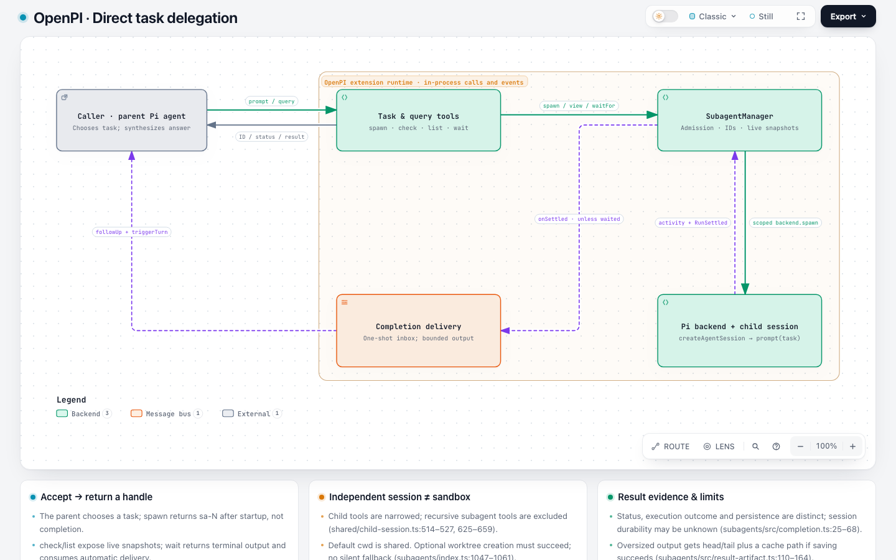 | 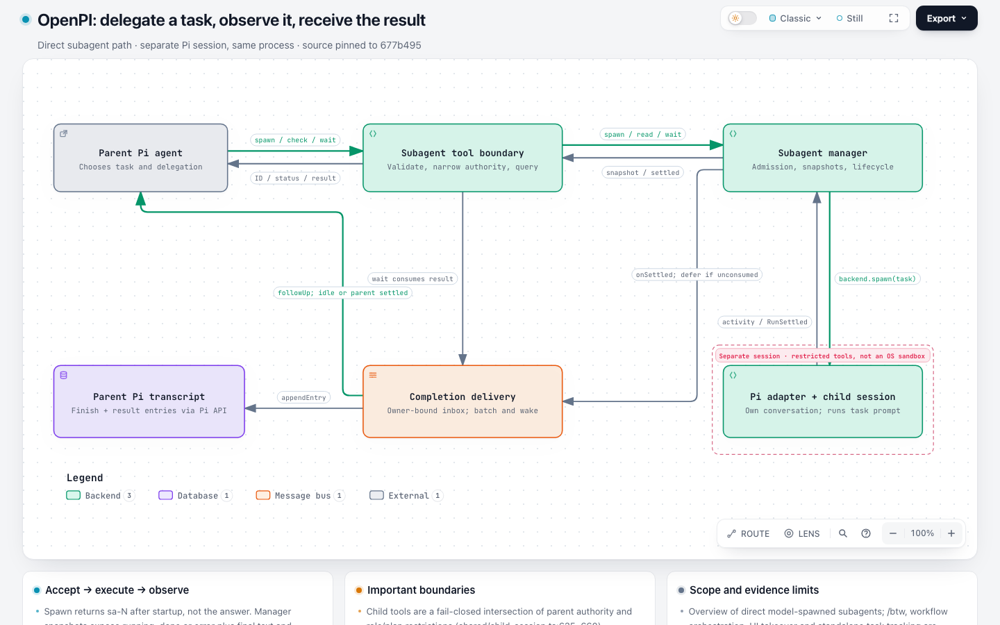 |

**base** — [final JSON](runs/openpi-base/workspace/output/candidate.json) · [HTML](runs/openpi-base/workspace/output/openpi-delegation.html) · [session](runs/openpi-base/evidence/session.jsonl) · [first JSON](runs/openpi-base/evidence/snapshots/e67f3b6015aea5233a6e9caa2e2813e4845c1b6e5d4b1569ac1e436352bd4215.json) · [replay](replay/openpi-base/) · [full page](captures/openpi-base/fullpage.light.png)
- Five components correctly separate the parent caller, extension tool surface, manager, in-process child session and completion delivery. Spawn/query and their returns remain separate directed relationships; no OS worker process or external broker is invented. The generic Message bus legend category is qualified by the completion node's explanation as an in-process inbox.
- Status snapshots, explicit wait consumption and deferred automatic follow-up match the source. The onSettled edge's 'unless waited' label describes the delivery portion: the hook itself also records the finish when consumed, as the node explanation states. Optional worktree isolation, narrowed tools and uncertain persistence are qualified rather than overstated.
- The first captured JSON passes validation. Two voluntary revisions follow: removal of redundant boundary metadata, then correcting the parent node category from frontend to external. All original bytes and checks remain captured; zero tool commands exit with failure.
- At 1440×900 light/Classic/Still, opposing request/result arrows remain separately traceable and labels avoid nodes and boundary titles. The full-page cards and node index are readable, with small secondary connection text as a presentation caveat. No clipping or route-mask occlusion was observed.
- All seven relationships use legacy forward semantics. The final JSON produces identical layout and canonical SVG on base and candidate, so this run provides legacy compatibility evidence and does not exercise the new relationship types. Source links in the original artifact are local-only; the pinned web links below support remote review.
- Source: [extensions/subagents/src/backends/pi.ts:216](https://github.com/openpi-dev/openpi/blob/677b4959108976b99fb63fb5029198b04aa51cb5/extensions/subagents/src/backends/pi.ts#L216) — The production backend creates a fresh AgentSession in-process with its own SessionManager and child tool policy.
- Source: [extensions/subagents/src/manager.ts:351](https://github.com/openpi-dev/openpi/blob/677b4959108976b99fb63fb5029198b04aa51cb5/extensions/subagents/src/manager.ts#L351) — Settlement records completed, failed or interrupted outcomes, clears live state, notifies waiters and invokes the settlement hook with consumption state.
- Source: [extensions/subagents/index.ts:797](https://github.com/openpi-dev/openpi/blob/677b4959108976b99fb63fb5029198b04aa51cb5/extensions/subagents/index.ts#L797) — The hook records subagent-finished, consumes explicit waits, and otherwise defers a snapshot for automatic delivery.
- Source: [extensions/subagents/src/result-delivery.ts:35](https://github.com/openpi-dev/openpi/blob/677b4959108976b99fb63fb5029198b04aa51cb5/extensions/subagents/src/result-delivery.ts#L35) — Owner-scoped inbox claim/ack/retry, idle flushing and explicit consumption govern one-shot result delivery.
- Source: [extensions/subagents/index.ts:441](https://github.com/openpi-dev/openpi/blob/677b4959108976b99fb63fb5029198b04aa51cb5/extensions/subagents/index.ts#L441) — Display transcript entry and hidden followUp/triggerTurn model message are separate outputs.
- Cross-replay: {"run_id": "openpi-base", "input_sha256": "00e1046a2ee3e3c6217cbaaef22779f3ce9abce46cc7c90682d98ad8f4356527", "first_draft_validation_exit": 0, "base_layout_exit": 0, "base_deliver_exit": 0, "candidate_layout_exit": 0, "candidate_deliver_exit": 0, "identical_layout": true, "identical_canonical_svg": true}

**candidate** — [final JSON](runs/openpi-candidate/workspace/output/openpi-subagent.architecture.json) · [HTML](runs/openpi-candidate/workspace/output/openpi-subagent.html) · [session](runs/openpi-candidate/evidence/session.jsonl) · [first JSON](runs/openpi-candidate/evidence/snapshots/0588202277d7d78f1ab1d0cba19cd39ea0fb601b656a831964293d4b24d48ed9.json) · [replay](replay/openpi-candidate/) · [full page](captures/openpi-candidate/fullpage.light.png)
- Six components correctly separate parent, tools, manager, in-process child, completion inbox and transcript API. Request/result, spawn/events, explicit wait and automatic follow-up remain distinct directed paths. Generic database/message-bus symbols are explicitly qualified as a transcript API and an in-process inbox, not independent services or durable-storage guarantees.
- Child isolation is correctly limited to session/lifecycle ownership with restricted tools. Explicit wait consumes deferred delivery; stopping a wait does not stop the child. Stop uncertainty and persistence uncertainty remain separate from successful execution.
- The final child-session boundary title masks both vertical spawn/event routes. In SVG coordinates the mask is x=806..1059, y=335..351; the route legs run at x=940.55 and x=925.5 through that interval before reaching the child at y=355. The screenshot shows the gap. This is a readability issue despite passing automated checks; the final artifact has not been repaired retrospectively.
- First captured JSON passes validation. One voluntary ablation removes the larger redundant runtime boundary; the child boundary and its mask issue remain. Two failed commands are a guessed nonexistent example and an unmatched browser glob, not failed diagram validations. All attempted bytes and failures are preserved.
- All ten relationships retain legacy forward semantics. This final JSON yields identical layout and canonical SVG on base and candidate, so the visual issue is reproducible on both revisions and is not evidence of a direction-feature rendering regression. The differing repair counts between the two generation runs cannot be attributed to the new feature.
- Source: [extensions/subagents/src/backends/pi.ts:216](https://github.com/openpi-dev/openpi/blob/677b4959108976b99fb63fb5029198b04aa51cb5/extensions/subagents/src/backends/pi.ts#L216) — The adapter owns creation of an independent AgentSession inside the current process.
- Source: [extensions/subagents/src/manager.ts:351](https://github.com/openpi-dev/openpi/blob/677b4959108976b99fb63fb5029198b04aa51cb5/extensions/subagents/src/manager.ts#L351) — Settlement updates snapshots, releases admission when safe and notifies waiters before calling the settlement hook.
- Source: [extensions/subagents/index.ts:1280](https://github.com/openpi-dev/openpi/blob/677b4959108976b99fb63fb5029198b04aa51cb5/extensions/subagents/index.ts#L1280) — Explicit wait collects settled results and consumes deferred automatic delivery; aborting a wait leaves children running.
- Source: [extensions/subagents/index.ts:797](https://github.com/openpi-dev/openpi/blob/677b4959108976b99fb63fb5029198b04aa51cb5/extensions/subagents/index.ts#L797) — Finish transcript recording occurs separately from deferring an unconsumed automatic result.
- Source: [extensions/subagents/index.ts:441](https://github.com/openpi-dev/openpi/blob/677b4959108976b99fb63fb5029198b04aa51cb5/extensions/subagents/index.ts#L441) — Automatic dispatch appends a transcript result and sends a hidden follow-up with triggerTurn.
- Source: [extensions/subagents/src/result-delivery.ts:35](https://github.com/openpi-dev/openpi/blob/677b4959108976b99fb63fb5029198b04aa51cb5/extensions/subagents/src/result-delivery.ts#L35) — Inbox ownership, claim/ack/retry, idle flushing and explicit consume prevent duplicate collection.
- Cross-replay: {"run_id": "openpi-candidate", "input_sha256": "6f1950231b0894d05a6e8c74c423862441ae4ba5b735695a140ccfabc3b558a9", "first_draft_validation_exit": 0, "base_layout_exit": 0, "base_deliver_exit": 0, "candidate_layout_exit": 0, "candidate_deliver_exit": 0, "identical_layout": true, "identical_canonical_svg": true}

### hive

| Base | Candidate |
| --- | --- |
| 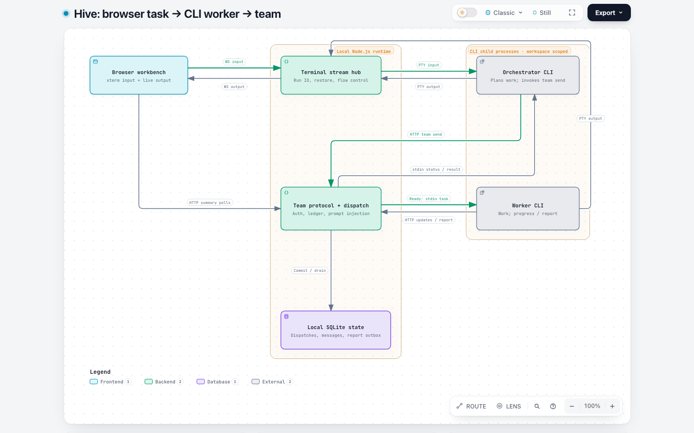 | 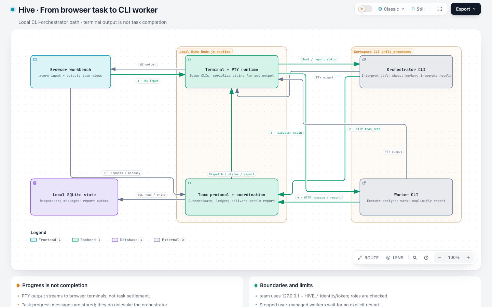 |

**base** — [final JSON](runs/hive-base/workspace/output/candidate.json) · [HTML](runs/hive-base/workspace/output/hive-task-path.html) · [session](runs/hive-base/evidence/session.jsonl) · [first JSON](runs/hive-base/evidence/snapshots/9ba66a6f79d61ba18fe6e5fa0edf6b3653a74d72963a137aaa287f08e997680f.json) · [replay](replay/hive-base/) · [full page](captures/hive-base/fullpage.light.png)
- Six components preserve the terminal ingress, orchestrator decision, authenticated team protocol, independent worker process and persisted state. Direct team-to-worker and team-to-orchestrator arrows summarize the protocol's stdin-dispatch responsibility; the node explanation names the writer and does not invent an independent transport.
- The final artifact correctly distinguishes silent task-scoped progress, injected legacy status, raw terminal output and durable explicit reports. UI summary/report polling and task-list file synchronization remain distinct from dispatch. Stopped user-managed workers retain queued work until restarted; report acknowledgment and model consumption are not conflated.
- The first captured JSON passes automated validation but omits silent task-scoped progress from its account. Subsequent source review adds that distinction. Two revised candidates are captured: a route-side ablation, followed by source corrections and restoration of the explicit worker-output route. Zero shell commands exit with failure. Final success must not be relabeled first-draft semantic acceptance.
- The final drawing is readable, including its return arrows and separate process/runtime boundaries. The worker-output edge takes a long outside detour, but its identity and endpoint are traceable and it avoids the boundary title. There is considerable empty space below the worker; small secondary labels remain a presentation caveat, with no observed clipping or masked connection.
- All eleven relationships use forward semantics. The final input has identical layout and canonical SVG on both revisions; no new direction behavior is exercised, and different authoring effort cannot be attributed to this patch.
- Source: [web/src/terminal/useTerminalRun.ts:640](https://github.com/tt-a1i/hive/blob/f8f1343da6595a232f0baba7f0ea5b5a58fe0e9c/web/src/terminal/useTerminalRun.ts#L640) — Browser terminal input calls sendInput; live output returns through the terminal client.
- Source: [src/server/routes-team.ts:127](https://github.com/tt-a1i/hive/blob/f8f1343da6595a232f0baba7f0ea5b5a58fe0e9c/src/server/routes-team.ts#L127) — Authenticated team send resolves dispatch and distinguishes parked user-managed workers from initial auto-start of spawned workers.
- Source: [src/server/agent-stdin-dispatcher.ts:286](https://github.com/tt-a1i/hive/blob/f8f1343da6595a232f0baba7f0ea5b5a58fe0e9c/src/server/agent-stdin-dispatcher.ts#L286) — Dispatch input is formatted and written only to an active process through the serialized writer.
- Source: [src/server/dispatch-message-store.ts:160](https://github.com/tt-a1i/hive/blob/f8f1343da6595a232f0baba7f0ea5b5a58fe0e9c/src/server/dispatch-message-store.ts#L160) — Task-scoped progress is recorded without a delivery-outbox row; it does not trigger model delivery.
- Source: [src/server/dispatch-ledger-store.ts:294](https://github.com/tt-a1i/hive/blob/f8f1343da6595a232f0baba7f0ea5b5a58fe0e9c/src/server/dispatch-ledger-store.ts#L294) — Report closure requires submitted owned work and the exact required inbound seen sequence.
- Source: [src/server/team-operations.ts:294](https://github.com/tt-a1i/hive/blob/f8f1343da6595a232f0baba7f0ea5b5a58fe0e9c/src/server/team-operations.ts#L294) — Report outbox draining marks delivery only after the orchestrator PTY write resolves.
- Source: [web/src/notifications/useReportNotifications.ts:36](https://github.com/tt-a1i/hive/blob/f8f1343da6595a232f0baba7f0ea5b5a58fe0e9c/web/src/notifications/useReportNotifications.ts#L36) — Report polling uses a server snapshot and subsequent pages to display new completion notifications.
- Cross-replay: {"run_id": "hive-base", "input_sha256": "2c3559f60044b47b61fefaa29834595cf42985dd991d8843b67cba729a4f72b9", "first_draft_validation_exit": 0, "base_layout_exit": 0, "base_deliver_exit": 0, "candidate_layout_exit": 0, "candidate_deliver_exit": 0, "identical_layout": true, "identical_canonical_svg": true}

**candidate** — [final JSON](runs/hive-candidate/workspace/output/candidate.json) · [HTML](runs/hive-candidate/workspace/output/hive-task-path.html) · [session](runs/hive-candidate/evidence/session.jsonl) · [first JSON](runs/hive-candidate/evidence/snapshots/c16672aaad562c05300c85162ec703d075fac18637e952077c2106181485deba.json) · [replay](replay/hive-candidate/) · [full page](captures/hive-candidate/fullpage.light.png)
- Six components distinguish the browser, local PTY runtime, team protocol, CLI child processes and SQLite state. The browser's active xterm/WebSocket path is used; the unused sendWorkspaceUserInput helper is explicitly excluded from the primary UI path.
- Delegation is an orchestrator decision, stdin delivery is separate from terminal output, and explicit report settlement is separate from output streaming. Progress messages are persisted without an orchestrator wake; optional status wakes without closing work. Report outbox delivery is acknowledged after a successful PTY write, not as proof of agent consumption.
- Stopped-worker handling, CLI identity/roles and report seen-sequence checks match the source. The architecture omits detailed return arrows for SQL reads and HTTP polling but labels those relationships as reads/queries and explains returned results; it does not assert a separate transport or automatic completion.
- First JSON passes validation. One voluntary simplification removes a redundant round-trip card while preserving nodes and all eleven relationships. One command exits with status 1 because a final rg query finds no update fields; this is not a generation or delivery failure.
- The diagram and cards are readable. Several routes bend or cross in the center, but separation/halos keep them traceable; no observed node clipping or boundary-title masking. Secondary labels are small. All relationships remain forward, and fixed-input replay is identical across versions, so this run does not exercise the new direction fields.
- Source: [web/src/terminal/useTerminalRun.ts:640](https://github.com/tt-a1i/hive/blob/f8f1343da6595a232f0baba7f0ea5b5a58fe0e9c/web/src/terminal/useTerminalRun.ts#L640) — Actual terminal onData calls the client's sendInput; browser input is not inferred solely from an unused API helper.
- Source: [src/server/agent-manager.ts:153](https://github.com/tt-a1i/hive/blob/f8f1343da6595a232f0baba7f0ea5b5a58fe0e9c/src/server/agent-manager.ts#L153) — Configured CLIs are spawned through node-pty and process input is written through the run object.
- Source: [src/server/agent-stdin-dispatcher.ts:286](https://github.com/tt-a1i/hive/blob/f8f1343da6595a232f0baba7f0ea5b5a58fe0e9c/src/server/agent-stdin-dispatcher.ts#L286) — Dispatch envelopes require an active run and are delivered through the serialized process input path.
- Source: [src/server/routes-team.ts:127](https://github.com/tt-a1i/hive/blob/f8f1343da6595a232f0baba7f0ea5b5a58fe0e9c/src/server/routes-team.ts#L127) — Team send authenticates identity/role, records dispatch and preserves the stopped-worker policy.
- Source: [src/server/dispatch-message-store.ts:160](https://github.com/tt-a1i/hive/blob/f8f1343da6595a232f0baba7f0ea5b5a58fe0e9c/src/server/dispatch-message-store.ts#L160) — Progress messages are persisted but excluded from the delivery outbox.
- Source: [src/server/dispatch-ledger-store.ts:294](https://github.com/tt-a1i/hive/blob/f8f1343da6595a232f0baba7f0ea5b5a58fe0e9c/src/server/dispatch-ledger-store.ts#L294) — Reports require submitted work owned by the worker; the seen sequence must exactly match required inbound messages.
- Source: [src/server/team-operations.ts:294](https://github.com/tt-a1i/hive/blob/f8f1343da6595a232f0baba7f0ea5b5a58fe0e9c/src/server/team-operations.ts#L294) — Pending report envelopes remain queued until successful PTY delivery; delivery is distinct from consumption.
- Source: [web/src/notifications/useReportNotifications.ts:36](https://github.com/tt-a1i/hive/blob/f8f1343da6595a232f0baba7f0ea5b5a58fe0e9c/web/src/notifications/useReportNotifications.ts#L36) — The browser polls reported dispatches and emits notifications for newly observed reports.
- Cross-replay: {"run_id": "hive-candidate", "input_sha256": "00c46cc7ca6b6f8113bafae1c5e52dad87feec336f54872b06a44415649ab5f0", "first_draft_validation_exit": 0, "base_layout_exit": 0, "base_deliver_exit": 0, "candidate_layout_exit": 0, "candidate_deliver_exit": 0, "identical_layout": true, "identical_canonical_svg": true}

### mco

| Base | Candidate |
| --- | --- |
| 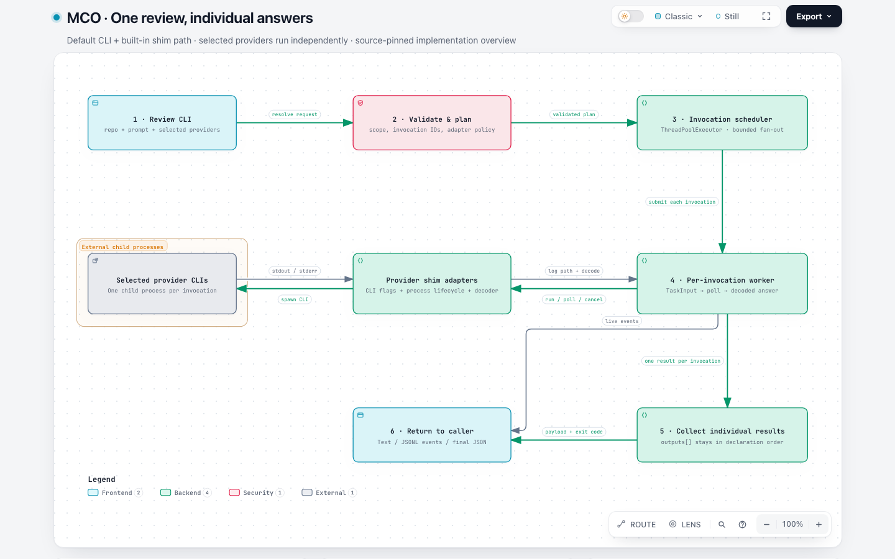 | 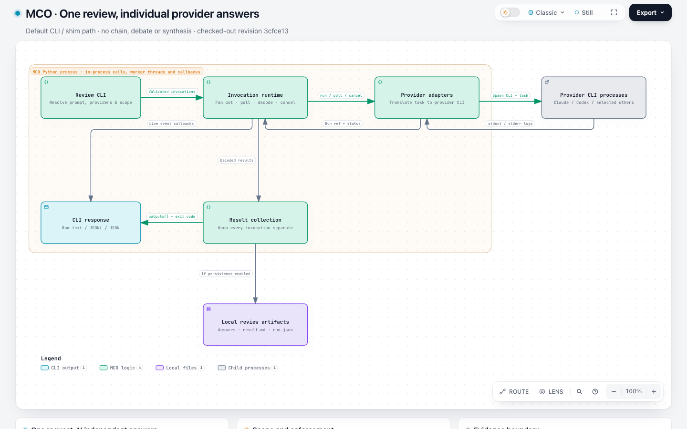 |

**base** — [final JSON](runs/mco-base/workspace/output/mco-review.architecture.json) · [HTML](runs/mco-base/workspace/output/mco-review.html) · [session](runs/mco-base/evidence/session.jsonl) · [first JSON](runs/mco-base/evidence/snapshots/78d12082bf3c336b0a1454a0d1c4c8373d7982c1875e778b16abb13c2b6bab4e.json) · [replay](replay/mco-base/) · [full page](captures/mco-base/fullpage.light.png)
- Eight components describe the default CLI/built-in shim path without inventing hosted model services. Validation precedes the local thread-pool scheduler; workers call provider adapters, and adapters spawn external CLI processes. Return arrows summarize raw-log capture and decoding, which the explanations explicitly distinguish from an HTTP response.
- Provider invocation failures, cancellation and timeouts remain individual results; completion order does not reorder outputs. The task status complete/partial/failed and exit codes match source. Input configuration errors are separately described at preflight. Optional chain/debate/synthesis and ACP are outside the default path, and read-only permissions are not overstated as universal isolation.
- Streaming events reach the caller during execution, while the aggregate payload returns after collection. Persistent artifact modes and stdout-only temporary cleanup are correctly distinguished; default execution does not synthesize a merged answer.
- First JSON passes validation. One voluntary revision removes a redundant local-thread boundary without changing nodes or relationships. No shell command failures occurred. Final review found no clipping, title-mask collision or ambiguous opposing arrows; the presentation has small secondary labels and generous spacing but remains readable.
- All ten relationships use legacy forward semantics. Fixed-input replay is identical in layout and canonical SVG on both revisions; this run supports compatibility but does not exercise the new relationship types.
- Source: [runtime/cli.py:1522](https://github.com/mco-org/mco/blob/3cfce130362dbcc2aedda6170d1a31e39cf67d3e/runtime/cli.py#L1522) — Review defaults to read_only while allowing explicit execution-policy configuration.
- Source: [runtime/cli.py:2248](https://github.com/mco-org/mco/blob/3cfce130362dbcc2aedda6170d1a31e39cf67d3e/runtime/cli.py#L2248) — Unknown providers and invalid configuration are rejected before dispatching the invocation workflow.
- Source: [runtime/invocation_runtime.py:188](https://github.com/mco-org/mco/blob/3cfce130362dbcc2aedda6170d1a31e39cf67d3e/runtime/invocation_runtime.py#L188) — Each worker builds a TaskInput and retains startup failures as invocation results.
- Source: [runtime/invocation_runtime.py:349](https://github.com/mco-org/mco/blob/3cfce130362dbcc2aedda6170d1a31e39cf67d3e/runtime/invocation_runtime.py#L349) — The worker reads raw logs, decodes output, emits deltas and observes timeout/cancellation.
- Source: [runtime/invocation_runtime.py:498](https://github.com/mco-org/mco/blob/3cfce130362dbcc2aedda6170d1a31e39cf67d3e/runtime/invocation_runtime.py#L498) — Thread-pool futures execute independently and their results are stored at original declaration indexes.
- Source: [runtime/invocation_runtime.py:600](https://github.com/mco-org/mco/blob/3cfce130362dbcc2aedda6170d1a31e39cf67d3e/runtime/invocation_runtime.py#L600) — Individual success counts determine complete/partial/failed and persistent versus temporary artifact handling.
- Source: [runtime/adapters/shim.py:115](https://github.com/mco-org/mco/blob/3cfce130362dbcc2aedda6170d1a31e39cf67d3e/runtime/adapters/shim.py#L115) — The shim launches a subprocess in repo_root with stdout/stderr redirected to files.
- Source: [runtime/cli.py:2482](https://github.com/mco-org/mco/blob/3cfce130362dbcc2aedda6170d1a31e39cf67d3e/runtime/cli.py#L2482) — The CLI returns the payload's exit code and prints the final JSON in JSON mode.
- Cross-replay: {"run_id": "mco-base", "input_sha256": "495a319af685bf363fe45dc746970e508ffc3ba69325816e31b3d28225d03960", "first_draft_validation_exit": 0, "base_layout_exit": 0, "base_deliver_exit": 0, "candidate_layout_exit": 0, "candidate_deliver_exit": 0, "identical_layout": true, "identical_canonical_svg": true}

**candidate** — [final JSON](runs/mco-candidate/workspace/output/candidate.json) · [HTML](runs/mco-candidate/workspace/output/mco-review.html) · [session](runs/mco-candidate/evidence/session.jsonl) · [first JSON](runs/mco-candidate/evidence/snapshots/76c485bb2f106d6f09b0036f87801f48368b036edb81e7c2e46c33cb5208ea78.json) · [replay](replay/mco-candidate/) · [full page](captures/mco-candidate/fullpage.light.png)
- Seven components separate logical responsibilities inside MCO, external provider CLI processes and local artifact files. Runtime/adapter return arrows summarize run references, process status and log transport; explanations identify actual raw-log reads. No remote topology, provider reasoning or independent result-collection service is invented.
- The default concurrent workflow, selected-provider ordering, individual failed/cancelled results and complete/partial/failed aggregate outcome match source. Live callbacks and final JSON return are separately drawn. Optional persistence is conditional, and read-only is correctly described as a configurable permission mode.
- First captured JSON passes validation. Two voluntary revisions remove a redundant adapter tag and replace generic legend category names with CLI output, MCO logic, Local files and Child processes. Two failed shell commands refer to guessed source/example paths or an unmatched finalize glob; neither is a diagram validation failure.
- The final drawing is readable, with traceable reciprocal control/result paths and a clear process/filesystem boundary. No clipping or boundary-title masking was observed. Return paths use broad bends and substantial empty space remains, but the diagram's factual distinctions are legible.
- All nine relationships use forward semantics. Fixed-input replay yields identical layout and canonical SVG on both revisions. The changed number of logical boxes, revisions and tokens reflects separate generation choices; this run provides no direct evidence of new direction-feature benefit.
- Source: [runtime/cli.py:1522](https://github.com/mco-org/mco/blob/3cfce130362dbcc2aedda6170d1a31e39cf67d3e/runtime/cli.py#L1522) — Review defaults read_only but explicit policy can override the mode.
- Source: [runtime/cli.py:2248](https://github.com/mco-org/mco/blob/3cfce130362dbcc2aedda6170d1a31e39cf67d3e/runtime/cli.py#L2248) — Provider/configuration checks occur before invocation dispatch.
- Source: [runtime/invocation_runtime.py:188](https://github.com/mco-org/mco/blob/3cfce130362dbcc2aedda6170d1a31e39cf67d3e/runtime/invocation_runtime.py#L188) — Each invocation constructs its own task input and retains adapter startup errors as a result.
- Source: [runtime/invocation_runtime.py:349](https://github.com/mco-org/mco/blob/3cfce130362dbcc2aedda6170d1a31e39cf67d3e/runtime/invocation_runtime.py#L349) — Workers decode raw output, emit live deltas and enforce cancellation/deadlines.
- Source: [runtime/invocation_runtime.py:498](https://github.com/mco-org/mco/blob/3cfce130362dbcc2aedda6170d1a31e39cf67d3e/runtime/invocation_runtime.py#L498) — Concurrent futures are collected into original declaration-index slots.
- Source: [runtime/invocation_runtime.py:600](https://github.com/mco-org/mco/blob/3cfce130362dbcc2aedda6170d1a31e39cf67d3e/runtime/invocation_runtime.py#L600) — Success counts determine aggregate task status; nonpersistent artifacts are cleaned and their returned paths cleared.
- Source: [runtime/adapters/shim.py:115](https://github.com/mco-org/mco/blob/3cfce130362dbcc2aedda6170d1a31e39cf67d3e/runtime/adapters/shim.py#L115) — Provider CLI subprocess stdout/stderr are captured in local files.
- Cross-replay: {"run_id": "mco-candidate", "input_sha256": "f8952f83d00e496791ac1377fec003bdba1410f3bbab99968e6a165ee006cec0", "first_draft_validation_exit": 0, "base_layout_exit": 0, "base_deliver_exit": 0, "candidate_layout_exit": 0, "candidate_deliver_exit": 0, "identical_layout": true, "identical_canonical_svg": true}

### squad

| Base | Candidate |
| --- | --- |
| 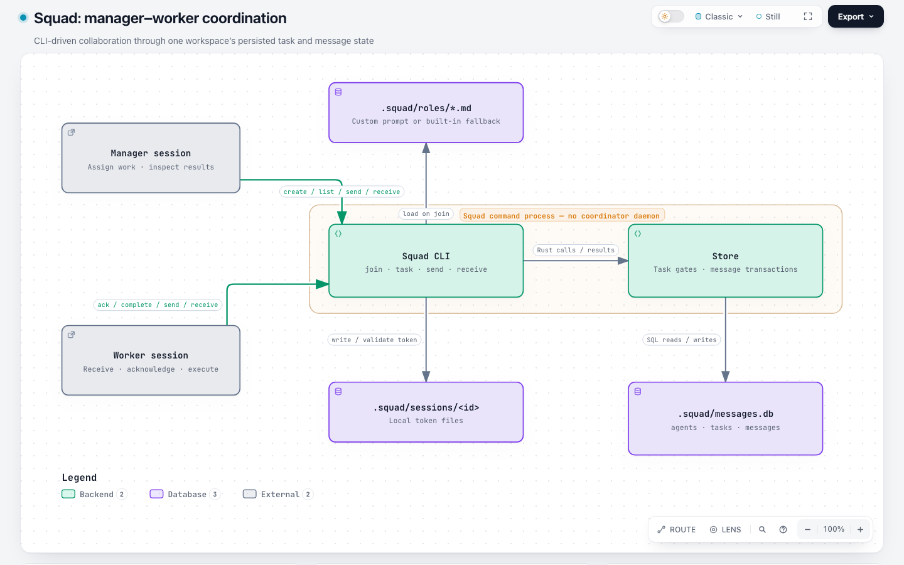 | 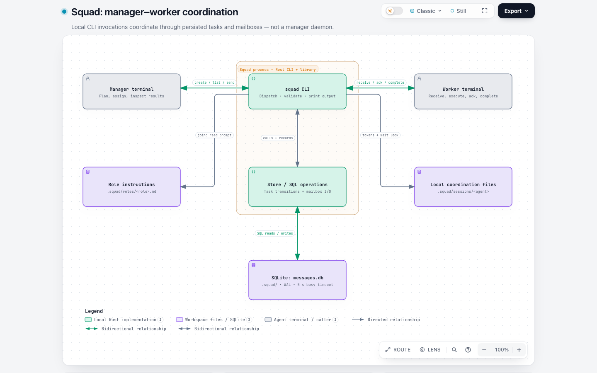 |

**base** — [final JSON](runs/squad-base/workspace/output/candidate.json) · [HTML](runs/squad-base/workspace/output/squad-coordination.html) · [session](runs/squad-base/evidence/session.jsonl) · [first JSON](runs/squad-base/evidence/snapshots/9b773aad9bced1274a82020719b63048f3602794511cf180a04d2bf2f2dbd935.json) · [replay](replay/squad-base/) · [full page](captures/squad-base/fullpage.light.png)
- Seven components distinguish manager and worker callers, the CLI, role prompts, session/wait files, Store and SQLite state. All six relationships are directed calls, reads or file operations. Returned values are summarized in explanations and call labels; the diagram does not assert that the same commands are invoked in reverse.
- The graph correctly identifies persisted tasks and mailboxes as the coordination mechanism, without inventing a manager daemon or broker. Task acknowledgment, mailbox receive and task completion remain distinct; completion does not automatically send a report. The explanations correctly limit role authorization, token compatibility and lease enforcement.
- The first and only submitted JSON validates and is the delivered final JSON. There are no changed submitted revisions or failed shell commands. The native viewport and taller full-page view are readable; file symbols are explicitly labeled as local prompt/session files. No clipping or boundary-title masking was observed.
- All six relationships use legacy forward behavior. Fixed-input replay gives identical layout and canonical SVG on both versions. This supports compatibility for this input and provides the base observation for the candidate's natural both-adoption semantic error; it is not a repeatability or speed claim.
- Source: [src/store.rs:452](https://github.com/mco-org/squad/blob/8146bcc1c38c439aedaf3ff44548c830654c8621/src/store.rs#L452) — Create atomically inserts the task and initial assignment.
- Source: [src/store.rs:340](https://github.com/mco-org/squad/blob/8146bcc1c38c439aedaf3ff44548c830654c8621/src/store.rs#L340) — Receiving a mailbox message marks it read independently of task acknowledgment.
- Source: [src/store.rs:624](https://github.com/mco-org/squad/blob/8146bcc1c38c439aedaf3ff44548c830654c8621/src/store.rs#L624) — Ack requires queued state and matching assignee and records a lease.
- Source: [src/store.rs:653](https://github.com/mco-org/squad/blob/8146bcc1c38c439aedaf3ff44548c830654c8621/src/store.rs#L653) — Complete requires acked state and ownership but does not check lease expiry or send a report.
- Source: [src/store.rs:681](https://github.com/mco-org/squad/blob/8146bcc1c38c439aedaf3ff44548c830654c8621/src/store.rs#L681) — Requeue clears the lease and may change assignment without creating a result message.
- Source: [src/session.rs:50](https://github.com/mco-org/squad/blob/8146bcc1c38c439aedaf3ff44548c830654c8621/src/session.rs#L50) — An absent token file preserves the compatibility path.
- Source: [src/main.rs:786](https://github.com/mco-org/squad/blob/8146bcc1c38c439aedaf3ff44548c830654c8621/src/main.rs#L786) — Waiting uses a per-agent receive lock, periodic polling and lock heartbeat.
- Cross-replay: {"run_id": "squad-base", "input_sha256": "9b773aad9bced1274a82020719b63048f3602794511cf180a04d2bf2f2dbd935", "first_draft_validation_exit": 0, "base_layout_exit": 0, "base_deliver_exit": 0, "candidate_layout_exit": 0, "candidate_deliver_exit": 0, "identical_layout": true, "identical_canonical_svg": true}

**candidate** — [final JSON](runs/squad-candidate/workspace/output/candidate.json) · [HTML](runs/squad-candidate/workspace/output/squad-coordination.html) · [session](runs/squad-candidate/evidence/session.jsonl) · [first JSON](runs/squad-candidate/evidence/snapshots/7adb00507f87bf6bacc7ea0aae6c988614ff3dfc6cb936845ebab64faff5958c.json) · [replay](replay/squad-candidate/) · [full page](captures/squad-candidate/fullpage.light.png)
- The candidate naturally authors four both relationships. At least Manager terminal ↔ squad CLI labeled create / list / send and Worker terminal ↔ squad CLI labeled receive / ack / complete combine distinct commands and returned output. Those commands do not hold in both directions. This conflicts with the candidate authoring contract, which reserves both for the same relationship in both directions and keeps distinct requests/results separate.
- The first JSON explicitly describes its both legend as Command and returned output. One voluntary revision removes that custom legend but retains all four both edges. Automated validation passes on the initial and final bytes; it does not establish source-semantic correctness. The recorded semantic failure is preserved in ISSUES.md, item 2.
- Other reviewed claims match source: task and initial assignment creation are transactional; receiving a message does not acknowledge a task; completion does not send a report; lease expiry is not enforced by complete; role prompts are not manager authorization; absent session-token files retain compatibility behavior.
- The settled native screenshot is readable and the actual direction legend is visible. An earlier captureBeyondViewport screenshot caused transient layout changes; those harness captures are retained separately and excluded from product acceptance. All four new relationships pass reverse Route and Reach checks, retain unique IDs and remain static in Live mode. Native light/dark SVG and PNG exports are retained. Correct runtime behavior does not compensate for the incorrect authored semantics.
- The base rejects the direction fields as unsupported. The unchanged candidate JSON passes on the candidate. This is a capability difference, not proof of baseline malfunction or improved authoring quality. One guessed example-path command fails; there is no generation-process timeout or provider failure.
- Source: [src/main.rs:973](https://github.com/mco-org/squad/blob/8146bcc1c38c439aedaf3ff44548c830654c8621/src/main.rs#L973) — Task-create invokes Store and then prints the created identifier; command invocation and stdout return are different actions.
- Source: [src/main.rs:984](https://github.com/mco-org/squad/blob/8146bcc1c38c439aedaf3ff44548c830654c8621/src/main.rs#L984) — Task-ack calls Store before printing acknowledgment; the CLI does not send an ack command back to its caller.
- Source: [src/main.rs:995](https://github.com/mco-org/squad/blob/8146bcc1c38c439aedaf3ff44548c830654c8621/src/main.rs#L995) — Task-complete performs completion and prints a result; it does not reverse-invoke complete on the worker.
- Source: [src/store.rs:452](https://github.com/mco-org/squad/blob/8146bcc1c38c439aedaf3ff44548c830654c8621/src/store.rs#L452) — Task and initial assignment creation share one SQLite transaction.
- Source: [src/store.rs:624](https://github.com/mco-org/squad/blob/8146bcc1c38c439aedaf3ff44548c830654c8621/src/store.rs#L624) — Ack checks queued state and assignee and installs a fifteen-minute lease.
- Source: [src/store.rs:653](https://github.com/mco-org/squad/blob/8146bcc1c38c439aedaf3ff44548c830654c8621/src/store.rs#L653) — Complete checks acked state and ownership, without an expiry check or automatic result message.
- Source: [src/session.rs:50](https://github.com/mco-org/squad/blob/8146bcc1c38c439aedaf3ff44548c830654c8621/src/session.rs#L50) — Missing session-token files preserve the backward-compatible identity path.
- Cross-replay: {"run_id": "squad-candidate", "input_sha256": "f7bed3f87cae0824c907b7f344ee6a4b5bd0d4d3bb4e0d1b99d8a2b877858c03", "first_draft_validation_exit": 0, "base_layout_exit": 1, "base_deliver_exit": 1, "candidate_layout_exit": 0, "candidate_deliver_exit": 0, "identical_layout": null}

### skillroster

| Base | Candidate |
| --- | --- |
| 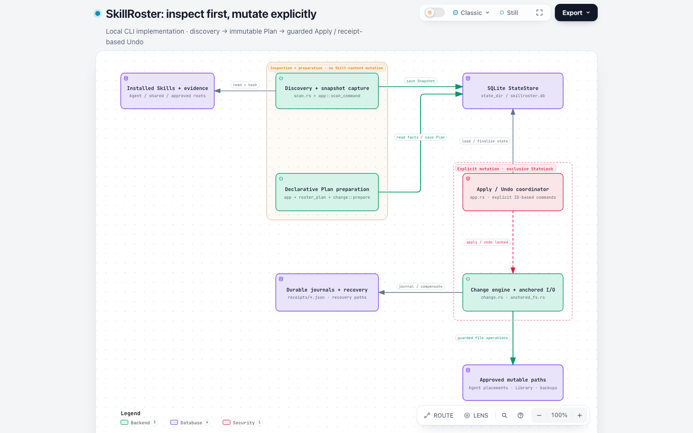 | 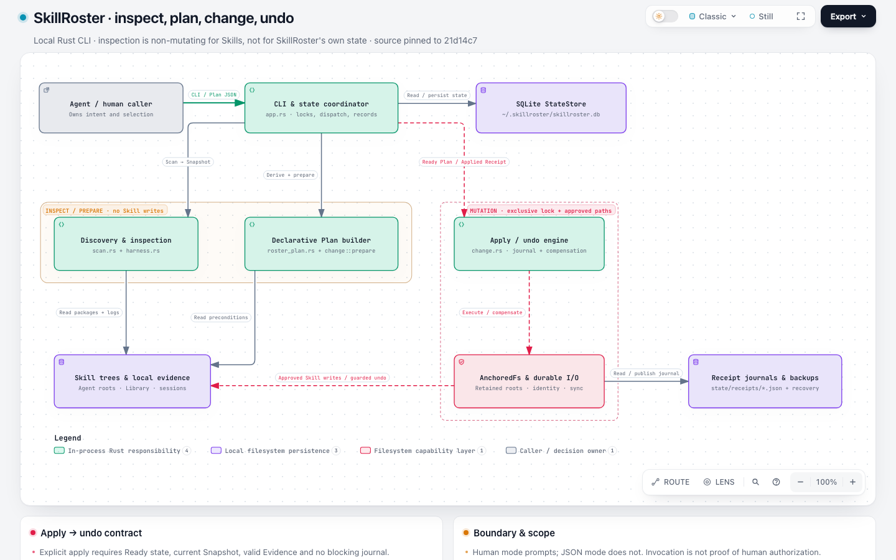 |

**base** — [final JSON](runs/skillroster-base/workspace/output/candidate.json) · [HTML](runs/skillroster-base/workspace/output/skillroster-architecture.html) · [session](runs/skillroster-base/evidence/session.jsonl) · [first JSON](runs/skillroster-base/evidence/snapshots/f8c5b6da93a33b1ff2000dc2bbf0efd2291d37a9b3ccfd803884225c96fd8a99.json) · [replay](replay/skillroster-base/) · [full page](captures/skillroster-base/fullpage.light.png)
- Eight components distinguish the observed read surface, scan/snapshot capture, SQLite state, declarative Plan, explicit mutation coordinator, anchored change engine, receipt/recovery files and approved write targets. Read and write filesystem views are explicitly described as overlapping subsets, not duplicate stores. Scan and preparation do not mutate Skill content but do persist owned state.
- Trusted operation derivation, latest-Snapshot/Evidence binding, explicit ID-based Apply/Undo, human-mode-only confirmation, current-state checks, reverse compensations and drift refusal match the pinned source. SQLite finalization and filesystem-journal durability are correctly separated. The graph does not imply that planning automatically executes Apply or that an exclusive lock alone permits mutation.
- The security-boundary title masks the load / finalize state route leaving Apply / Undo coordinator. The canonical route is vertical at x=900 from y=260 to y=118 and crosses the title above that node. This is a second naturally generated example of ISSUES.md item 1, now in the base arm. Other relationships and cards are readable; the figure has generous unused space and needs scrolling at the primary viewport.
- First JSON passes validation. One voluntary revision consolidates two same-direction StateStore calls, corrects the SQLite-open source reference and clarifies that Scan also takes a state lock. No shell commands fail. The remaining boundary-mask problem is preserved in the final artifact rather than repaired after generation.
- All seven connections use forward semantics. Identical input gives identical layout and canonical SVG on base and candidate, confirming the observed mask problem is pre-existing and independent of the new direction fields.
- Source: [src/scan.rs:984](https://github.com/tt-a1i/skillroster/blob/21d14c7cff25c66a016562e238e62d0538eb696f/src/scan.rs#L984) — Discovery enumerates approved observation roots rather than granting mutation authority.
- Source: [src/app.rs:1733](https://github.com/tt-a1i/skillroster/blob/21d14c7cff25c66a016562e238e62d0538eb696f/src/app.rs#L1733) — Scan persists indexed inventory and ScanResult in SQLite although Skill content remains read-only.
- Source: [src/app.rs:8223](https://github.com/tt-a1i/skillroster/blob/21d14c7cff25c66a016562e238e62d0538eb696f/src/app.rs#L8223) — Plan preparation binds current Snapshot/Evidence and derives operations under the effective origin policy.
- Source: [src/app.rs:345](https://github.com/tt-a1i/skillroster/blob/21d14c7cff25c66a016562e238e62d0538eb696f/src/app.rs#L345) — Apply/Undo are explicit commands; interactive confirmation is conditional on non-JSON mode.
- Source: [src/app.rs:8479](https://github.com/tt-a1i/skillroster/blob/21d14c7cff25c66a016562e238e62d0538eb696f/src/app.rs#L8479) — Apply checks readiness, recovery, snapshot/governance bindings and finalizes metadata after filesystem execution.
- Source: [src/app.rs:8601](https://github.com/tt-a1i/skillroster/blob/21d14c7cff25c66a016562e238e62d0538eb696f/src/app.rs#L8601) — Undo requires an applied unreversed Receipt and can report durable-journal/SQLite-finalization failure separately.
- Source: [src/change.rs:1954](https://github.com/tt-a1i/skillroster/blob/21d14c7cff25c66a016562e238e62d0538eb696f/src/change.rs#L1954) — Undo compensation runs in reverse order with fingerprint and missing-path checks.
- Cross-replay: {"run_id": "skillroster-base", "input_sha256": "5f42788524538f6f205e5bb78144d4c5ed26fb790794ab9e91c0937298d1736d", "first_draft_validation_exit": 0, "base_layout_exit": 0, "base_deliver_exit": 0, "candidate_layout_exit": 0, "candidate_deliver_exit": 0, "identical_layout": true, "identical_canonical_svg": true}

**candidate** — [final JSON](runs/skillroster-candidate/workspace/output/candidate.json) · [HTML](runs/skillroster-candidate/workspace/output/skillroster-architecture.html) · [session](runs/skillroster-candidate/evidence/session.jsonl) · [first JSON](runs/skillroster-candidate/evidence/snapshots/b62e5ae7e07493c50fb4e7f2e9ccb84c0f5a7af27c4c97cfee3204a7346cb498.json) · [replay](replay/skillroster-candidate/) · [full page](captures/skillroster-candidate/fullpage.light.png)
- Nine components separate caller intent, CLI/state coordination, SQLite, discovery, trusted planning, the Apply/Undo engine, observed Skill/evidence files, anchored filesystem capability and receipt/recovery files. These are grouped in-process responsibilities, not invented services or an OS sandbox. Read-only inspection is correctly scoped to Skill content, while local snapshots and Plans are persisted.
- The diagram preserves explicit Apply/Undo commands, non-JSON confirmation, current Snapshot/Evidence and governance guards, approved-path mutation, journaling before changes, verification and reverse-order drift-checked compensation. SQLite finalization remains distinct from durable filesystem journals. Provider-managed observation roots are not automatically mutation targets, and recovery limits are stated.
- The first captured JSON fails on an unsupported security-line legend key and an overlong source label. The next candidate exposes an out-of-range AGENTS.md reference. After those two diagnostic repairs, validation passes. A voluntary route/card simplification then triggers three label-gap diagnostics, repaired by increasing node spacing. All five submitted versions and original diagnostic outputs are retained: four revisions total, three diagnostic-driven and one voluntary.
- Four shell commands fail: one guessed example path and three finalize attempts. The final drawing is readable, with distinct inspection/mutation boundaries and no observed boundary-title masking or clipping. Fine secondary text and empty right-side space remain presentation caveats. The richer graph and extra rework are not evidence of a causal patch regression from one generation pair.
- All ten connections use forward semantics. The final frozen JSON has identical layout and canonical SVG on both versions. This input does not exercise the new direction feature; its existing validation/repair behavior is recorded without attributing the repairs to both/none.
- Source: [src/app.rs:345](https://github.com/tt-a1i/skillroster/blob/21d14c7cff25c66a016562e238e62d0538eb696f/src/app.rs#L345) — Apply/Undo require explicit IDs, and human confirmation is conditional on non-JSON mode.
- Source: [src/scan.rs:984](https://github.com/tt-a1i/skillroster/blob/21d14c7cff25c66a016562e238e62d0538eb696f/src/scan.rs#L984) — Scanner reads established roots and optional evidence without granting mutation rights.
- Source: [src/app.rs:1733](https://github.com/tt-a1i/skillroster/blob/21d14c7cff25c66a016562e238e62d0538eb696f/src/app.rs#L1733) — Discovery persists its Snapshot in SQLite although observed Skill content is not modified.
- Source: [src/app.rs:7572](https://github.com/tt-a1i/skillroster/blob/21d14c7cff25c66a016562e238e62d0538eb696f/src/app.rs#L7572) — Caller-authored operations are refused and incompatible declarative request families cannot be combined.
- Source: [src/app.rs:8479](https://github.com/tt-a1i/skillroster/blob/21d14c7cff25c66a016562e238e62d0538eb696f/src/app.rs#L8479) — Apply validates readiness and current-state bindings before execution, then handles governance metadata and journal/SQLite outcomes.
- Source: [src/app.rs:8601](https://github.com/tt-a1i/skillroster/blob/21d14c7cff25c66a016562e238e62d0538eb696f/src/app.rs#L8601) — Undo checks applied/unreversed receipt state and restores metadata after filesystem compensation verifies.
- Source: [src/anchored_fs.rs:605](https://github.com/tt-a1i/skillroster/blob/21d14c7cff25c66a016562e238e62d0538eb696f/src/anchored_fs.rs#L605) — The filesystem capability retains approved directory anchors and validates their identities.
- Source: [src/change.rs:1954](https://github.com/tt-a1i/skillroster/blob/21d14c7cff25c66a016562e238e62d0538eb696f/src/change.rs#L1954) — Saved compensations run in reverse order with fingerprint and missing-target guards.
- Source: [src/change.rs:2641](https://github.com/tt-a1i/skillroster/blob/21d14c7cff25c66a016562e238e62d0538eb696f/src/change.rs#L2641) — Receipt publication writes serialized JSON through the anchored atomic-file routine.
- Cross-replay: {"run_id": "skillroster-candidate", "input_sha256": "becc66d0298630ddefa586797c34864c415c9c96dbb2c21dad53efa2c8a728ba", "first_draft_validation_exit": 1, "base_layout_exit": 0, "base_deliver_exit": 0, "candidate_layout_exit": 0, "candidate_deliver_exit": 0, "identical_layout": true, "identical_canonical_svg": true}

### association

| Base | Candidate |
| --- | --- |
| 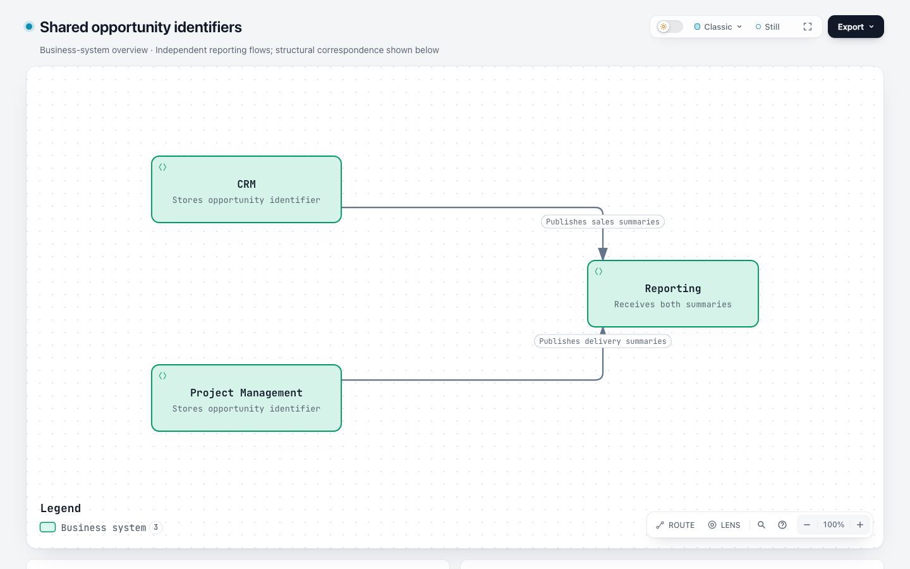 | 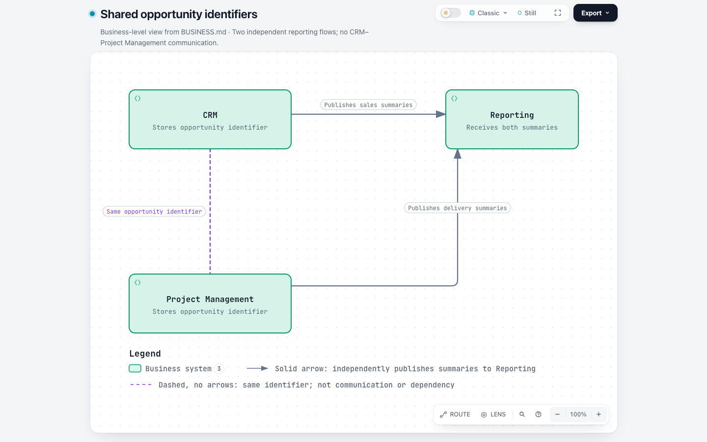 |

**base** — [final JSON](runs/association-base/workspace/output/candidate.json) · [HTML](runs/association-base/workspace/output/shared-opportunity-identifiers.html) · [session](runs/association-base/evidence/session.jsonl) · [first JSON](runs/association-base/evidence/snapshots/764982bcc9c08e724cdd861b322cf2beb03bab7758ed3fa435889f72ed9b279b.json) · [replay](replay/association-base/) · [full page](captures/association-base/fullpage.light.png)
- The two Reporting arrows and all business text agree with [BUSINESS.md](runs/association-base/workspace/project/BUSINESS.md). The Agent recognizes the old schema limitation and places CRM ─── Project Management in a separate text card, with an explicit no-message/no-dependency explanation. It does not invent a directed CRM-to-Project-Management communication flow.
- The requested association is absent from the canonical graph's connections; only the two reporting edges exist. The semantic outcome is marked incorrect relative to the complete requested graph, because a text card is not a traversable undirected relationship. This is the known unsupported baseline capability, not a new regression or a false claim by the Agent that native support exists.
- The rendered partial graph and supporting cards are readable, and the final response discloses the limitation. First/final submitted JSON are identical and pass the old validator. There are no submitted revisions; one guessed example-path command fails. The Agent's ablation inspection retains both explanatory panels.
- Both versions reproduce this old-format input with identical layout and canonical SVG. Candidate replay cannot infer a missing relationship from prose. New direction fields are not stripped or injected to turn the workaround into a capability success.
- Cross-replay: {"run_id": "association-base", "input_sha256": "764982bcc9c08e724cdd861b322cf2beb03bab7758ed3fa435889f72ed9b279b", "first_draft_validation_exit": 0, "base_layout_exit": 0, "base_deliver_exit": 0, "candidate_layout_exit": 0, "candidate_deliver_exit": 0, "identical_layout": true, "identical_canonical_svg": true}

**candidate** — [final JSON](runs/association-candidate/workspace/output/candidate.json) · [HTML](runs/association-candidate/workspace/output/shared-opportunity-identifiers.html) · [session](runs/association-candidate/evidence/session.jsonl) · [first JSON](runs/association-candidate/evidence/snapshots/c5fbe8bcec0c998297de1f0f595f8cffeae16da9585226e5c43088f07f3423c4.json) · [replay](replay/association-candidate/) · [full page](captures/association-candidate/fullpage.light.png)
- The three-node graph matches [BUSINESS.md](runs/association-candidate/workspace/project/BUSINESS.md): CRM and Project Management share an identifier with no claimed message/dependency, and each independently publishes its own summary to Reporting. No extra system, path, protocol or source link is invented.
- The correspondence is one direction:none dashed relationship. Its explicit legend says the dash/no-arrow combination denotes identifier correspondence rather than communication; the two real reporting paths remain solid directed arrows. This is an instance-specific legend, not a universal claim that every dashed line is an association.
- First and final submitted JSON are identical and pass validation. There are no repair rounds; one guessed example-path command fails. The native light viewport and dark PNG export are readable, including both direction legend entries; exports retain the same relationship meanings.
- Reverse structural Route and Reach find the opposite endpoint, retain one identity and create no route-flow overlay in Live mode. The association itself has neither marker-start nor marker-end. Base replay rejects the new direction/legend fields as unsupported; candidate replay succeeds without altering the input. This supports the requested new capability, not a real-project quality or speed claim.
- Cross-replay: {"run_id": "association-candidate", "input_sha256": "c5fbe8bcec0c998297de1f0f595f8cffeae16da9585226e5c43088f07f3423c4", "first_draft_validation_exit": 0, "base_layout_exit": 1, "base_deliver_exit": 1, "candidate_layout_exit": 0, "candidate_deliver_exit": 0, "identical_layout": null}

### symmetric-sync

| Base | Candidate |
| --- | --- |
| 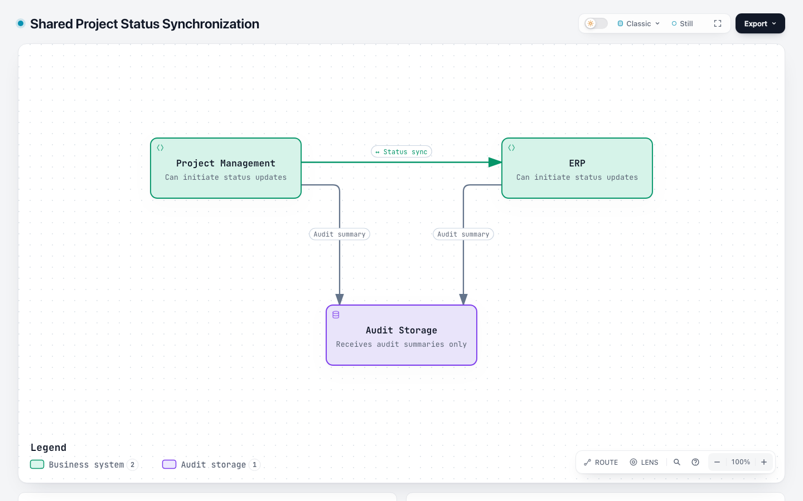 | 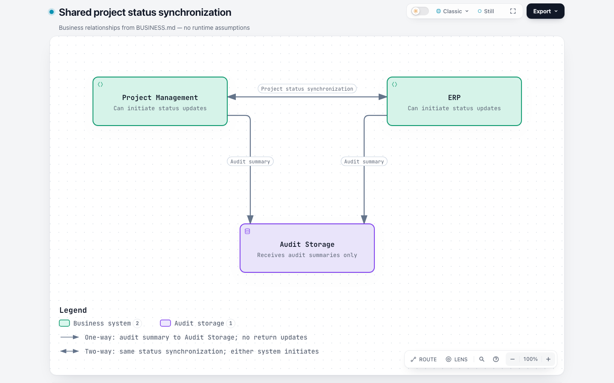 |

**base** — [final JSON](runs/symmetric-sync-base/workspace/output/candidate.json) · [HTML](runs/symmetric-sync-base/workspace/output/status-synchronization.html) · [session](runs/symmetric-sync-base/evidence/session.jsonl) · [first JSON](runs/symmetric-sync-base/evidence/snapshots/2429af020c07b01b93ce9a51af660b70e17c84568c7749a72cb9a00970b51b96.json) · [replay](replay/symmetric-sync-base/) · [full page](captures/symmetric-sync-base/fullpage.light.png)
- The three nodes and two one-way audit flows match [BUSINESS.md](runs/symmetric-sync-base/workspace/project/BUSINESS.md). No protocol, retry or timing detail is invented. The Agent preserves one synchronization relationship and explicitly discloses that the old renderer cannot draw its requested two-headed connection.
- The actual synchronization edge remains forward from Project Management to ERP. A ↔ symbol in its label and a supporting disclaimer describe two-way business meaning, but do not change its one-way arrow or graph traversal. The diagram therefore has a visible direction conflict and does not satisfy the requested bidirectional relationship. This is unsupported old capability, not a new rendering regression or a silent Agent misrepresentation.
- First JSON passes automated validation. One voluntary revision removes a redundant subtitle; it does not change the unsupported direction. Two shell commands exit nonzero for absent AGENTS.md search matches and an unmatched update-file glob. No diagram validation failure occurs. Text and routes are otherwise legible, but the arrow/label conflict is recorded as a readability issue.
- The unchanged final input replays identically on both versions. The candidate does not infer direction from a Unicode label. This demonstrates why textual workarounds cannot substitute for the new contract; it does not establish generation-effort savings.
- Cross-replay: {"run_id": "symmetric-sync-base", "input_sha256": "2b9d0cd0e606d2b07dc3e3c73f3e3151a0f473a73c7752057f5db9ae80fa4592", "first_draft_validation_exit": 0, "base_layout_exit": 0, "base_deliver_exit": 0, "candidate_layout_exit": 0, "candidate_deliver_exit": 0, "identical_layout": true, "identical_canonical_svg": true}

**candidate** — [final JSON](runs/symmetric-sync-candidate/workspace/output/candidate.json) · [HTML](runs/symmetric-sync-candidate/workspace/output/status-synchronization.html) · [session](runs/symmetric-sync-candidate/evidence/session.jsonl) · [first JSON](runs/symmetric-sync-candidate/evidence/snapshots/6223a1305762edfb064db175dc2ec6c7371416e84cd2979105fa5c2b94a78165.json) · [replay](replay/symmetric-sync-candidate/) · [full page](captures/symmetric-sync-candidate/fullpage.light.png)
- The graph matches [BUSINESS.md](runs/symmetric-sync-candidate/workspace/project/BUSINESS.md): one both relationship expresses the same project-status synchronization in either direction, while two independent forward audit arrows terminate at Audit Storage. No audit return, protocol, retry or timing behavior is invented.
- The actual arrowheads and legend agree: the synchronization has two heads, and audit has one. The primary viewport is readable with all three relationships and both direction legend entries visible. The supplemental full-page image includes the evidence card under explicitly recorded capture conditions.
- First and final submitted JSON are identical and pass validation. There are no repair rounds. Two shell commands fail on missing AGENTS.md search matches and a guessed Archify README path; neither is a failed diagram validation.
- Reverse structural Route and Reach work with one relationship identity and no route-flow overlay in Live mode. Native light/dark SVG and PNG exports preserve the two-headed relationship and legend. Base replay rejects the new direction/legend fields as unsupported; candidate replay succeeds on unchanged bytes. This is a focused capability success, not evidence that arbitrary commands and replies should be merged into both.
- Cross-replay: {"run_id": "symmetric-sync-candidate", "input_sha256": "6223a1305762edfb064db175dc2ec6c7371416e84cd2979105fa5c2b94a78165", "first_draft_validation_exit": 0, "base_layout_exit": 1, "base_deliver_exit": 1, "candidate_layout_exit": 0, "candidate_deliver_exit": 0, "identical_layout": null}

### distinct-messages

| Base | Candidate |
| --- | --- |
| 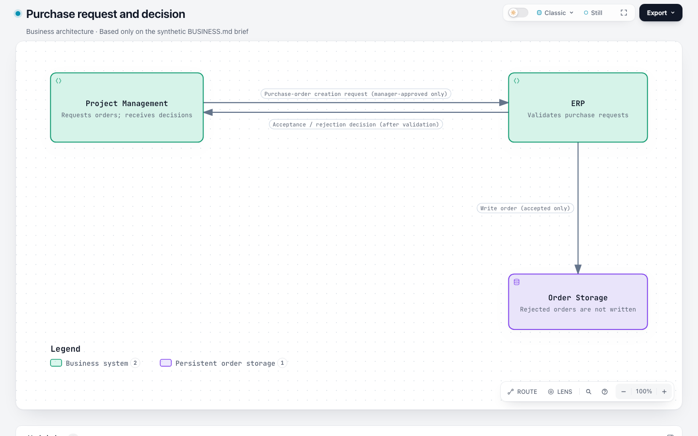 | 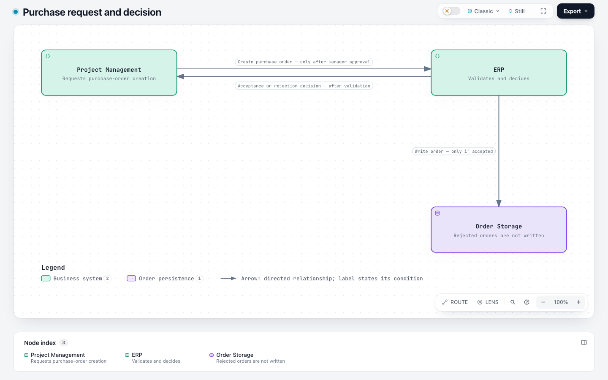 |

**base** — [final JSON](runs/distinct-messages-base/workspace/output/purchase-orders.json) · [HTML](runs/distinct-messages-base/workspace/output/purchase-orders.html) · [session](runs/distinct-messages-base/evidence/session.jsonl) · [first JSON](runs/distinct-messages-base/evidence/snapshots/bb1f19f78f3e95278e6f6d119b80a24dc65b34537d31f53cff98e0d7f4b3fdc9.json) · [replay](replay/distinct-messages-base/) · [full page](captures/distinct-messages-base/fullpage.light.png)
- The graph preserves [BUSINESS.md](runs/distinct-messages-base/workspace/project/BUSINESS.md)'s distinct manager-approved request, post-validation acceptance/rejection decision and accepted-only write to Order Storage. Opposite request/decision arrows remain separate; no extra communication or source link is invented.
- The final diagram is readable: each conditional label stays with its own arrow, opposing paths remain distinguishable and rejected orders are explicitly excluded from storage. It uses old directed defaults without needing the new capability.
- First JSON passes validation. One voluntary simplification removes a redundant supporting card while keeping all components, connections and conditions. One guessed example-path command fails; diagram checks succeed. All attempted bytes are retained.
- The final input has identical layout and canonical SVG on both revisions. Both arms meet this explicit distinct-message task, but one pair and differing presentation choices cannot establish a rework or speed improvement.
- Cross-replay: {"run_id": "distinct-messages-base", "input_sha256": "149d25b73c9f84aeea303df372db32236e349dd7bed3ffb168d85b9252a33253", "first_draft_validation_exit": 0, "base_layout_exit": 0, "base_deliver_exit": 0, "candidate_layout_exit": 0, "candidate_deliver_exit": 0, "identical_layout": true, "identical_canonical_svg": true}

**candidate** — [final JSON](runs/distinct-messages-candidate/workspace/output/candidate.json) · [HTML](runs/distinct-messages-candidate/workspace/output/purchase-request-decision.html) · [session](runs/distinct-messages-candidate/evidence/session.jsonl) · [first JSON](runs/distinct-messages-candidate/evidence/snapshots/9447dc4468d1ece6d7bbc57d77876d5c033405459ac724f6c7c000df19304c60.json) · [replay](replay/distinct-messages-candidate/) · [full page](captures/distinct-messages-candidate/fullpage.light.png)
- All three relationships match [BUSINESS.md](runs/distinct-messages-candidate/workspace/project/BUSINESS.md). Project Management sends a purchase-order request only after manager approval; ERP returns an acceptance/rejection decision after validation; ERP writes accepted orders only. The request and decision remain distinct opposite directed edges with independent IDs and readable conditions.
- No generic both exchange, extra manager system, invented storage write on rejection or additional runtime behavior is introduced. The explicit relation-forward legend correctly describes direction and conditional labels. Opposing arrows and their labels are separated and readable, with no observed clipping or obstruction.
- The first and final submitted JSON are identical and pass validation. No revisions are submitted; one shell command fails on a guessed browser-script glob. Native light/dark exports retain the explicit directed-relation legend.
- Base replay rejects the newly supported explicit direction fields and relation-forward legend key, despite the underlying three facts also being expressible with old defaults. Candidate replay succeeds without changing bytes. This targeted success shows that an explicit requirement can be followed; it does not invalidate the natural Squad command/output-merging failure.
- Cross-replay: {"run_id": "distinct-messages-candidate", "input_sha256": "9447dc4468d1ece6d7bbc57d77876d5c033405459ac724f6c7c000df19304c60", "first_draft_validation_exit": 0, "base_layout_exit": 1, "base_deliver_exit": 1, "candidate_layout_exit": 0, "candidate_deliver_exit": 0, "identical_layout": null}

## Audit limits and retention

- Full scheduled failures, timeouts, revisions and provider errors remain in native sessions. No successful retry replaces a prior run. Source/package integrity and artifact receipt hashes are recorded in [observations.json](observations.json).
- First-draft validation is a replay of captured original bytes on its original arm. First-draft semantics and readability are unverified unless a review explicitly says otherwise. A final passing diagram is not first-draft success.
- Base rejection of new fields is reported as unsupported capability, not a regression or proof of fewer repairs. New metadata never gets removed for a passing replay.
- Timings are descriptive only: local gateway/network delay and provider queue time are not separated. Reasoning usage is unavailable when the client does not report it. No fabricated cost estimate is supplied.
- Active evidence-assembly labor was not separately timed while generation and inspection overlapped; it is unavailable. Maintainer review time is not applicable because no maintainer review has occurred. Capture-method investigation added avoidable collection work, whose unsuccessful outputs remain retained.
- Local evidence location: `/evidence/issue-1139/benchmark-20261104`. No public upload, GitHub comment, or maintainer sign-off is implied. Archive digest and retention are in [bundle-notes.md](bundle-notes.md); the manifest records the literal configured-credential scan and its limits.
