# #1139 centered label arrows — generation benchmark evidence

## 本轮结论

用户选定的共享线路呈现已实现并在真实生成中使用：不同命令／结果保持两条有向关系和独立 ID，标签居中分列线路两侧，小三角指向各自方向。官方五项目的 10 次对照与合成场景的 2 次补充均完成，12 次都有最终 JSON、当前交付收据和完整原生会话。**交付全部完成，不等于质量全面通过。**

- Hive、MCO、Squad 候选自然采用了 10、6、4 个标签箭头，共 20 个；OpenPI 与 SkillRoster 未采用新呈现。自然任务没有提示字段或参考布局。
- 补充业务场景中，基线诚实说明表达限制并使用两条平行箭头；候选生成用户选择的一条共享线与两个居中方向标签，同时保留审批前提、返回条件和仅保存已接受订单的规则。提示词要求这种呈现，但没有透露字段或坐标，也没有额外禁止端点箭头。
- 这 22 个标签箭头逐一检查了正向 Route 的节点与独立 edge ID，以及浅／深色 SVG、PNG 导出。定向浏览器测试另覆盖 Reach、低细节显示和窄屏查询。没有发现本轮新标记造成的交付或身份合并回归。
- 发现并保留两类实质问题：OpenPI／Squad 候选的边界标题遮住普通连线；Hive 基线误称任务内 progress 会通过 PTY 推送给 orchestrator。前者在两版相同输入上都存在，后者是生成内容的事实错误。另记下 SkillRoster 候选文字达到最低检查但仍偏小的阅读质量问题。见 [问题及复现记录](ISSUES.md)。
- 前一轮 Squad 误合并 `both` 的失败仍在原候选 SHA 下保留。本轮未复现该误用，不能证明以后不会再出现，也不能把语义差异归因于新字段。

| 官方五项目合计 | Base | Candidate |
| --- | ---: | ---: |
| 已交付会话 | 5 / 5 | 5 / 5 |
| 首份 JSON 检查通过 | 4 / 5 | 4 / 5 |
| 提交后修订轮次（含主动修改） | 8 | 7 |
| 其中诊断驱动修订 | 2 | 1 |
| Shell 命令／失败命令 | 122 / 6 | 125 / 3 |
| 未缓存输入 token | 356,730 | 492,357 |
| 缓存输入 token | 8,305,280 | 8,568,576 |
| 输出 token | 44,730 | 45,596 |

这是一组诊断性样本，图的内容和布局也不同，不能推出省轮次、省 token 或速度提升。首稿语义与视觉没有普遍逐张验收，因此“首份 JSON 检查通过”仅指其自动检查。补充两场各修订 1 次，未混入五项目合计；详细 token 和失败见下表与各自 run.json。费用按用户要求暂不统计，网络和排队时间未分离。

基线冻结为启动时复核的 dev `63c9263e84bd3993cab8e09b3d69888857858635`，候选为 `c4f28b89e6ee39edb1e0a09db96998bda27670f1`。五项目沿用官方固定源码提交，Codex CLI 0.144.0、`gpt-6.1-sol / medium`，最多两场同时运行。实际受影响的新 schema 与标签行为限定 Architecture；其他类型使用已有输入回放和共享 Viewer 定向检查，范围理由在启动前的 [plan.json](plan.json)。

所有最终 JSON 都在两版原字节回放。未用新字段的 8 份输入布局与 canonical SVG 相同；4 份含标签箭头的候选输入被基线按不支持字段拒绝，不能把这种拒绝描述为修复旧 bug。前轮 3 份 `none`／`both`／不同消息输入在当前候选确定性重放，交付与 SVG 保持一致；这是复用证据，不是新模型会话。

[证据核对](audit-summary.json)检查原提示词、源码与包完整性、全部提交版本、最终产物哈希、原生截图、22 条关系身份与 44 项主题导出记录。它不替代上述事实核查或视觉判断。当前仅完成作者侧审查，未获得维护者验收；[本地证据包](bundle-notes.md)尚未发布到 GitHub，投稿前仍须提供维护者可访问的持久附件。

Completed generation sessions: **10/10 official**, **2/2 supplemental**. Review and replay status is shown per run; a completed session is not an accepted diagram.

Actionable defects are retained separately in [ISSUES.md](ISSUES.md), including reproduction steps, screenshots, affected versions and attribution limits. No GitHub issue has been submitted by this run.

## Frozen comparison

- Base: `63c9263e84bd3993cab8e09b3d69888857858635`; candidate: `c4f28b89e6ee39edb1e0a09db96998bda27670f1`.
- Official scope: Architecture on all five pinned repositories; fresh base/candidate sessions. New direction metadata is Architecture-only. Existing saved inputs from ten diagram types and Viewer/Story focused checks cover unchanged shared callers.
- Supplemental scope: one synthetic shared-request/decision brief × two versions. It requests separate semantic identities with centered direction cues on a shared visual corridor, without schema or coordinate hints. It is not an official real-project case. Prior association/synchronization/distinct-message runs remain under their original candidate SHA in ../benchmark-20261104/.
- Codex CLI 0.144.0, `gpt-6.1-sol`, `medium`, concurrency 2, 20-minute budget per session. Each project pair finishes before the next pair. Arm submission order alternates; thread scheduling may reorder the nearly simultaneous START messages. No extra agent delegation. Contention is uncontrolled and no speed claims are made.
- [Frozen plan](plan.json), [setup](setup.log), [scheduler](dispatch.log), [dispatch records](dispatch.json). Package hashes, project pins, prompt hashes and environment are in the plan.
- Credentials are supplied through the existing local gateway environment and are not included in evidence. Sessions are fresh/ephemeral and ignore user configuration; ordinary same-host instructions may remain. Source isolation uses task restrictions plus post-run integrity checks, not an OS read-only sandbox.
- The client requests `gpt-6.1-sol` with medium reasoning in both arms. stderr retains client-side model-cache/model-metadata fallback warnings, API-key remote-plugin-catalog warnings and local plugin/state-database warnings. These are environment limitations, not Archify diagnostics; successful sessions do not independently establish the gateway backend identity. No configuration was changed between arms to hide them.
- The recorder snapshots complete JSON before CLI entry and polls output every 50 ms. Unsubmitted transient versions between polls cannot be guaranteed. Native events, timed event copies, all submitted versions, errors and receipts are retained.
- Review below is author-side maintenance Codex inspection, independently checked against pinned source, not human maintainer acceptance. No overall score or speedup is inferred from one pair. Costs are deferred by user.

## Per-run observations

Input token totals include cached input. The table separates uncached input, cached input and output. Missing reasoning-token details stay unknown. Repair rounds count changed submitted JSON after the first check; voluntary revisions are included. Multiple commands on unchanged bytes are not extra rounds.

| Run | Delivery | Semantics / readability | First JSON check | Revisions | Failed commands / total | Tokens: uncached / cached / output | Directions: forward / both / none | Label arrows |
| --- | --- | --- | --- | --- | --- | --- | --- | --- |
| [openpi-base](runs/openpi-base/evidence/run.json) | delivered | source-backed at overview scope / readable | pass | 3 | 0 / 25 | 74116 / 1910016 / 9050 | 10 / 0 / 0 | 0 |
| [openpi-candidate](runs/openpi-candidate/evidence/run.json) | delivered | source-backed at overview scope / localized boundary-title route occlusion; issue retained | pass | 1 | 0 / 25 | 102796 / 1536768 / 7948 | 8 / 0 / 0 | 0 |
| [hive-candidate](runs/hive-candidate/evidence/run.json) | delivered | source-backed at overview scope / readable; dense labels are small at default viewport | pass | 2 | 1 / 28 | 72529 / 2287360 / 11328 | 12 / 0 / 0 | 10 |
| [hive-base](runs/hive-base/evidence/run.json) | delivered | incorrect task-scoped progress transport; see ISSUES.md / readable; dense labels are small at default viewport | fail | 2 | 2 / 26 | 82313 / 1868416 / 11346 | 11 / 0 / 0 | 0 |
| [mco-base](runs/mco-base/evidence/run.json) | delivered | source-backed at overview scope / readable; no material overlap seen | pass | 1 | 1 / 22 | 59258 / 1394176 / 8012 | 10 / 0 / 0 | 0 |
| [mco-candidate](runs/mco-candidate/evidence/run.json) | delivered | source-backed at overview scope / readable; no material overlap seen | pass | 1 | 1 / 25 | 134413 / 1465728 / 6881 | 7 / 0 / 0 | 6 |
| [squad-candidate](runs/squad-candidate/evidence/run.json) | delivered | source-backed at overview scope / localized boundary-title route occlusion; see ISSUES.md | pass | 1 | 0 / 17 | 95740 / 956032 / 6950 | 9 / 0 / 0 | 4 |
| [squad-base](runs/squad-base/evidence/run.json) | delivered | source-backed at overview scope / readable | pass | 1 | 1 / 20 | 55113 / 1131520 / 6565 | 10 / 0 / 0 | 0 |
| [skillroster-base](runs/skillroster-base/evidence/run.json) | delivered | source-backed at overview scope / readable; no material overlap observed | pass | 1 | 2 / 29 | 85930 / 2001152 / 9757 | 9 / 0 / 0 | 0 |
| [skillroster-candidate](runs/skillroster-candidate/evidence/run.json) | delivered | source-backed at overview scope / small context labels at native viewport; no material overlap observed | fail | 2 | 1 / 30 | 86879 / 2322688 / 12489 | 11 / 0 / 0 | 0 |
| [shared-messages-candidate](runs/shared-messages-candidate/evidence/run.json) | delivered | correct against the synthetic brief / readable; requested shared-label presentation observed | pass | 1 | 1 / 12 | 93807 / 543488 / 2691 | 3 / 0 / 0 | 2 |
| [shared-messages-base](runs/shared-messages-base/evidence/run.json) | delivered fallback; requested presentation unsupported | correct against the synthetic brief / readable; requested shared-label presentation unsupported | pass | 1 | 2 / 12 | 59704 / 521216 / 3489 | 3 / 0 / 0 | 0 |

Command counts cover completed shell command-execution items; compound shell subcommands are not counted independently. Native sessions retain their full output, including failures hidden by a later successful command. Reasoning-token detail, descriptive timings and revision-reason grouping are in each run.json.

## Visual and source comparisons

Primary captures: native 1440 × 900 CSS pixels, device scale 1, zoom 100%, light / Classic / Still, captureBeyondViewport=false. Full-page images use an explicitly taller, settled viewport and may reflow; exact dimensions are in captures/metrics.json. Small viewport-filling diagrams additionally have their settled diagram/SVG box dimensions fixed only during the full-page capture to keep supporting cards within the image; this is marked frozenDiagramSize and never changes original HTML or the primary capture. This round reuses the corrected capture procedure from the preceding benchmark; no earlier-round capture is counted as current evidence. New direction artifacts also retain dark screenshots, native light/dark SVG/PNG exports and Route/Reach observations. Automated measurements are separate from visual judgment.

### openpi

| Base | Candidate |
| --- | --- |
| 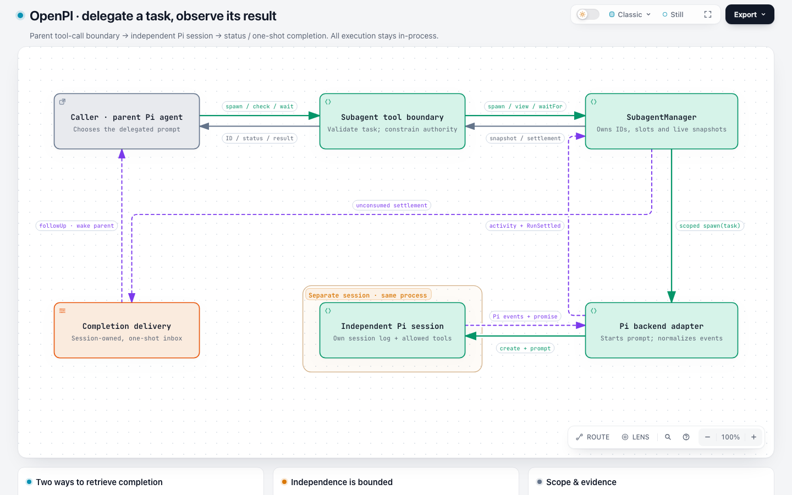 | 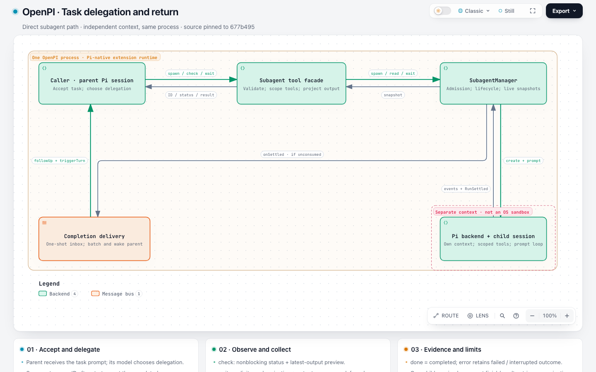 |

**base** — [final JSON](runs/openpi-base/workspace/output/openpi-subagents.json) · [HTML](runs/openpi-base/workspace/output/openpi-subagents.html) · [session](runs/openpi-base/evidence/session.jsonl) · [first JSON](runs/openpi-base/evidence/snapshots/d88eecabe6f50a775e90f914a62746a89182f1289d93ddad1c301fdac6b0edc5.json) · [replay](replay/openpi-base/) · [full page](captures/openpi-base/fullpage.light.png)
- Independent in-process Pi session, manager status snapshots, explicit wait versus one-shot follow-up delivery remain distinct. No OS worker or durable broker is invented.
- The final diagram uses only ordinary forward relations and no label markers; this run does not exercise the new presentation.
- Same final JSON delivers on both versions with identical canonical SVG and layout. Revision-count differences cannot be attributed to new markers.
- Source: [extensions/subagents/src/backends/pi.ts:216](https://github.com/openpi-dev/openpi/blob/677b4959108976b99fb63fb5029198b04aa51cb5/extensions/subagents/src/backends/pi.ts#L216) — The production backend creates a fresh AgentSession in-process with its own SessionManager and child tool policy.
- Source: [extensions/subagents/src/manager.ts:351](https://github.com/openpi-dev/openpi/blob/677b4959108976b99fb63fb5029198b04aa51cb5/extensions/subagents/src/manager.ts#L351) — Settlement records completed, failed or interrupted outcomes, clears live state, notifies waiters and invokes the settlement hook with consumption state.
- Source: [extensions/subagents/index.ts:797](https://github.com/openpi-dev/openpi/blob/677b4959108976b99fb63fb5029198b04aa51cb5/extensions/subagents/index.ts#L797) — The hook records subagent-finished, consumes explicit waits, and otherwise defers a snapshot for automatic delivery.
- Source: [extensions/subagents/src/result-delivery.ts:35](https://github.com/openpi-dev/openpi/blob/677b4959108976b99fb63fb5029198b04aa51cb5/extensions/subagents/src/result-delivery.ts#L35) — Owner-scoped inbox claim/ack/retry, idle flushing and explicit consumption govern one-shot result delivery.
- Source: [extensions/subagents/index.ts:441](https://github.com/openpi-dev/openpi/blob/677b4959108976b99fb63fb5029198b04aa51cb5/extensions/subagents/index.ts#L441) — Display transcript entry and hidden followUp/triggerTurn model message are separate outputs.
- Cross-replay: {"run_id": "openpi-base", "input_sha256": "45559fd747ff9297b521caded3014305a019bee52c618bea199c10595e8c85f6", "first_draft_validation_exit": 0, "base_layout_exit": 0, "base_deliver_exit": 0, "candidate_layout_exit": 0, "candidate_deliver_exit": 0, "identical_layout": true, "identical_canonical_svg": true}

**candidate** — [final JSON](runs/openpi-candidate/workspace/output/openpi-subagent.architecture.json) · [HTML](runs/openpi-candidate/workspace/output/openpi-subagent.html) · [session](runs/openpi-candidate/evidence/session.jsonl) · [first JSON](runs/openpi-candidate/evidence/snapshots/0e7c94ae253a39f69412c669fbe81f5d28ccd782427ce94338ee3723dd78f9ad.json) · [replay](replay/openpi-candidate/) · [full page](captures/openpi-candidate/fullpage.light.png)
- Independent in-process Pi session, manager status snapshots, explicit wait versus one-shot follow-up delivery remain distinct. No OS worker or durable broker is invented.
- The final diagram uses only ordinary forward relations and no label markers; this run does not exercise the new presentation.
- Same final JSON delivers on both versions with identical canonical SVG and layout. Revision-count differences cannot be attributed to new markers.
- Boundary title masks the child input/output routes; retained in ISSUES.md and reproducible on both versions.
- Source: [extensions/subagents/src/backends/pi.ts:216](https://github.com/openpi-dev/openpi/blob/677b4959108976b99fb63fb5029198b04aa51cb5/extensions/subagents/src/backends/pi.ts#L216) — The production backend creates a fresh AgentSession in-process with its own SessionManager and child tool policy.
- Source: [extensions/subagents/src/manager.ts:351](https://github.com/openpi-dev/openpi/blob/677b4959108976b99fb63fb5029198b04aa51cb5/extensions/subagents/src/manager.ts#L351) — Settlement records completed, failed or interrupted outcomes, clears live state, notifies waiters and invokes the settlement hook with consumption state.
- Source: [extensions/subagents/index.ts:797](https://github.com/openpi-dev/openpi/blob/677b4959108976b99fb63fb5029198b04aa51cb5/extensions/subagents/index.ts#L797) — The hook records subagent-finished, consumes explicit waits, and otherwise defers a snapshot for automatic delivery.
- Source: [extensions/subagents/src/result-delivery.ts:35](https://github.com/openpi-dev/openpi/blob/677b4959108976b99fb63fb5029198b04aa51cb5/extensions/subagents/src/result-delivery.ts#L35) — Owner-scoped inbox claim/ack/retry, idle flushing and explicit consumption govern one-shot result delivery.
- Source: [extensions/subagents/index.ts:441](https://github.com/openpi-dev/openpi/blob/677b4959108976b99fb63fb5029198b04aa51cb5/extensions/subagents/index.ts#L441) — Display transcript entry and hidden followUp/triggerTurn model message are separate outputs.
- Cross-replay: {"run_id": "openpi-candidate", "input_sha256": "fcddf35fa3ecd262e4630058d18e1fcc7de72d56c4ef269d512e22f78eabb97c", "first_draft_validation_exit": 0, "base_layout_exit": 0, "base_deliver_exit": 0, "candidate_layout_exit": 0, "candidate_deliver_exit": 0, "identical_layout": true, "identical_canonical_svg": true}

### hive

| Base | Candidate |
| --- | --- |
| 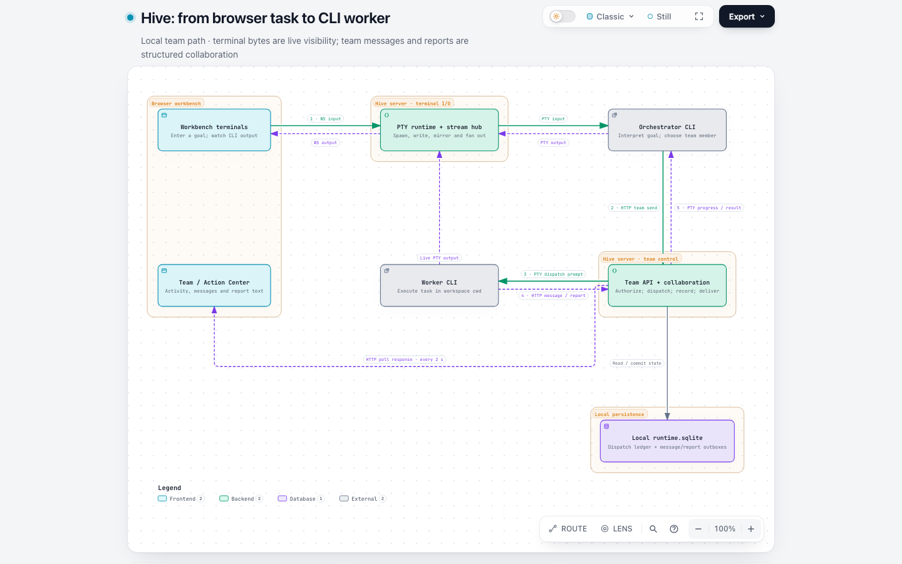 | 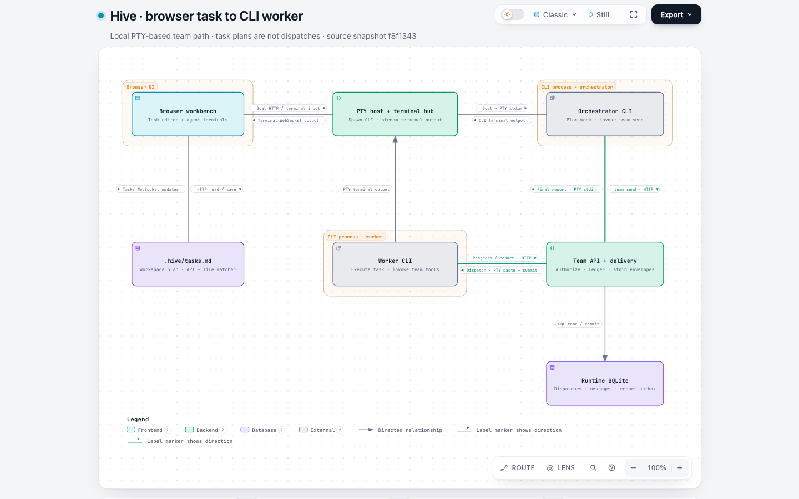 |

**base** — [final JSON](runs/hive-base/workspace/output/hive-task-path.json) · [HTML](runs/hive-base/workspace/output/hive-task-path.html) · [session](runs/hive-base/evidence/session.jsonl) · [first JSON](runs/hive-base/evidence/snapshots/41b61068c1fc15fbf1c822f905946eb8d455e773ee362e14f1e44dd979feb0a0.json) · [replay](replay/hive-base/) · [full page](captures/hive-base/fullpage.light.png)
- Task planning is distinct from worker dispatch; CLI agents execute under local PTYs and final report persistence is distinct from delivery.
- Two modified submitted candidates after first validation.
- Task-scoped progress is incorrectly included in the PTY result-return edge and summary card. The pinned store explicitly excludes progress from its delivery outbox. This is a baseline generation fact error, unchanged by replay on candidate.
- Two failed finalize rounds reported route-side and label-route collisions; final layout passes. No new presentation used.
- Source: [web/src/terminal/useTerminalRun.ts:640](https://github.com/tt-a1i/hive/blob/f8f1343da6595a232f0baba7f0ea5b5a58fe0e9c/web/src/terminal/useTerminalRun.ts#L640) — Browser terminal input calls sendInput; live output returns through the terminal client.
- Source: [src/server/routes-team.ts:127](https://github.com/tt-a1i/hive/blob/f8f1343da6595a232f0baba7f0ea5b5a58fe0e9c/src/server/routes-team.ts#L127) — Authenticated team send resolves dispatch and distinguishes parked user-managed workers from initial auto-start of spawned workers.
- Source: [src/server/agent-stdin-dispatcher.ts:286](https://github.com/tt-a1i/hive/blob/f8f1343da6595a232f0baba7f0ea5b5a58fe0e9c/src/server/agent-stdin-dispatcher.ts#L286) — Dispatch input is formatted and written only to an active process through the serialized writer.
- Source: [src/server/dispatch-message-store.ts:193](https://github.com/tt-a1i/hive/blob/f8f1343da6595a232f0baba7f0ea5b5a58fe0e9c/src/server/dispatch-message-store.ts#L193) — Task-scoped progress is recorded without a delivery-outbox row; it does not trigger model delivery.
- Source: [src/server/dispatch-ledger-store.ts:294](https://github.com/tt-a1i/hive/blob/f8f1343da6595a232f0baba7f0ea5b5a58fe0e9c/src/server/dispatch-ledger-store.ts#L294) — Report closure requires submitted owned work and the exact required inbound seen sequence.
- Source: [src/server/team-operations.ts:294](https://github.com/tt-a1i/hive/blob/f8f1343da6595a232f0baba7f0ea5b5a58fe0e9c/src/server/team-operations.ts#L294) — Report outbox draining marks delivery only after the orchestrator PTY write resolves.
- Source: [web/src/notifications/useReportNotifications.ts:36](https://github.com/tt-a1i/hive/blob/f8f1343da6595a232f0baba7f0ea5b5a58fe0e9c/web/src/notifications/useReportNotifications.ts#L36) — Report polling uses a server snapshot and subsequent pages to display new completion notifications.
- Cross-replay: {"run_id": "hive-base", "input_sha256": "0ad2946d45fe041349195d9e29c53baccfb0d99c47a8b441efdcd194bca0c6f6", "first_draft_validation_exit": 1, "base_layout_exit": 0, "base_deliver_exit": 0, "candidate_layout_exit": 0, "candidate_deliver_exit": 0, "identical_layout": true, "identical_canonical_svg": true}

**candidate** — [final JSON](runs/hive-candidate/workspace/output/candidate.json) · [HTML](runs/hive-candidate/workspace/output/hive-task-path.html) · [session](runs/hive-candidate/evidence/session.jsonl) · [first JSON](runs/hive-candidate/evidence/snapshots/eec4847ccdc02e6f3aa78fd71e7bbb9e71eeafa01979909670294f2aa1a7a766.json) · [replay](replay/hive-candidate/) · [full page](captures/hive-candidate/fullpage.light.png)
- Task planning is distinct from worker dispatch; CLI agents execute under local PTYs and final report persistence is distinct from delivery.
- Two modified submitted candidates after first validation.
- Ten label markers on five opposite-direction pairs were naturally selected without feature hints. IDs remain separate and every inspected direct Route selects the corresponding relationship.
- Horizontal and vertical direction cues remain attributable in light/dark, native SVG and PNG exports. All 12 edges remain forward; distinct input/output messages are not merged into both.
- Two voluntary refinements after first successful validation; a separate failed file-read command requested a nonexistent example, not a generation/renderer failure.
- Base rejects the new arrowPosition field as unsupported; that rejection is not a repaired baseline defect.
- Source: [web/src/terminal/useTerminalRun.ts:640](https://github.com/tt-a1i/hive/blob/f8f1343da6595a232f0baba7f0ea5b5a58fe0e9c/web/src/terminal/useTerminalRun.ts#L640) — Browser terminal input calls sendInput; live output returns through the terminal client.
- Source: [src/server/routes-team.ts:127](https://github.com/tt-a1i/hive/blob/f8f1343da6595a232f0baba7f0ea5b5a58fe0e9c/src/server/routes-team.ts#L127) — Authenticated team send resolves dispatch and distinguishes parked user-managed workers from initial auto-start of spawned workers.
- Source: [src/server/agent-stdin-dispatcher.ts:286](https://github.com/tt-a1i/hive/blob/f8f1343da6595a232f0baba7f0ea5b5a58fe0e9c/src/server/agent-stdin-dispatcher.ts#L286) — Dispatch input is formatted and written only to an active process through the serialized writer.
- Source: [src/server/dispatch-message-store.ts:193](https://github.com/tt-a1i/hive/blob/f8f1343da6595a232f0baba7f0ea5b5a58fe0e9c/src/server/dispatch-message-store.ts#L193) — Task-scoped progress is recorded without a delivery-outbox row; it does not trigger model delivery.
- Source: [src/server/dispatch-ledger-store.ts:294](https://github.com/tt-a1i/hive/blob/f8f1343da6595a232f0baba7f0ea5b5a58fe0e9c/src/server/dispatch-ledger-store.ts#L294) — Report closure requires submitted owned work and the exact required inbound seen sequence.
- Source: [src/server/team-operations.ts:294](https://github.com/tt-a1i/hive/blob/f8f1343da6595a232f0baba7f0ea5b5a58fe0e9c/src/server/team-operations.ts#L294) — Report outbox draining marks delivery only after the orchestrator PTY write resolves.
- Source: [web/src/notifications/useReportNotifications.ts:36](https://github.com/tt-a1i/hive/blob/f8f1343da6595a232f0baba7f0ea5b5a58fe0e9c/web/src/notifications/useReportNotifications.ts#L36) — Report polling uses a server snapshot and subsequent pages to display new completion notifications.
- Cross-replay: {"run_id": "hive-candidate", "input_sha256": "5624e40aeb8b6a1f78a32ee3ac97b382352ce677c4510b4a6e134e066f6e4ee9", "first_draft_validation_exit": 0, "base_layout_exit": 1, "base_deliver_exit": 1, "candidate_layout_exit": 0, "candidate_deliver_exit": 0, "identical_layout": null}

### mco

| Base | Candidate |
| --- | --- |
| 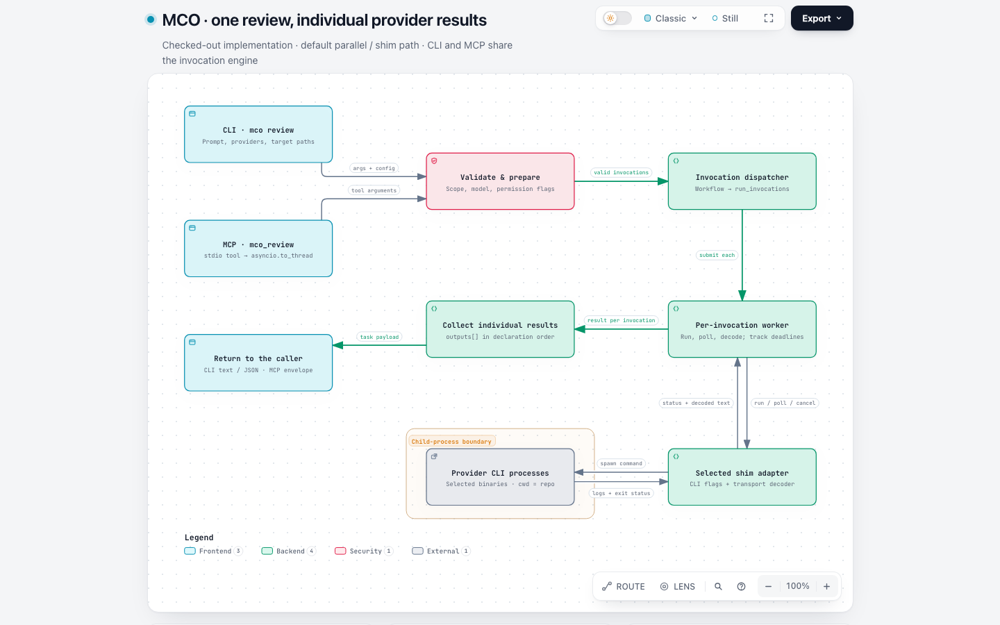 | 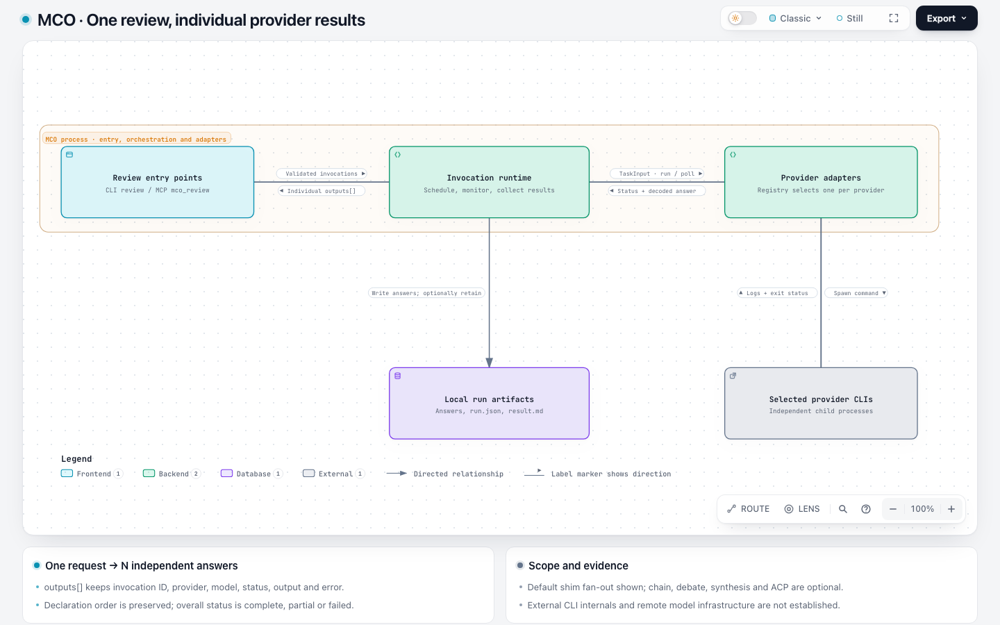 |

**base** — [final JSON](runs/mco-base/workspace/output/mco-review.json) · [HTML](runs/mco-base/workspace/output/mco-review.html) · [session](runs/mco-base/evidence/session.jsonl) · [first JSON](runs/mco-base/evidence/snapshots/b7b139abec7dbe394420c17e6ee32d1f69a17e0d955417efefac9f945b45ebbe.json) · [replay](replay/mco-base/) · [full page](captures/mco-base/fullpage.light.png)
- Selected invocations run independently through adapters and local provider processes; declaration order is retained in results. Read-only is a configurable default, not an unconditional sandbox.
- Individual failures remain in the result payload and aggregate complete/partial/failed status is distinct from synthesis.
- One voluntary revision after a passing first validation. A nonzero source/package lookup command is retained separately from product diagnostics.
- Uses ordinary endpoint arrows; replay on candidate produces identical layout and canonical SVG.
- Source: [runtime/cli.py:1522](https://github.com/mco-org/mco/blob/3cfce130362dbcc2aedda6170d1a31e39cf67d3e/runtime/cli.py#L1522) — Review defaults to read_only while allowing explicit execution-policy configuration.
- Source: [runtime/cli.py:2248](https://github.com/mco-org/mco/blob/3cfce130362dbcc2aedda6170d1a31e39cf67d3e/runtime/cli.py#L2248) — Unknown providers and invalid configuration are rejected before dispatching the invocation workflow.
- Source: [runtime/invocation_runtime.py:188](https://github.com/mco-org/mco/blob/3cfce130362dbcc2aedda6170d1a31e39cf67d3e/runtime/invocation_runtime.py#L188) — Each worker builds a TaskInput and retains startup failures as invocation results.
- Source: [runtime/invocation_runtime.py:349](https://github.com/mco-org/mco/blob/3cfce130362dbcc2aedda6170d1a31e39cf67d3e/runtime/invocation_runtime.py#L349) — The worker reads raw logs, decodes output, emits deltas and observes timeout/cancellation.
- Source: [runtime/invocation_runtime.py:498](https://github.com/mco-org/mco/blob/3cfce130362dbcc2aedda6170d1a31e39cf67d3e/runtime/invocation_runtime.py#L498) — Thread-pool futures execute independently and their results are stored at original declaration indexes.
- Source: [runtime/invocation_runtime.py:600](https://github.com/mco-org/mco/blob/3cfce130362dbcc2aedda6170d1a31e39cf67d3e/runtime/invocation_runtime.py#L600) — Individual success counts determine complete/partial/failed and persistent versus temporary artifact handling.
- Source: [runtime/adapters/shim.py:115](https://github.com/mco-org/mco/blob/3cfce130362dbcc2aedda6170d1a31e39cf67d3e/runtime/adapters/shim.py#L115) — The shim launches a subprocess in repo_root with stdout/stderr redirected to files.
- Source: [runtime/cli.py:2482](https://github.com/mco-org/mco/blob/3cfce130362dbcc2aedda6170d1a31e39cf67d3e/runtime/cli.py#L2482) — The CLI returns the payload's exit code and prints the final JSON in JSON mode.
- Cross-replay: {"run_id": "mco-base", "input_sha256": "2cbd1024a90e5f6f4e7884b0deb75f821eda67d78c81ecf841ea8ec8765b591a", "first_draft_validation_exit": 0, "base_layout_exit": 0, "base_deliver_exit": 0, "candidate_layout_exit": 0, "candidate_deliver_exit": 0, "identical_layout": true, "identical_canonical_svg": true}

**candidate** — [final JSON](runs/mco-candidate/workspace/output/candidate.json) · [HTML](runs/mco-candidate/workspace/output/mco-review.html) · [session](runs/mco-candidate/evidence/session.jsonl) · [first JSON](runs/mco-candidate/evidence/snapshots/4b9fb3ea0ac096131e9c3088d54182001842a4e046d2f8e4f07db50a8e5e3826.json) · [replay](replay/mco-candidate/) · [full page](captures/mco-candidate/fullpage.light.png)
- Selected invocations run independently through adapters and local provider processes; declaration order is retained in results. Read-only is a configurable default, not an unconditional sandbox.
- Individual failures remain in the result payload and aggregate complete/partial/failed status is distinct from synthesis.
- One voluntary revision after a passing first validation. A nonzero source/package lookup command is retained separately from product diagnostics.
- Six label arrows naturally express three distinct request/return pairs. Vertical and horizontal cues, corresponding direct Route IDs and light/dark exports are preserved.
- The older base rejects the opt-in field; unsupported capability is not scored as a baseline rendering defect.
- Source: [runtime/cli.py:1522](https://github.com/mco-org/mco/blob/3cfce130362dbcc2aedda6170d1a31e39cf67d3e/runtime/cli.py#L1522) — Review defaults to read_only while allowing explicit execution-policy configuration.
- Source: [runtime/cli.py:2248](https://github.com/mco-org/mco/blob/3cfce130362dbcc2aedda6170d1a31e39cf67d3e/runtime/cli.py#L2248) — Unknown providers and invalid configuration are rejected before dispatching the invocation workflow.
- Source: [runtime/invocation_runtime.py:188](https://github.com/mco-org/mco/blob/3cfce130362dbcc2aedda6170d1a31e39cf67d3e/runtime/invocation_runtime.py#L188) — Each worker builds a TaskInput and retains startup failures as invocation results.
- Source: [runtime/invocation_runtime.py:349](https://github.com/mco-org/mco/blob/3cfce130362dbcc2aedda6170d1a31e39cf67d3e/runtime/invocation_runtime.py#L349) — The worker reads raw logs, decodes output, emits deltas and observes timeout/cancellation.
- Source: [runtime/invocation_runtime.py:498](https://github.com/mco-org/mco/blob/3cfce130362dbcc2aedda6170d1a31e39cf67d3e/runtime/invocation_runtime.py#L498) — Thread-pool futures execute independently and their results are stored at original declaration indexes.
- Source: [runtime/invocation_runtime.py:600](https://github.com/mco-org/mco/blob/3cfce130362dbcc2aedda6170d1a31e39cf67d3e/runtime/invocation_runtime.py#L600) — Individual success counts determine complete/partial/failed and persistent versus temporary artifact handling.
- Source: [runtime/adapters/shim.py:115](https://github.com/mco-org/mco/blob/3cfce130362dbcc2aedda6170d1a31e39cf67d3e/runtime/adapters/shim.py#L115) — The shim launches a subprocess in repo_root with stdout/stderr redirected to files.
- Source: [runtime/cli.py:2482](https://github.com/mco-org/mco/blob/3cfce130362dbcc2aedda6170d1a31e39cf67d3e/runtime/cli.py#L2482) — The CLI returns the payload's exit code and prints the final JSON in JSON mode.
- Cross-replay: {"run_id": "mco-candidate", "input_sha256": "a9072dfc4de29b635bc5f9bd96d83ee29a51fcb74fb8cae96adae2549a287a24", "first_draft_validation_exit": 0, "base_layout_exit": 1, "base_deliver_exit": 1, "candidate_layout_exit": 0, "candidate_deliver_exit": 0, "identical_layout": null}

### squad

| Base | Candidate |
| --- | --- |
| 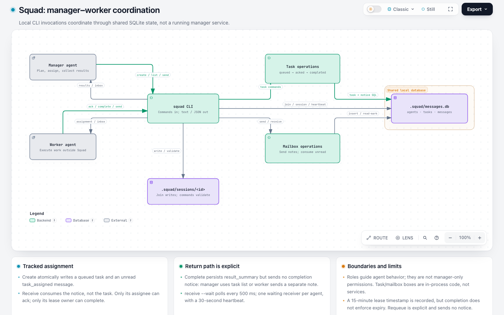 | 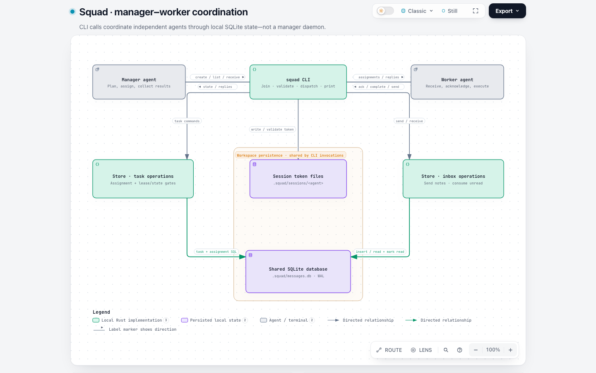 |

**base** — [final JSON](runs/squad-base/workspace/output/candidate.json) · [HTML](runs/squad-base/workspace/output/squad-coordination.html) · [session](runs/squad-base/evidence/session.jsonl) · [first JSON](runs/squad-base/evidence/snapshots/c5a67f0f3d1e0bdc4931268ad972475e309b08f27e618a69d0f97e13c4d40fd5.json) · [replay](replay/squad-base/) · [full page](captures/squad-base/fullpage.light.png)
- Task creation records the assignment; receive marks a message read independently of ack. Complete requires matching lease ownership and acked status, but does not send a result message or enforce lease expiry.
- Task/message operations are local Store code, role instructions are guidance rather than a manager-only authorization boundary.
- No both relation was used in either arm in this sample; the earlier both misuse is retained under its original run and cannot be declared eliminated.
- Uses ordinary forward relationships and endpoint arrows. One voluntary boundary cleanup; one nonexistent example read failed before generation.
- Source: [src/store.rs:452](https://github.com/mco-org/squad/blob/8146bcc1c38c439aedaf3ff44548c830654c8621/src/store.rs#L452) — Create atomically inserts the task and initial assignment.
- Source: [src/store.rs:340](https://github.com/mco-org/squad/blob/8146bcc1c38c439aedaf3ff44548c830654c8621/src/store.rs#L340) — Receiving a mailbox message marks it read independently of task acknowledgment.
- Source: [src/store.rs:624](https://github.com/mco-org/squad/blob/8146bcc1c38c439aedaf3ff44548c830654c8621/src/store.rs#L624) — Ack requires queued state and matching assignee and records a lease.
- Source: [src/store.rs:653](https://github.com/mco-org/squad/blob/8146bcc1c38c439aedaf3ff44548c830654c8621/src/store.rs#L653) — Complete requires acked state and ownership but does not check lease expiry or send a report.
- Source: [src/store.rs:681](https://github.com/mco-org/squad/blob/8146bcc1c38c439aedaf3ff44548c830654c8621/src/store.rs#L681) — Requeue clears the lease and may change assignment without creating a result message.
- Source: [src/session.rs:50](https://github.com/mco-org/squad/blob/8146bcc1c38c439aedaf3ff44548c830654c8621/src/session.rs#L50) — An absent token file preserves the compatibility path.
- Source: [src/main.rs:786](https://github.com/mco-org/squad/blob/8146bcc1c38c439aedaf3ff44548c830654c8621/src/main.rs#L786) — Waiting uses a per-agent receive lock, periodic polling and lock heartbeat.
- Cross-replay: {"run_id": "squad-base", "input_sha256": "ba9c4631b436b5d20c11ce20a339f20f3c2a12250a1ef042a666f1e26223e275", "first_draft_validation_exit": 0, "base_layout_exit": 0, "base_deliver_exit": 0, "candidate_layout_exit": 0, "candidate_deliver_exit": 0, "identical_layout": true, "identical_canonical_svg": true}

**candidate** — [final JSON](runs/squad-candidate/workspace/output/squad-coordination.json) · [HTML](runs/squad-candidate/workspace/output/squad-coordination.html) · [session](runs/squad-candidate/evidence/session.jsonl) · [first JSON](runs/squad-candidate/evidence/snapshots/df259c1958d3c93abfcfe5125d36a53c55f1936a15325b89842cf207198a9534.json) · [replay](replay/squad-candidate/) · [full page](captures/squad-candidate/fullpage.light.png)
- Task creation records the assignment; receive marks a message read independently of ack. Complete requires matching lease ownership and acked status, but does not send a result message or enforce lease expiry.
- Task/message operations are local Store code, role instructions are guidance rather than a manager-only authorization boundary.
- No both relation was used in either arm in this sample; the earlier both misuse is retained under its original run and cannot be declared eliminated.
- After the first successful check, the Agent added separate manager/worker return edges and 4 label arrows on 2 shared paths, plus prose cleanup. This is a voluntary semantic/presentation revision, not first-draft completeness.
- Four direct Route checks select the matching edge ID; the shared paths do not collapse command/output meanings.
- An ordinary session-token route is hidden by the workspace boundary-title background. A reduced unchanged-geometry case delivers identically on base and candidate; retained separately from new marker capability.
- Source: [src/store.rs:452](https://github.com/mco-org/squad/blob/8146bcc1c38c439aedaf3ff44548c830654c8621/src/store.rs#L452) — Create atomically inserts the task and initial assignment.
- Source: [src/store.rs:340](https://github.com/mco-org/squad/blob/8146bcc1c38c439aedaf3ff44548c830654c8621/src/store.rs#L340) — Receiving a mailbox message marks it read independently of task acknowledgment.
- Source: [src/store.rs:624](https://github.com/mco-org/squad/blob/8146bcc1c38c439aedaf3ff44548c830654c8621/src/store.rs#L624) — Ack requires queued state and matching assignee and records a lease.
- Source: [src/store.rs:653](https://github.com/mco-org/squad/blob/8146bcc1c38c439aedaf3ff44548c830654c8621/src/store.rs#L653) — Complete requires acked state and ownership but does not check lease expiry or send a report.
- Source: [src/store.rs:681](https://github.com/mco-org/squad/blob/8146bcc1c38c439aedaf3ff44548c830654c8621/src/store.rs#L681) — Requeue clears the lease and may change assignment without creating a result message.
- Source: [src/session.rs:50](https://github.com/mco-org/squad/blob/8146bcc1c38c439aedaf3ff44548c830654c8621/src/session.rs#L50) — An absent token file preserves the compatibility path.
- Source: [src/main.rs:786](https://github.com/mco-org/squad/blob/8146bcc1c38c439aedaf3ff44548c830654c8621/src/main.rs#L786) — Waiting uses a per-agent receive lock, periodic polling and lock heartbeat.
- Cross-replay: {"run_id": "squad-candidate", "input_sha256": "b194a441159518aa176eb6065fcfb36da0e177146afc0e07013168d55acd7a9d", "first_draft_validation_exit": 0, "base_layout_exit": 1, "base_deliver_exit": 1, "candidate_layout_exit": 0, "candidate_deliver_exit": 0, "identical_layout": null}

### skillroster

| Base | Candidate |
| --- | --- |
| 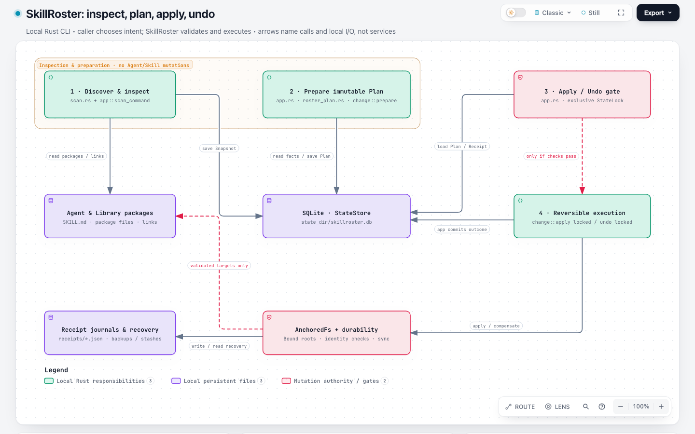 | 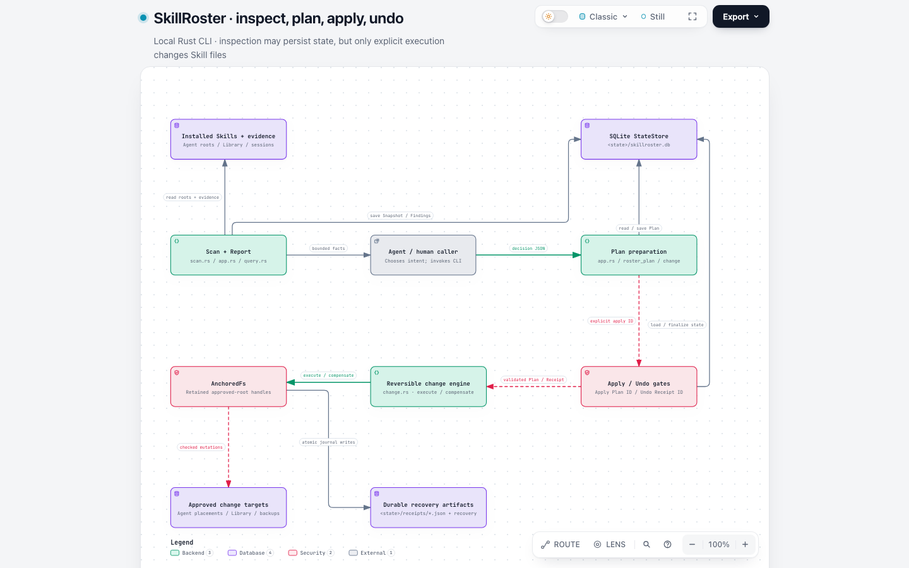 |

**base** — [final JSON](runs/skillroster-base/workspace/output/candidate.json) · [HTML](runs/skillroster-base/workspace/output/skillroster-architecture.html) · [session](runs/skillroster-base/evidence/session.jsonl) · [first JSON](runs/skillroster-base/evidence/snapshots/9ac09203998529fdaf6e3d7c4dd439a430ff115995628ea7d7ff189cf37f3a1a.json) · [replay](replay/skillroster-base/) · [full page](captures/skillroster-base/fullpage.light.png)
- Inspection and planning persist control state but do not execute Skill-content mutations. Discovery is separate from mutation authority.
- Apply and Undo are explicit commands with live-state rechecks; Undo reverses stored receipt compensations, not a new semantic plan. JSON mode does not enforce an extra confirmation prompt.
- Filesystem journals and SQLite are distinct persistence layers; failure/recovery limitations are disclosed.
- One voluntary revision removed a redundant boundary after passing validation. Two failed lookup commands came from nonexistent paths/globs, not diagram diagnostics.
- No new direction or label-arrow field was used. Unchanged final bytes deliver with identical layout and SVG on both versions.
- Source: [src/scan.rs:984](https://github.com/tt-a1i/skillroster/blob/21d14c7cff25c66a016562e238e62d0538eb696f/src/scan.rs#L984) — Discovery observes approved roots and bounded session evidence; read scope does not confer mutation authority.
- Source: [src/app.rs:1733](https://github.com/tt-a1i/skillroster/blob/21d14c7cff25c66a016562e238e62d0538eb696f/src/app.rs#L1733) — Scan persists a Snapshot in local control state without applying Skill-content operations.
- Source: [src/app.rs:8223](https://github.com/tt-a1i/skillroster/blob/21d14c7cff25c66a016562e238e62d0538eb696f/src/app.rs#L8223) — Plan preparation binds declarative intent and evidence to the latest Snapshot and saves an immutable prepared plan.
- Source: [src/app.rs:345](https://github.com/tt-a1i/skillroster/blob/21d14c7cff25c66a016562e238e62d0538eb696f/src/app.rs#L345) — Apply and Undo are separate commands; interactive confirmation is bypassed in JSON mode.
- Source: [src/app.rs:8479](https://github.com/tt-a1i/skillroster/blob/21d14c7cff25c66a016562e238e62d0538eb696f/src/app.rs#L8479) — Apply requires a Ready plan and rechecks recovery, Snapshot, bindings, evidence and governance state.
- Source: [src/app.rs:8601](https://github.com/tt-a1i/skillroster/blob/21d14c7cff25c66a016562e238e62d0538eb696f/src/app.rs#L8601) — Undo requires an Applied receipt and rejects an existing reverse receipt.
- Source: [src/change.rs:1954](https://github.com/tt-a1i/skillroster/blob/21d14c7cff25c66a016562e238e62d0538eb696f/src/change.rs#L1954) — Undo reverses recorded compensations in reverse order, checking expected fingerprints or absent destinations.
- Cross-replay: {"run_id": "skillroster-base", "input_sha256": "c9837239f9b67768a706b1910d11ea381dcbab75ba8fafc806fa37fb2ef6d121", "first_draft_validation_exit": 0, "base_layout_exit": 0, "base_deliver_exit": 0, "candidate_layout_exit": 0, "candidate_deliver_exit": 0, "identical_layout": true, "identical_canonical_svg": true}

**candidate** — [final JSON](runs/skillroster-candidate/workspace/output/candidate.json) · [HTML](runs/skillroster-candidate/workspace/output/skillroster-architecture.html) · [session](runs/skillroster-candidate/evidence/session.jsonl) · [first JSON](runs/skillroster-candidate/evidence/snapshots/760655b64411cb2dfa3ba0ceda5c18ba69084aebc1ec4fa4c2159cef0684b661.json) · [replay](replay/skillroster-candidate/) · [full page](captures/skillroster-candidate/fullpage.light.png)
- The overview retains inspection versus Skill-content mutation, latest-Snapshot/evidence validation, independent Apply/Undo commands and receipt-based reversal.
- The Plan-to-gate arrow is explicitly labeled apply ID and the node/card state a separate invocation; it does not establish an automatic apply step.
- The first submitted input failed the projected-text floor at 5.47px. One diagnostic-driven revision compacted it; a later voluntary revision clarified Apply/Undo IDs and moved the state route endpoint.
- Final native context labels are approximately 6.67px: above the 6px failure floor but below the preferred 7.5px target. The taller full-page image reflows larger and is not evidence of better 1440x900 readability; see ISSUES.md.
- No new direction or label-arrow field was used. Unchanged final bytes deliver with identical layout and SVG on both versions.
- Source: [src/scan.rs:984](https://github.com/tt-a1i/skillroster/blob/21d14c7cff25c66a016562e238e62d0538eb696f/src/scan.rs#L984) — Discovery observes approved roots and bounded session evidence; read scope does not confer mutation authority.
- Source: [src/app.rs:1733](https://github.com/tt-a1i/skillroster/blob/21d14c7cff25c66a016562e238e62d0538eb696f/src/app.rs#L1733) — Scan persists a Snapshot in local control state without applying Skill-content operations.
- Source: [src/app.rs:8223](https://github.com/tt-a1i/skillroster/blob/21d14c7cff25c66a016562e238e62d0538eb696f/src/app.rs#L8223) — Plan preparation binds declarative intent and evidence to the latest Snapshot and saves an immutable prepared plan.
- Source: [src/app.rs:345](https://github.com/tt-a1i/skillroster/blob/21d14c7cff25c66a016562e238e62d0538eb696f/src/app.rs#L345) — Apply and Undo are separate commands; interactive confirmation is bypassed in JSON mode.
- Source: [src/app.rs:8479](https://github.com/tt-a1i/skillroster/blob/21d14c7cff25c66a016562e238e62d0538eb696f/src/app.rs#L8479) — Apply requires a Ready plan and rechecks recovery, Snapshot, bindings, evidence and governance state.
- Source: [src/app.rs:8601](https://github.com/tt-a1i/skillroster/blob/21d14c7cff25c66a016562e238e62d0538eb696f/src/app.rs#L8601) — Undo requires an Applied receipt and rejects an existing reverse receipt.
- Source: [src/change.rs:1954](https://github.com/tt-a1i/skillroster/blob/21d14c7cff25c66a016562e238e62d0538eb696f/src/change.rs#L1954) — Undo reverses recorded compensations in reverse order, checking expected fingerprints or absent destinations.
- Cross-replay: {"run_id": "skillroster-candidate", "input_sha256": "1547fb0d3138280167c34f44c48247dee157b13f8a15188aefb90e98ed51effe", "first_draft_validation_exit": 1, "base_layout_exit": 0, "base_deliver_exit": 0, "candidate_layout_exit": 0, "candidate_deliver_exit": 0, "identical_layout": true, "identical_canonical_svg": true}

### shared-messages

| Base | Candidate |
| --- | --- |
| 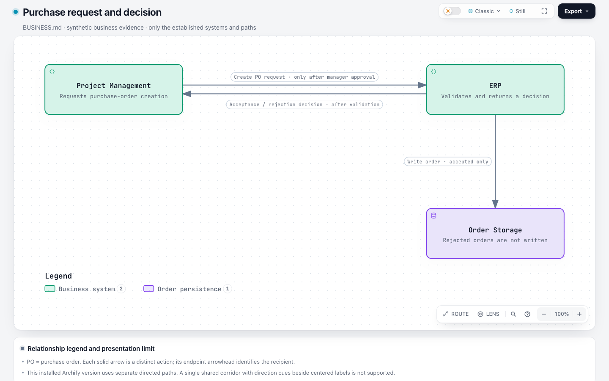 | 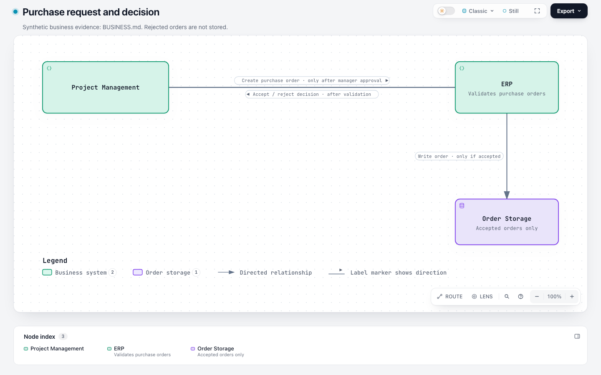 |

**base** — [final JSON](runs/shared-messages-base/workspace/output/purchase-order.architecture.json) · [HTML](runs/shared-messages-base/workspace/output/purchase-order.html) · [session](runs/shared-messages-base/evidence/session.jsonl) · [first JSON](runs/shared-messages-base/evidence/snapshots/0f6dfee87b4204563e887104cf89e3c25037fae8e0143b88216d904fdc0d72fa.json) · [replay](replay/shared-messages-base/) · [full page](captures/shared-messages-base/fullpage.light.png)
- The manager-approved purchase request and post-validation accept/reject decision retain distinct IDs and directions. Only accepted orders are stored; no systems or source citations were invented.
- The Agent reported the installed tool limitation and used two parallel endpoint-arrow paths. This preserves the business facts but does not satisfy the requested shared corridor with label-adjacent direction cues.
- Endpoint arrows were not forbidden by the benchmark prompt; the finding concerns the expressly requested shared-label presentation, not an invented extra acceptance criterion.
- One voluntary revision trimmed redundant supporting text after a passing first check. Two failed commands were missing example/glob lookups.
- Original final bytes render identically on both versions.
- Cross-replay: {"run_id": "shared-messages-base", "input_sha256": "bbf0684fac131acc535b04c27753990c33415b168638691abc0c33c56d184dd0", "first_draft_validation_exit": 0, "base_layout_exit": 0, "base_deliver_exit": 0, "candidate_layout_exit": 0, "candidate_deliver_exit": 0, "identical_layout": true, "identical_canonical_svg": true}

**candidate** — [final JSON](runs/shared-messages-candidate/workspace/output/purchase-request.architecture.json) · [HTML](runs/shared-messages-candidate/workspace/output/purchase-request.html) · [session](runs/shared-messages-candidate/evidence/session.jsonl) · [first JSON](runs/shared-messages-candidate/evidence/snapshots/69cfdf5fcd6a453055841b316d1146507ec1353a4dce7b6750b48396bfcc2493.json) · [replay](replay/shared-messages-candidate/) · [full page](captures/shared-messages-candidate/fullpage.light.png)
- The two differently conditioned actions remain separate forward identities. Accepted-only storage and rejected-order exclusion match BUSINESS.md.
- Two label arrows use one explicit straight corridor with centered opposite-side labels. Light/dark presentation and native SVG/PNG exports retain labels and direction cues without redundant endpoint arrows.
- Direct Route from Project Management to ERP selects only approved-purchase-request; the reverse selects only validated-purchase-decision. Visual path sharing does not merge the relationships.
- One voluntary revision removed redundant node prose after first-check success. One failed source-example lookup is retained.
- Base rejects arrowPosition as unsupported. This is new presentation capability, not proof of fixing a previously supported renderer failure or reducing model rework.
- Cross-replay: {"run_id": "shared-messages-candidate", "input_sha256": "d038964dc99e7a6a24d120efa73c33472f829e0e2847afb7f1d4ccc43fc50b7b", "first_draft_validation_exit": 0, "base_layout_exit": 1, "base_deliver_exit": 1, "candidate_layout_exit": 0, "candidate_deliver_exit": 0, "identical_layout": null}

## Audit limits and retention

- Full scheduled failures, timeouts, revisions and provider errors remain in native sessions. No successful retry replaces a prior run. Source/package integrity and artifact receipt hashes are recorded in [observations.json](observations.json).
- First-draft validation is a replay of captured original bytes on its original arm. First-draft semantics and readability are unverified unless a review explicitly says otherwise. A final passing diagram is not first-draft success.
- Base rejection of new fields is reported as unsupported capability, not a regression or proof of fewer repairs. New metadata never gets removed for a passing replay.
- Timings are descriptive only: local gateway/network delay and provider queue time are not separated. Reasoning usage is unavailable when the client does not report it. No fabricated cost estimate is supplied.
- Active evidence-assembly labor was not separately timed while generation and inspection overlapped; it is unavailable. Maintainer review time is not applicable because no maintainer review has occurred.
- Local evidence location: `/evidence/issue-1139/benchmark-label-arrows-20261104`. No public upload, GitHub comment, or maintainer sign-off is implied. Archive digest and retention are in [bundle-notes.md](bundle-notes.md); the manifest records the literal configured-credential scan and its limits.
