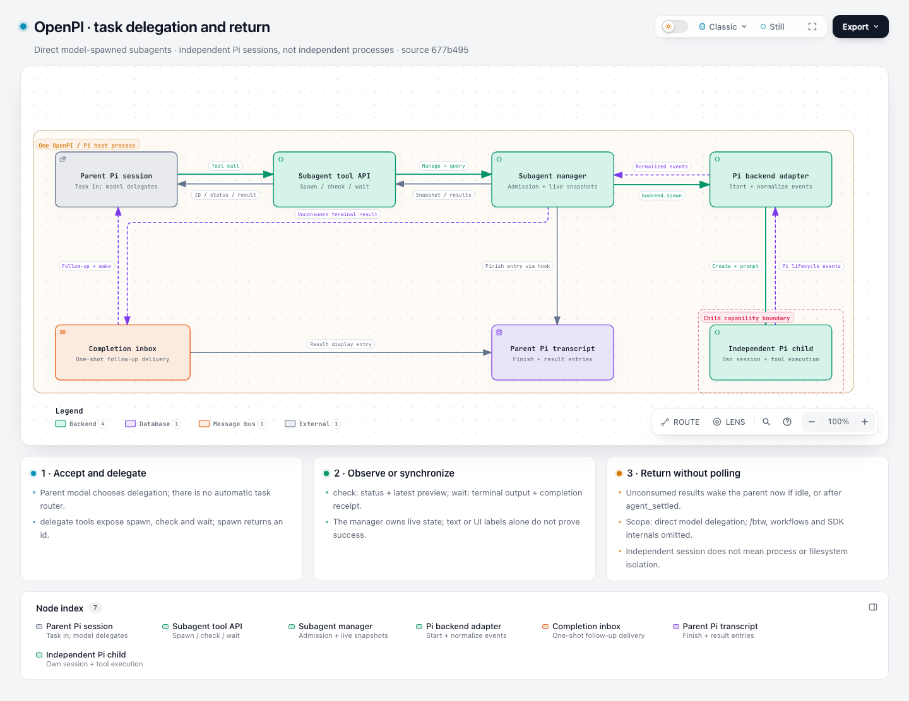
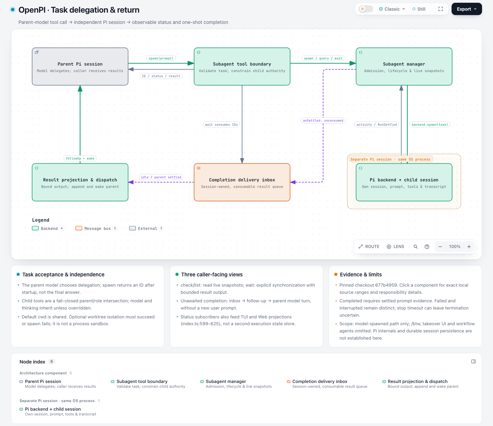
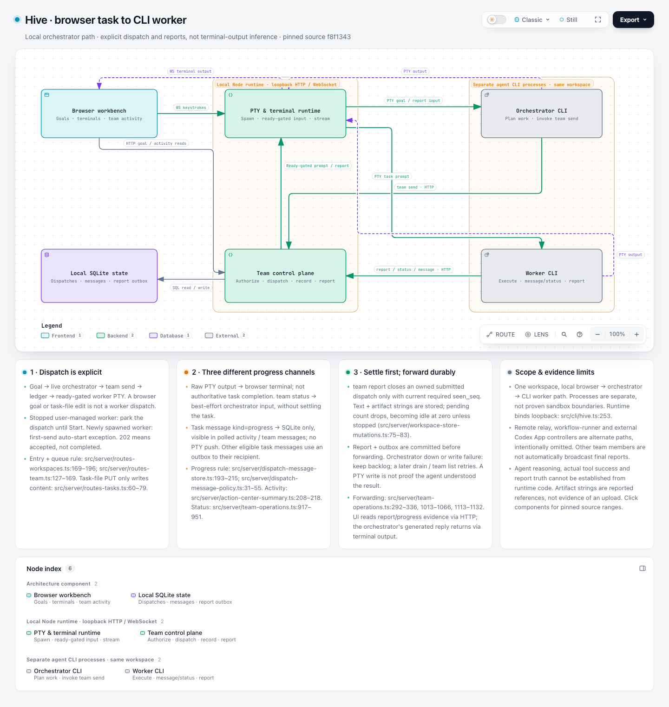
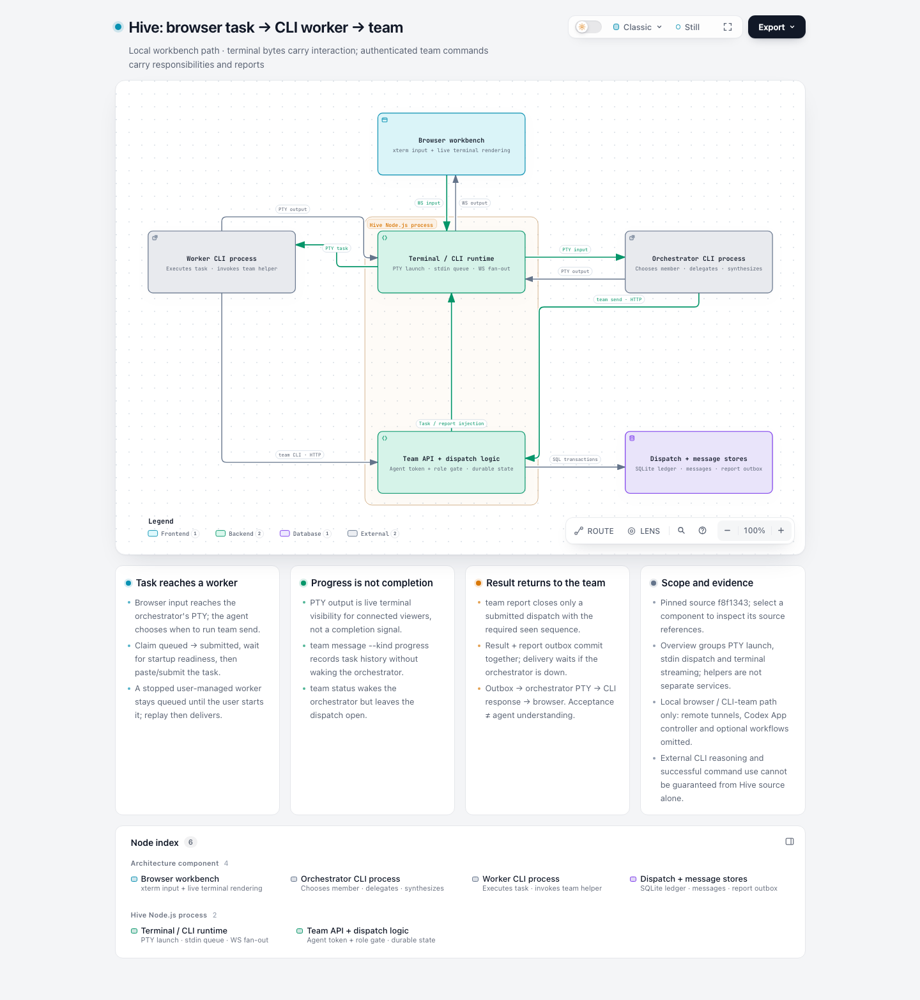
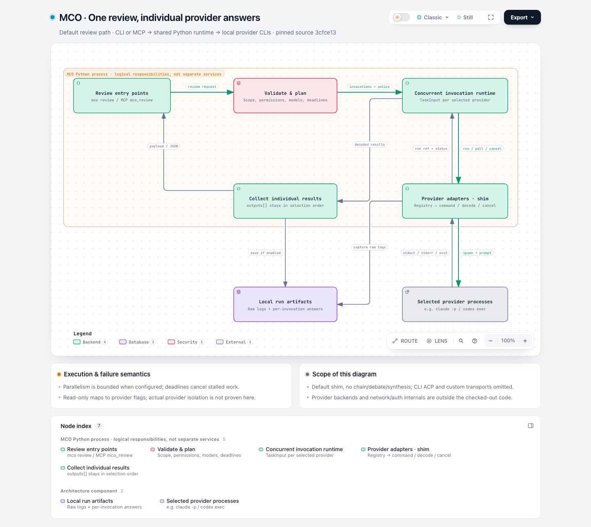
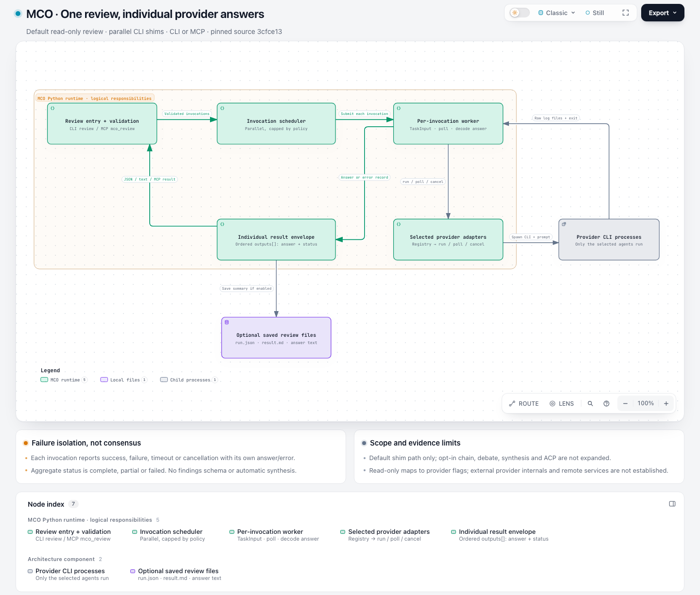
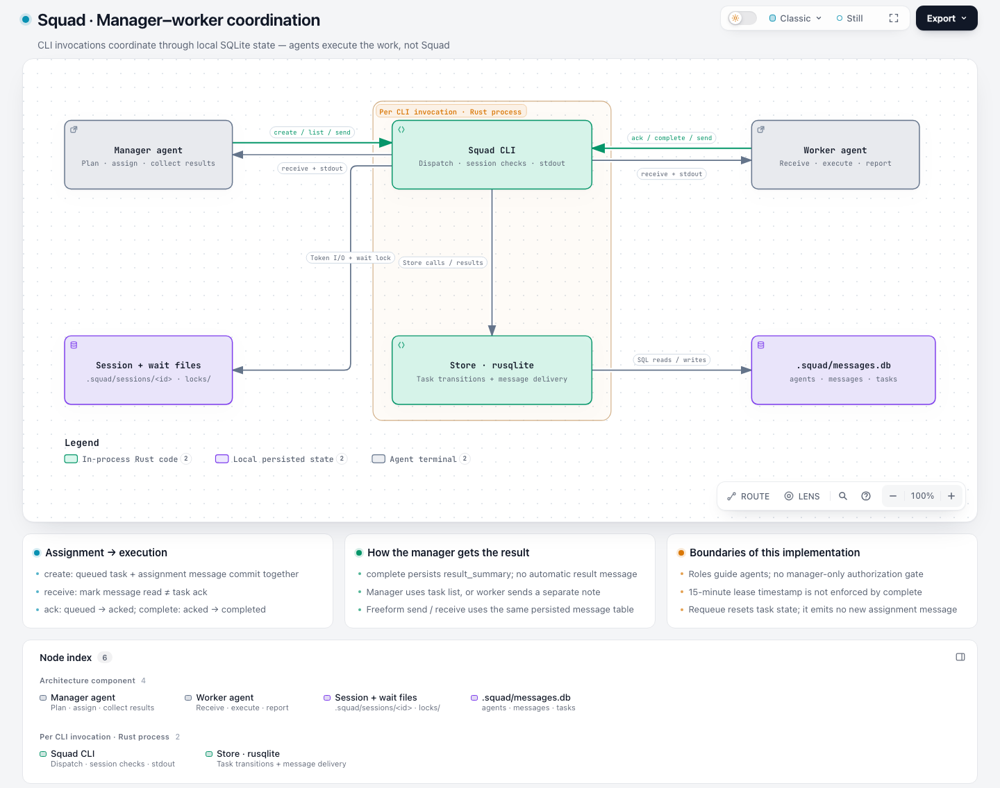
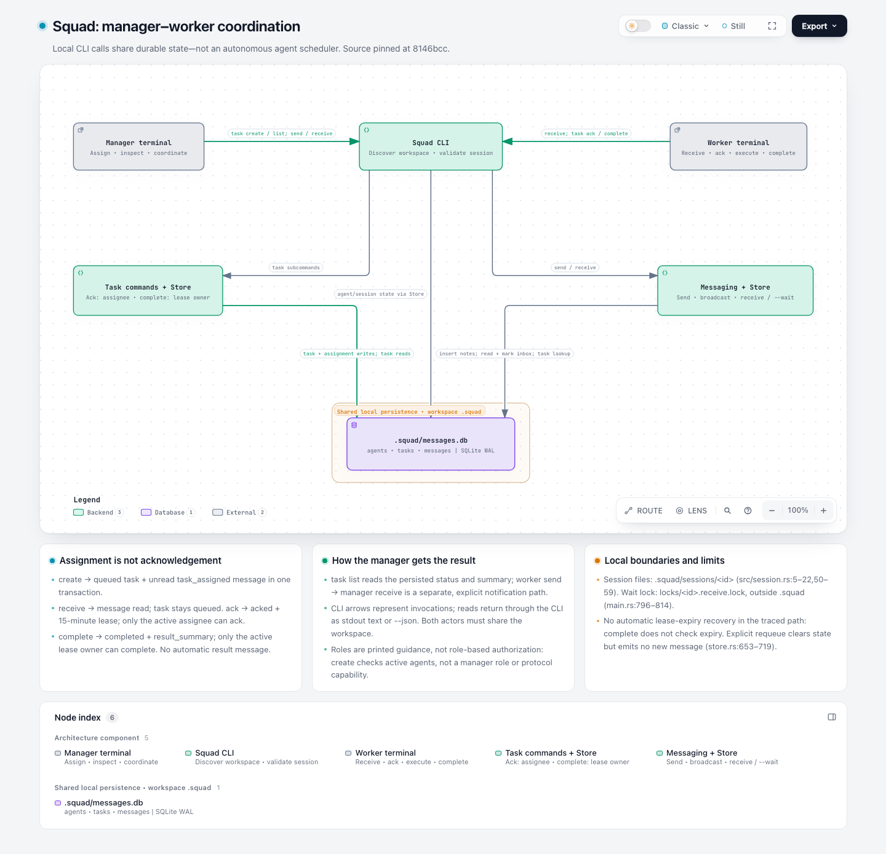
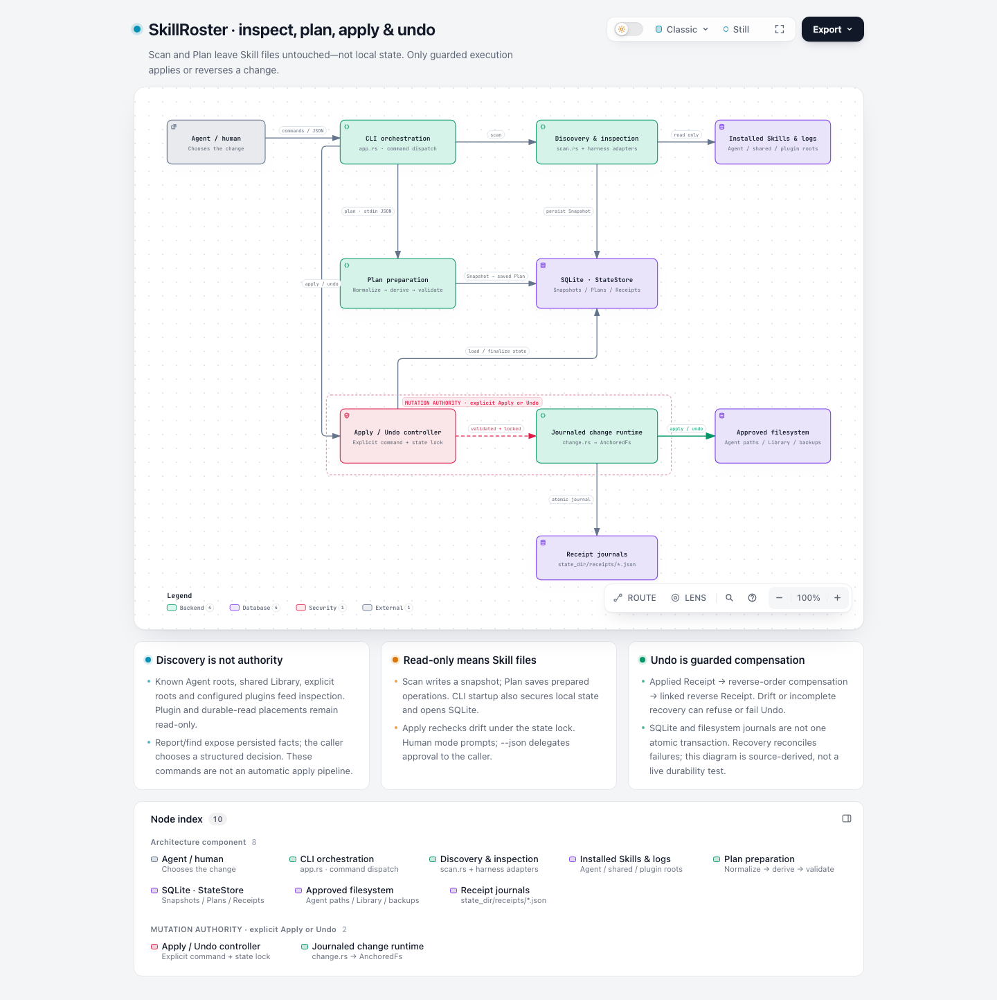
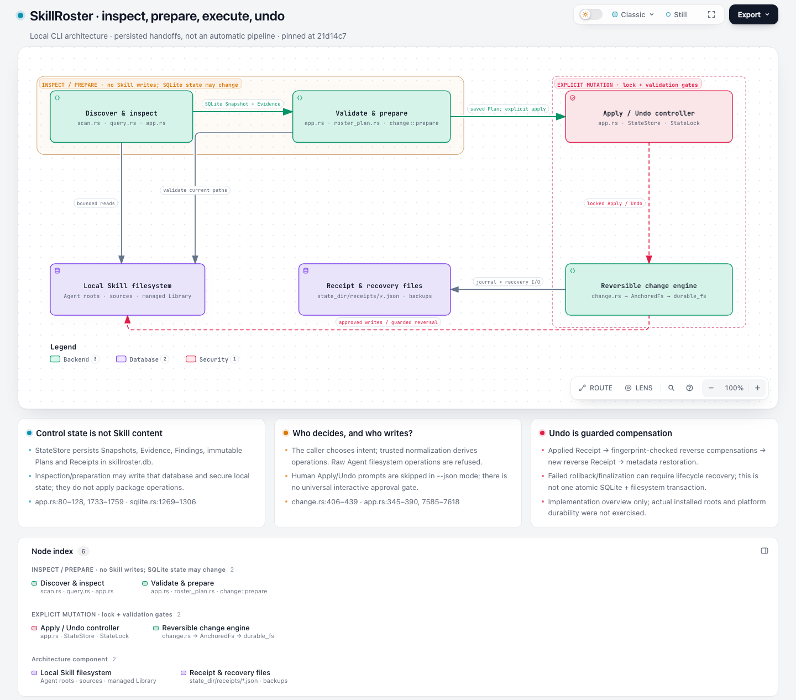

# Generation comparison: PR #1184

Status: **10/10 sessions completed**. Final semantic/visual reviews recorded: 10/10. This is an author-side maintenance Codex report, not independent human acceptance.

## Decision summary

All ten scheduled sessions delivered final artifacts with matching current receipts; none timed out or reported a provider-error event. Author-side review marks nine semantically correct and eight readable. These are separate observations, not an aggregate pass score. All ten frozen final JSON inputs pass on both code versions and produce identical layouts and canonical diagram SVG.

Quality finding: the Hive base run passes CLI delivery but fails source/visual review. It promotes an uncalled browser HTTP helper to an active UI entry, and long boundary-title masks obscure the top return-route legs. Both defects remain when replaying that exact JSON on candidate; they are not a new renderer regression or evidence that relative coordinates improve fresh generation. The original artifact is retained unchanged. See the paired Hive review below.

Candidate-run quality gap: Squad candidate has correct source semantics but its database boundary title masks two incoming route legs. Automated delivery passes; author-side readability is marked issues. The same frozen JSON has identical geometry/SVG on base, so this is an existing presentation/authoring problem rather than a demonstrated PR regression. It remains visible in the report and needs an explicit quality decision; this benchmark is not an all-pass claim.

Retained natural validation failure: MCO candidate first places a filesystem node inside an unrelated process boundary, then repairs it after the CLI diagnostic. [Original failure event](runs/mco-candidate/evidence/session.jsonl#L46) and [unchanged failed JSON on base](replay/mco-candidate/first-draft.base.validate.json) remain available. The same pre-existing boundary rule rejects it on both versions; later success does not erase this first attempt.

SkillRoster base also retains natural failures: abbreviated endpoint sides fail schema validation, then an over-wide diagram fails projected desktop readability. Two subsequent browser attempts fail because the participant wraps Chrome in a restrictive OS sandbox; successful reruns do not replace those records. [First failure](runs/skillroster-base/evidence/session.jsonl#L48) · [readability failure](runs/skillroster-base/evidence/session.jsonl#L50).

The proposed capability preserves required authored corridors when nodes move by resolving endpoint-relative waypoint axes. This real-repository matrix tests fresh source-to-diagram authoring and compatibility. The separate synthetic edit reproduction demonstrates the intended mechanism after bindings are prepared; it does not establish natural adoption or free migration.

Observed relative-coordinate objects in completed final diagrams: **0**. When the new mechanism is not used, differences in revision count, chosen layout or tokens must not be attributed to it. No speed or stable efficiency claim is made from one pair per project.

The earlier exploratory two-project runs are retained separately and are not counted in these ten fresh sessions. The feature remains a partial response to #359; bands layout and automatic migration are outside scope.

## Frozen plan

- Base: `63c9263e84bd3993cab8e09b3d69888857858635`; candidate: `e7174173cbbd134418a08155c6e1e4a0c8f398cd`.
- The candidate adds only a regenerated distribution ZIP to implementation commit `41076efb`. Earlier focused/core/browser checks are reused at that original SHA; current-head CI is recorded in [ci.json](ci.json). The original stale-ZIP CI failure is retained in PR history.
- Scope: Architecture on OpenPI, Hive, MCO, Squad and SkillRoster, once per arm. The schema, resolver and new authoring section apply only to Architecture; the shared router and other diagram types are unchanged.
- This is the repository's own `real-repo-generation-v1` corpus, not five contributor-selected substitutes. [Protocol audit](protocol-audit.json) verifies every pinned project entry and exact task + Architecture prompt text, both-arm prompt equivalence after path normalization, and prompt hashes. The protocol files are unchanged between base and candidate. The local runner only launches sessions and records evidence; the repository explicitly supplies no Agent launcher.
- Codex CLI 0.144.0; `gpt-6.1-sol`, reasoning `medium`; fresh exec sessions with user config disabled and no maintenance history. One active generation session at a time; alternate arm order between projects. 20 minutes per session; no extra subagents.
- macOS arm64; Node 20.20.2; Chrome 156.0.8078.74; screenshots light/Classic/Still, zoom 100%, 1440×900 CSS pixels, device scale 1, both initial viewport and full page. Each browser capture uses a fresh profile.
- [Plan](plan.json) contains full project pins, clean-source hashes, Archify archive hashes/Git tree identities, exact prompt paths and hashes. Preparation is outside generation time. Source/package mutation checks are recorded per run.
- [recorder.cjs](recorder.cjs) snapshots each complete input before CLI entry; [run.py](run.py) also polls complete JSON revisions every 50ms and records native Codex JSONL plus received timestamps. Transient complete unsubmitted drafts between polls may be missed. Earliest observed draft and first submitted draft are distinct.

## Results

| Project / Architecture / repetition 1 | Base: semantics / readability / delivery | Candidate: semantics / readability / delivery | First captured draft CLI, base → candidate | Post-check revisions, base → candidate |
| --- | --- | --- | --- | --- |
| OpenPI | correct / readable / delivered | correct / readable / delivered | fail → pass | 1 → 1 |
| Hive | incorrect / issues / delivered | correct / readable / delivered | pass → pass | 2 → 2 |
| MCO | correct / readable / delivered | correct / readable / delivered | pass → fail | 1 → 3 |
| Squad | correct / readable / delivered | correct / issues / delivered | pass → pass | 1 → 2 |
| SkillRoster | correct / readable / delivered | correct / readable / delivered | fail → pass | 3 → 1 |

CLI first-draft outcomes above do not imply first-draft semantic/visual acceptance. Revision counts include voluntary revisions; unchanged repeated checks are not new rounds. Pre-check revisions and reasons are detailed below and in [observations.json](observations.json).

| Session | Uncached input | Cached input | Output tokens | Tool commands / failures | Pre-check revisions observed |
| --- | ---: | ---: | ---: | ---: | ---: |
| openpi-base | 88656 | 1905792 | 11599 | 29 / 0 | 1 |
| openpi-candidate | 58761 | 1504640 | 7450 | 23 / 1 | 0 |
| hive-candidate | 95744 | 2587648 | 14375 | 31 / 4 | 0 |
| hive-base | 202182 | 2640512 | 14049 | 32 / 0 | 0 |
| mco-base | 64511 | 1733248 | 8240 | 26 / 1 | 0 |
| mco-candidate | 66781 | 2190592 | 11312 | 30 / 2 | 0 |
| squad-candidate | 56495 | 1301632 | 7688 | 21 / 2 | 0 |
| squad-base | 66745 | 1178752 | 6142 | 19 / 0 | 0 |
| skillroster-base | 72687 | 2192384 | 10435 | 29 / 4 | 0 |
| skillroster-candidate | 88101 | 1868800 | 8405 | 29 / 1 | 0 |

Input columns are disjoint; their sum is total input. Reasoning tokens are already included in output. Usage comes from native turn-completed events. Costs are unknown/deferred by the user.

| Session | Wall seconds (descriptive only) | Seconds to first captured JSON |
| --- | ---: | ---: |
| openpi-base | 509.4 | 323.5 |
| openpi-candidate | 325.8 | 217.1 |
| hive-candidate | 616.6 | 421.9 |
| hive-base | 571.1 | 379.1 |
| mco-base | 395.0 | 257.0 |
| mco-candidate | 467.8 | 219.8 |
| squad-candidate | 370.2 | 212.7 |
| squad-base | 292.1 | 179.7 |
| skillroster-base | 458.8 | 262.0 |
| skillroster-candidate | 384.1 | 261.5 |

These times are descriptive records, not speed comparisons. Local connection instability and unobservable provider queues prevent meaningful speed claims. CLI runtime and queue/wait time are null in observations because native events do not isolate them; setup is outside the generation clock.

## Visual and source comparison

### OpenPI

Pinned source: `677b4959108976b99fb63fb5029198b04aa51cb5`.

| Base screenshot | Candidate screenshot |
| --- | --- |
|  |  |

**openpi-base**

[prompt](runs/openpi-base/prompt.txt) · [session](runs/openpi-base/evidence/session.jsonl) · [first JSON](runs/openpi-base/evidence/snapshots/9cd077d512654349e88d2d1a071a1bd5c2bffe665a27f739b26104e90a33168a.json) · [first submitted](runs/openpi-base/evidence/snapshots/5f58cc3287e9463526b5f1828e6986de9f95a6c3b1097bba8984d3ac872be2fe.json) · [final JSON](runs/openpi-base/workspace/output/openpi-delegation.json) · [original HTML](runs/openpi-base/workspace/output/openpi-delegation.html) · [version/receipt index](runs/openpi-base/evidence/observations.json)

Same-input replay: base delivery exit 0, candidate 0; equal layouts: True; equal canonical SVG: True. Inputs preserved byte-for-byte. [Replay](replay/openpi-base/).

Failed command records: none.

Reviewer: maintenance Codex, author-side, separately inspecting the participant output.
- Seven components distinguish parent, tools, live manager, backend, child, completion inbox and parent-session transcript. The child is explicitly an independent in-process session, not an OS process or sandbox.
- Status/wait results and deferred follow-up are separate directed paths. Manager settlement owns live status; the result inbox has claim/ack/retry and explicit wait consumption.
- The parent transcript's generic Database icon is a presentation caveat: the accompanying explanation explicitly avoids asserting a physical database or SDK persistence implementation.
- The earliest complete captured JSON cites line 103 in a 90-line source file and fails independent provenance validation. The agent corrects it before the first CLI submission; first submitted JSON passes. Do not conflate those metrics.
- One post-check voluntary revision simplifies boundary framing. Reciprocal arrows and labels remain distinct and no clipping, opaque-node intersection or ambiguous shared route was observed; secondary text is small.
- Source check: Settlement updates outcome/live state, notifies waiters and invokes onSettled. [extensions/subagents/src/manager.ts:351](https://github.com/openpi-dev/openpi/blob/677b4959108976b99fb63fb5029198b04aa51cb5/extensions/subagents/src/manager.ts#L351)
- Source check: Owner-scoped result inbox claims, acknowledges and retries delivery; wait can consume pending results. [extensions/subagents/src/result-delivery.ts:35](https://github.com/openpi-dev/openpi/blob/677b4959108976b99fb63fb5029198b04aa51cb5/extensions/subagents/src/result-delivery.ts#L35)
- Source check: Settlement hook appends parent evidence and defers only unconsumed model results. [extensions/subagents/index.ts:797](https://github.com/openpi-dev/openpi/blob/677b4959108976b99fb63fb5029198b04aa51cb5/extensions/subagents/index.ts#L797)
- Source check: Result display entry and followUp/triggerTurn message are separate outputs. [extensions/subagents/index.ts:441](https://github.com/openpi-dev/openpi/blob/677b4959108976b99fb63fb5029198b04aa51cb5/extensions/subagents/index.ts#L441)
- Source check: Child AgentSession creation is owned by the Pi backend. [extensions/subagents/src/backends/pi.ts:216](https://github.com/openpi-dev/openpi/blob/677b4959108976b99fb63fb5029198b04aa51cb5/extensions/subagents/src/backends/pi.ts#L216)

**openpi-candidate**

[prompt](runs/openpi-candidate/prompt.txt) · [session](runs/openpi-candidate/evidence/session.jsonl) · [first JSON](runs/openpi-candidate/evidence/snapshots/0c7bf3f9e3c6b3cf0280060960b78115fecdf26aefb121f59b741590163e6e19.json) · [first submitted](runs/openpi-candidate/evidence/snapshots/0c7bf3f9e3c6b3cf0280060960b78115fecdf26aefb121f59b741590163e6e19.json) · [final JSON](runs/openpi-candidate/workspace/output/openpi-subagents.json) · [original HTML](runs/openpi-candidate/workspace/output/openpi-subagents.html) · [version/receipt index](runs/openpi-candidate/evidence/observations.json)

Same-input replay: base delivery exit 0, candidate 0; equal layouts: True; equal canonical SVG: True. Inputs preserved byte-for-byte. [Replay](replay/openpi-candidate/).

Failed command records: [item_8, exit 1](runs/openpi-candidate/evidence/session.jsonl#L17).

Reviewer: maintenance Codex, author-side, separately inspecting the participant output.
- Six components group the Pi backend and child but separately identify completion inbox and output projection/dispatch. The diagram explicitly limits itself to model-spawned delegation and distinguishes in-process sessions from an OS sandbox.
- Explicit wait consumption, live snapshot status, exact terminal evidence and deferred follow-up are source-backed. The message-bus symbol is qualified as an in-process coordinator, not a durable external broker.
- First captured/submitted JSON passes validation. One voluntary post-check revision removes a redundant relationship while preserving the caller-facing return and described query/wait behavior.
- The final screenshot has clear directions, readable primary nodes and separate return/control paths; no clipping or node intersection observed. Secondary edge labels remain small. No relative waypoint coordinates were used.
- Source check: Live outcome folding and consumed-wait notification precede the settlement hook. [extensions/subagents/src/manager.ts:351](https://github.com/openpi-dev/openpi/blob/677b4959108976b99fb63fb5029198b04aa51cb5/extensions/subagents/src/manager.ts#L351)
- Source check: Reserve admission and invoke the selected backend under a per-child scope. [extensions/subagents/src/manager.ts:547](https://github.com/openpi-dev/openpi/blob/677b4959108976b99fb63fb5029198b04aa51cb5/extensions/subagents/src/manager.ts#L547)
- Source check: Create the independent Pi AgentSession and wire inherited model/policy. [extensions/subagents/src/backends/pi.ts:216](https://github.com/openpi-dev/openpi/blob/677b4959108976b99fb63fb5029198b04aa51cb5/extensions/subagents/src/backends/pi.ts#L216)
- Source check: Inbox claim/ack/retry and explicit consumption avoid duplicate delivery. [extensions/subagents/src/result-delivery.ts:35](https://github.com/openpi-dev/openpi/blob/677b4959108976b99fb63fb5029198b04aa51cb5/extensions/subagents/src/result-delivery.ts#L35)
- Source check: Append display result and send followUp with triggerTurn separately. [extensions/subagents/index.ts:441](https://github.com/openpi-dev/openpi/blob/677b4959108976b99fb63fb5029198b04aa51cb5/extensions/subagents/index.ts#L441)

### Hive

Pinned source: `f8f1343da6595a232f0baba7f0ea5b5a58fe0e9c`.

| Base screenshot | Candidate screenshot |
| --- | --- |
|  |  |

**hive-base**

[prompt](runs/hive-base/prompt.txt) · [session](runs/hive-base/evidence/session.jsonl) · [first JSON](runs/hive-base/evidence/snapshots/526bdd1caa6f0ef2ee7494f2d67d30daf0cab21c4299f1e6173672bf3e5c3309.json) · [first submitted](runs/hive-base/evidence/snapshots/526bdd1caa6f0ef2ee7494f2d67d30daf0cab21c4299f1e6173672bf3e5c3309.json) · [final JSON](runs/hive-base/workspace/output/hive-task-path.json) · [original HTML](runs/hive-base/workspace/output/hive-task-path.html) · [version/receipt index](runs/hive-base/evidence/observations.json)

Same-input replay: base delivery exit 0, candidate 0; equal layouts: True; equal canonical SVG: True. Inputs preserved byte-for-byte. [Replay](replay/hive-base/).

Failed command records: none.

Reviewer: maintenance Codex, author-side, separately inspecting the participant output.
- The final browser explanation and HTTP goal / activity reads edge overstate an exported HTTP helper as the actual workbench goal entry. web/src/api.ts defines sendWorkspaceUserInput and the server endpoint exists, but a repository search finds no browser call site. Actual terminal input is wired through useTerminalRun/onData. Activity reads are real; the added goal-submission claim is unsupported for this pinned UI path.
- The rest of the core dispatch/report explanation is source-backed: independent CLI processes, token/role checks, stopped-worker queuing, owned submitted dispatch plus exact seen sequence, non-waking progress and separate durable report forwarding. Arbitrary terminal output is not treated as completion.
- The top dashed return paths are visually obscured by the long process-boundary titles. The runtime label mask spans x=399..657.4, y=50..66 and overlays the terminal-facing vertical legs at x=538 and x=552, y=46..70; the CLI boundary label similarly overlays the orchestrator leg. This makes the two top paths harder to distinguish. Node text is also small, though not clipped.
- The earliest captured/submitted JSON and final automated delivery pass. Two post-check revisions remove redundant boundary/tag decoration and qualify status/idle behavior; neither fixes the unsupported browser entry or title-mask occlusion. No tool command fails. This run is delivered but is not an accepted-quality result.
- The same frozen final JSON produces identical layouts and SVG on both versions. These are authoring/existing-presentation findings, not a regression introduced by the relative-via change. No relative waypoint coordinates were used.
- Source check: sendWorkspaceUserInput is an exported helper with no browser caller in the pinned tree; existence alone does not establish an active UI path. [web/src/api.ts:315](https://github.com/tt-a1i/hive/blob/f8f1343da6595a232f0baba7f0ea5b5a58fe0e9c/web/src/api.ts#L315)
- Source check: Actual xterm input subscribes to onData and calls the terminal client's sendInput. [web/src/terminal/useTerminalRun.ts:640](https://github.com/tt-a1i/hive/blob/f8f1343da6595a232f0baba7f0ea5b5a58fe0e9c/web/src/terminal/useTerminalRun.ts#L640)
- Source check: Action Center actually polls getActionCenterSummary, supporting the activity-read part of the edge. [web/src/action-center/ActionCenterStrip.tsx:123](https://github.com/tt-a1i/hive/blob/f8f1343da6595a232f0baba7f0ea5b5a58fe0e9c/web/src/action-center/ActionCenterStrip.tsx#L123)
- Source check: Authenticated team send reaches dispatch logic with the stopped-worker policy. [src/server/routes-team.ts:127](https://github.com/tt-a1i/hive/blob/f8f1343da6595a232f0baba7f0ea5b5a58fe0e9c/src/server/routes-team.ts#L127)
- Source check: Submitted ownership and exact seen sequence gate report closure. [src/server/dispatch-ledger-store.ts:294](https://github.com/tt-a1i/hive/blob/f8f1343da6595a232f0baba7f0ea5b5a58fe0e9c/src/server/dispatch-ledger-store.ts#L294)
- Source check: Report persistence and later forwarding are separate responsibilities. [src/server/team-operations.ts:978](https://github.com/tt-a1i/hive/blob/f8f1343da6595a232f0baba7f0ea5b5a58fe0e9c/src/server/team-operations.ts#L978)

**hive-candidate**

[prompt](runs/hive-candidate/prompt.txt) · [session](runs/hive-candidate/evidence/session.jsonl) · [first JSON](runs/hive-candidate/evidence/snapshots/2ff91ba43e317d40b2c62223b778a8a6908da04d0f3eb7f11e48decf350902e3.json) · [first submitted](runs/hive-candidate/evidence/snapshots/2ff91ba43e317d40b2c62223b778a8a6908da04d0f3eb7f11e48decf350902e3.json) · [final JSON](runs/hive-candidate/workspace/output/candidate.json) · [original HTML](runs/hive-candidate/workspace/output/hive-task-roundtrip.html) · [version/receipt index](runs/hive-candidate/evidence/observations.json)

Same-input replay: base delivery exit 0, candidate 0; equal layouts: True; equal canonical SVG: True. Inputs preserved byte-for-byte. [Replay](replay/hive-candidate/).

Failed command records: [item_21, exit 2](runs/hive-candidate/evidence/session.jsonl#L43), [item_25, exit 1](runs/hive-candidate/evidence/session.jsonl#L51), [item_28, exit 2](runs/hive-candidate/evidence/session.jsonl#L56), [item_29, exit 1](runs/hive-candidate/evidence/session.jsonl#L58).

Reviewer: maintenance Codex, author-side, separately inspecting the participant output.
- Six components distinguish browser, terminal runtime, two separate CLI processes, team protocol and local SQLite stores. The Node.js grouping is explicitly an overview of in-process helpers; the database symbol is qualified as local persistence, not another server.
- Browser input reaches a run through WebSocket/PTY; the orchestrator chooses to invoke authenticated team send. The diagram does not invent a direct browser-to-worker task scheduler or use the unreferenced HTTP user-input helper as the normal entry.
- PTY output, non-waking progress messages, status wake-up and final report are correctly distinguished. A report closes only a submitted, worker-owned dispatch with the required seen sequence; report commit and later outbox delivery remain separate. Stopped-worker queue behavior and CLI reasoning uncertainty are explicit.
- Earliest captured/submitted JSON passes. One revision reflows nodes after nonblocking route-review feedback; another removes redundant process boundary boxes while preserving the process distinction in labels. Neither follows a failing validator. Four command failures concern missing source paths or searches with no matches, not render failures.
- The final overview and cards are readable with clear directed paths, no clipping or opaque-node intersection. Secondary text is small and the long vertical gap below the runtime leaves noticeable whitespace. No relative waypoint coordinates were authored.
- Source check: Terminal client renders output and sends xterm onData input to the selected run. [web/src/terminal/useTerminalRun.ts:593](https://github.com/tt-a1i/hive/blob/f8f1343da6595a232f0baba7f0ea5b5a58fe0e9c/web/src/terminal/useTerminalRun.ts#L593)
- Source check: Runtime spawns each configured CLI under a PTY and writes its input. [src/server/agent-manager.ts:125](https://github.com/tt-a1i/hive/blob/f8f1343da6595a232f0baba7f0ea5b5a58fe0e9c/src/server/agent-manager.ts#L125)
- Source check: Send authenticates the agent/role and queues user-managed stopped workers; acceptance does not prove execution. [src/server/routes-team.ts:127](https://github.com/tt-a1i/hive/blob/f8f1343da6595a232f0baba7f0ea5b5a58fe0e9c/src/server/routes-team.ts#L127)
- Source check: Progress is stored but receives no dispatch-message outbox entry. [src/server/dispatch-message-store.ts:175](https://github.com/tt-a1i/hive/blob/f8f1343da6595a232f0baba7f0ea5b5a58fe0e9c/src/server/dispatch-message-store.ts#L175)
- Source check: Reporting requires submitted ownership and an exact required seen sequence. [src/server/dispatch-ledger-store.ts:294](https://github.com/tt-a1i/hive/blob/f8f1343da6595a232f0baba7f0ea5b5a58fe0e9c/src/server/dispatch-ledger-store.ts#L294)
- Source check: Report message, ledger closure and report outbox enqueue occur in one mutation; delivery is handled separately. [src/server/team-operations.ts:978](https://github.com/tt-a1i/hive/blob/f8f1343da6595a232f0baba7f0ea5b5a58fe0e9c/src/server/team-operations.ts#L978)

### MCO

Pinned source: `3cfce130362dbcc2aedda6170d1a31e39cf67d3e`.

| Base screenshot | Candidate screenshot |
| --- | --- |
|  |  |

**mco-base**

[prompt](runs/mco-base/prompt.txt) · [session](runs/mco-base/evidence/session.jsonl) · [first JSON](runs/mco-base/evidence/snapshots/41cbf1dd14348029e1f8bf58dfd6686e06f3a4e0533eaea187bcd8ebf9c5d488.json) · [first submitted](runs/mco-base/evidence/snapshots/41cbf1dd14348029e1f8bf58dfd6686e06f3a4e0533eaea187bcd8ebf9c5d488.json) · [final JSON](runs/mco-base/workspace/output/mco-review.json) · [original HTML](runs/mco-base/workspace/output/mco-review.html) · [version/receipt index](runs/mco-base/evidence/observations.json)

Same-input replay: base delivery exit 0, candidate 0; equal layouts: True; equal canonical SVG: True. Inputs preserved byte-for-byte. [Replay](replay/mco-base/).

Failed command records: [item_21, exit 2](runs/mco-base/evidence/session.jsonl#L42).

Reviewer: maintenance Codex, author-side, separately inspecting the participant output.
- Seven components show CLI/MCP entry, preparation, concurrent runtime, shim adapters, result collection, local artifacts and external provider processes. Internal responsibilities share one Python-process boundary and are not presented as independent services.
- The default path preserves individual outputs in selection order and derives complete/partial/failed from invocation outcomes. Optional synthesis/chain/debate are explicitly outside the drawn path. The MCP ok envelope is correctly distinguished from all-provider success.
- Scope checks, provider-specific permission mapping, run/poll/cancel, output decoding and deadlines match the implementation. Persisted CLI artifacts and temporary default MCP files are distinguished; the filesystem uses a generic Database symbol but its explanation explicitly says it is not a database server.
- Earliest captured/submitted JSON passes. One voluntary revision adds the explicit adapter status return edge and removes a redundant explanatory card. One failed read/search command names missing package reference paths; it is retained and is not a rendering failure.
- The overview, process boundary and reciprocal adapter/process arrows are readable. Secondary labels are small and the result/log routes have nearby elbows, but remain separately traceable; no clipping or boundary-title occlusion was observed. No relative waypoint coordinates were authored.
- Source check: The CLI validates scope and provider policy before dispatching the invocation workflow. [runtime/cli.py:2307](https://github.com/mco-org/mco/blob/3cfce130362dbcc2aedda6170d1a31e39cf67d3e/runtime/cli.py#L2307)
- Source check: MCP review uses the same workflow, defaults read_only and returns the payload inside an ok envelope; persistent artifacts are not enabled here. [runtime/mcp_server.py:275](https://github.com/mco-org/mco/blob/3cfce130362dbcc2aedda6170d1a31e39cf67d3e/runtime/mcp_server.py#L275)
- Source check: Without chain/debate/synthesis the workflow calls run_invocations directly. [runtime/invocation_runtime.py:737](https://github.com/mco-org/mco/blob/3cfce130362dbcc2aedda6170d1a31e39cf67d3e/runtime/invocation_runtime.py#L737)
- Source check: Thread-pool jobs execute independently; results are stored at their original invocation index. [runtime/invocation_runtime.py:498](https://github.com/mco-org/mco/blob/3cfce130362dbcc2aedda6170d1a31e39cf67d3e/runtime/invocation_runtime.py#L498)
- Source check: Individual results determine complete/partial/failed; nonpersistent artifact paths are cleared and temporary files cleaned. [runtime/invocation_runtime.py:600](https://github.com/mco-org/mco/blob/3cfce130362dbcc2aedda6170d1a31e39cf67d3e/runtime/invocation_runtime.py#L600)
- Source check: The shim launches the provider in repo_root and captures raw stdout/stderr in files. [runtime/adapters/shim.py:101](https://github.com/mco-org/mco/blob/3cfce130362dbcc2aedda6170d1a31e39cf67d3e/runtime/adapters/shim.py#L101)

**mco-candidate**

[prompt](runs/mco-candidate/prompt.txt) · [session](runs/mco-candidate/evidence/session.jsonl) · [first JSON](runs/mco-candidate/evidence/snapshots/16cbd6213a08d77313d57f77f6451271a3c207485cb1524b63e9b7f19e94c150.json) · [first submitted](runs/mco-candidate/evidence/snapshots/16cbd6213a08d77313d57f77f6451271a3c207485cb1524b63e9b7f19e94c150.json) · [final JSON](runs/mco-candidate/workspace/output/candidate.json) · [original HTML](runs/mco-candidate/workspace/output/mco-review.html) · [version/receipt index](runs/mco-candidate/evidence/observations.json)

Same-input replay: base delivery exit 0, candidate 0; equal layouts: True; equal canonical SVG: True. Inputs preserved byte-for-byte. [Replay](replay/mco-candidate/).

Failed command records: [item_19, exit 1](runs/mco-candidate/evidence/session.jsonl#L38), [item_22, exit 1](runs/mco-candidate/evidence/session.jsonl#L44).

Reviewer: maintenance Codex, author-side, separately inspecting the participant output.
- Seven components separate entry/validation, scheduler, each invocation's worker, provider adapters, external CLI processes, result envelope and optional files. The direct process-to-worker return edge summarizes raw-log reads and adapter-polled exit status; the explanation correctly avoids claiming an in-memory stdout pipe.
- Default parallel invocation, original-order results, independent failure records, provider permission mapping and optional artifact retention match the source. Chain/debate/synthesis and ACP are explicitly outside the drawn default path; no hosted service internals are invented.
- This run has a genuine first-finalize failure: answer-artifacts was geometrically enclosed by the Python boundary despite not being a member. The native diagnostic is retained at session line 46. Moving that node outside fixes it; two later revisions simplify wording/cards and correct the filesystem legend. The original failed JSON also fails on base with the same layout/boundary-encloses-non-member diagnostic, so this does not identify a new validator regression.
- One of the two failed commands is that finalize attempt; the other is an unmatched source-search glob. First/submitted/final versions are retained. The final artifact and cross-replays pass. Source references use local-only mode in the original artifact; this report supplies immutable web source links for remote review.
- The screenshot is readable and keeps the filesystem outside the Python process. The legend explicitly calls it Local files. Primary paths and the result return are traceable without clipping or title-mask occlusion; secondary text remains small. No relative waypoint coordinates were authored.
- Source check: Review defaults read_only, with provider-specific permission mappings and overrides. [runtime/cli.py:1522](https://github.com/mco-org/mco/blob/3cfce130362dbcc2aedda6170d1a31e39cf67d3e/runtime/cli.py#L1522)
- Source check: MCP validates inputs and invokes the same workflow without requesting artifact persistence. [runtime/mcp_server.py:275](https://github.com/mco-org/mco/blob/3cfce130362dbcc2aedda6170d1a31e39cf67d3e/runtime/mcp_server.py#L275)
- Source check: The thread pool dispatches invocations and stores results by the original input index. [runtime/invocation_runtime.py:498](https://github.com/mco-org/mco/blob/3cfce130362dbcc2aedda6170d1a31e39cf67d3e/runtime/invocation_runtime.py#L498)
- Source check: Each worker reads raw log files, decodes output and polls through its adapter; failures retain individual status. [runtime/invocation_runtime.py:345](https://github.com/mco-org/mco/blob/3cfce130362dbcc2aedda6170d1a31e39cf67d3e/runtime/invocation_runtime.py#L345)
- Source check: Outputs remain individual records; aggregate status and optional persistence are computed afterward. [runtime/invocation_runtime.py:600](https://github.com/mco-org/mco/blob/3cfce130362dbcc2aedda6170d1a31e39cf67d3e/runtime/invocation_runtime.py#L600)
- Source check: The shim launches the CLI subprocess with file-backed stdout/stderr capture. [runtime/adapters/shim.py:101](https://github.com/mco-org/mco/blob/3cfce130362dbcc2aedda6170d1a31e39cf67d3e/runtime/adapters/shim.py#L101)
- Source check: Persistent results include result.md and run.json metadata. [runtime/invocation_artifacts.py:84](https://github.com/mco-org/mco/blob/3cfce130362dbcc2aedda6170d1a31e39cf67d3e/runtime/invocation_artifacts.py#L84)

### Squad

Pinned source: `8146bcc1c38c439aedaf3ff44548c830654c8621`.

| Base screenshot | Candidate screenshot |
| --- | --- |
|  |  |

**squad-base**

[prompt](runs/squad-base/prompt.txt) · [session](runs/squad-base/evidence/session.jsonl) · [first JSON](runs/squad-base/evidence/snapshots/4f311d72ad0ea8b8eab7b91918678091314c35e0034089714426da4b1266d55e.json) · [first submitted](runs/squad-base/evidence/snapshots/4f311d72ad0ea8b8eab7b91918678091314c35e0034089714426da4b1266d55e.json) · [final JSON](runs/squad-base/workspace/output/candidate.json) · [original HTML](runs/squad-base/workspace/output/squad-coordination.html) · [version/receipt index](runs/squad-base/evidence/observations.json)

Same-input replay: base delivery exit 0, candidate 0; equal layouts: True; equal canonical SVG: True. Inputs preserved byte-for-byte. [Replay](replay/squad-base/).

Failed command records: none.

Reviewer: maintenance Codex, author-side, separately inspecting the participant output.
- Six components show two external actors, the per-invocation Rust CLI and Store, session/wait files and shared SQLite. Calls and stdout returns are explicit; the CLI does not execute task bodies or act as an autonomous scheduler.
- Assignment/message atomicity, read versus ack, assigned-agent/lease-owner checks, separate result notification and unenforced lease expiry match source. The diagram correctly avoids claiming manager-only authorization or strong authentication from compatibility session files.
- The first captured/submitted JSON passes CLI checks. One voluntary revision corrects the receive-lock filename from <id>.lock to <id>.receive.lock and removes redundant database decoration. No tool commands fail.
- The final layout and cards are readable with clear reciprocal actor arrows and a compact process boundary. The boundary title stays clear of the edges, with no clipping or route-mask occlusion observed. The legend qualifies both database-shaped nodes as local persisted state. No relative waypoint coordinates were used.
- Source check: Task create/ack/complete enter through workspace/store and acting-session checks. [src/main.rs:973](https://github.com/mco-org/squad/blob/8146bcc1c38c439aedaf3ff44548c830654c8621/src/main.rs#L973)
- Source check: Create commits the queued task and assignment message in one transaction. [src/store.rs:453](https://github.com/mco-org/squad/blob/8146bcc1c38c439aedaf3ff44548c830654c8621/src/store.rs#L453)
- Source check: Ack and completion enforce assignment/ownership and task state; completion writes no result message or expiry check. [src/store.rs:624](https://github.com/mco-org/squad/blob/8146bcc1c38c439aedaf3ff44548c830654c8621/src/store.rs#L624)
- Source check: Receive marks unread messages read transactionally, independently of task acknowledgement. [src/store.rs:340](https://github.com/mco-org/squad/blob/8146bcc1c38c439aedaf3ff44548c830654c8621/src/store.rs#L340)
- Source check: The wait loop uses locks/<agent>.receive.lock, periodic session rechecks and polling/heartbeats. [src/main.rs:786](https://github.com/mco-org/squad/blob/8146bcc1c38c439aedaf3ff44548c830654c8621/src/main.rs#L786)
- Source check: A missing local session file remains accepted for compatibility. [src/session.rs:50](https://github.com/mco-org/squad/blob/8146bcc1c38c439aedaf3ff44548c830654c8621/src/session.rs#L50)

**squad-candidate**

[prompt](runs/squad-candidate/prompt.txt) · [session](runs/squad-candidate/evidence/session.jsonl) · [first JSON](runs/squad-candidate/evidence/snapshots/5c5550ab5d6b810cee4d3dd00e769211aa282c2bdad76d44bad0d78ceaff8548.json) · [first submitted](runs/squad-candidate/evidence/snapshots/5c5550ab5d6b810cee4d3dd00e769211aa282c2bdad76d44bad0d78ceaff8548.json) · [final JSON](runs/squad-candidate/workspace/output/candidate.json) · [original HTML](runs/squad-candidate/workspace/output/squad-coordination.html) · [version/receipt index](runs/squad-candidate/evidence/observations.json)

Same-input replay: base delivery exit 0, candidate 0; equal layouts: True; equal canonical SVG: True. Inputs preserved byte-for-byte. [Replay](replay/squad-candidate/).

Failed command records: [item_8, exit 1](runs/squad-candidate/evidence/session.jsonl#L17), [item_17, exit 1](runs/squad-candidate/evidence/session.jsonl#L34).

Reviewer: maintenance Codex, author-side, separately inspecting the participant output.
- Six components correctly model external manager/worker terminals invoking a local CLI whose task/message responsibilities share SQLite state. Arrows are qualified as calls with stdout results, rather than a direct terminal-to-terminal transport or autonomous scheduler.
- Task creation atomically inserts queued work and an unread assignment message. Reading that message does not acknowledge the task. Ack checks the active assignee; completion checks the active lease owner but not expiry and does not automatically send a result message. The manager reads task list or receives a separate worker send.
- Role labels are correctly treated as guidance rather than manager-only access control. The draft also accurately records missing-session-file compatibility, explicit requeue clearing assignment when --to is absent, and the absence of an automatic expiry/requeue scheduler in this path.
- The final database boundary title obscures two incoming route legs. Its mask spans x=460..702.2, y=535..551, crossing the vertical CLI and task routes at x=615 and x=496 immediately before their y=555 database ports. The third incoming route at x=734 remains clear. This is visible in the screenshot and prevents an unqualified readability pass despite successful automated checks.
- First captured/submitted JSON passes. One revision widens/repositions nodes in response to nonblocking crossing/detour advice; another tightens labels/cards. Two failed commands refer to a guessed nonexistent example and an unmatched package glob. The final label-mask issue remains; it is not repaired retrospectively.
- The final JSON has no relative coordinates and produces identical layout/SVG on both code versions. The readability failure is retained as a candidate-run quality issue, but the fixed-input replay does not identify a regression from this PR.
- Source check: Task commands resolve workspace/store, check the acting session and call Store methods. [src/main.rs:973](https://github.com/mco-org/squad/blob/8146bcc1c38c439aedaf3ff44548c830654c8621/src/main.rs#L973)
- Source check: Creating a task requires active agents and atomically adds the task plus assignment message. [src/store.rs:453](https://github.com/mco-org/squad/blob/8146bcc1c38c439aedaf3ff44548c830654c8621/src/store.rs#L453)
- Source check: Ack checks queued status and assigned agent; completion checks acked status and lease owner without expiry or message insertion. [src/store.rs:624](https://github.com/mco-org/squad/blob/8146bcc1c38c439aedaf3ff44548c830654c8621/src/store.rs#L624)
- Source check: Explicit requeue clears lease/results and writes the optional assignee, including NULL when omitted. [src/store.rs:681](https://github.com/mco-org/squad/blob/8146bcc1c38c439aedaf3ff44548c830654c8621/src/store.rs#L681)
- Source check: Receive commits read flags in a transaction before CLI presentation; this is not task acknowledgement. [src/store.rs:340](https://github.com/mco-org/squad/blob/8146bcc1c38c439aedaf3ff44548c830654c8621/src/store.rs#L340)
- Source check: Wait uses a per-agent local lock, 500ms polling, session rechecks and 30-second heartbeats. [src/main.rs:786](https://github.com/mco-org/squad/blob/8146bcc1c38c439aedaf3ff44548c830654c8621/src/main.rs#L786)
- Source check: The local session validator explicitly accepts a missing session file for backward compatibility. [src/session.rs:50](https://github.com/mco-org/squad/blob/8146bcc1c38c439aedaf3ff44548c830654c8621/src/session.rs#L50)

### SkillRoster

Pinned source: `21d14c7cff25c66a016562e238e62d0538eb696f`.

| Base screenshot | Candidate screenshot |
| --- | --- |
|  |  |

**skillroster-base**

[prompt](runs/skillroster-base/prompt.txt) · [session](runs/skillroster-base/evidence/session.jsonl) · [first JSON](runs/skillroster-base/evidence/snapshots/9db7357d29ed5f19f2df13eb1bbfb4602dea30f89b2d7cb86e72545c5914a59d.json) · [first submitted](runs/skillroster-base/evidence/snapshots/9db7357d29ed5f19f2df13eb1bbfb4602dea30f89b2d7cb86e72545c5914a59d.json) · [final JSON](runs/skillroster-base/workspace/output/candidate.json) · [original HTML](runs/skillroster-base/workspace/output/skillroster-architecture.html) · [version/receipt index](runs/skillroster-base/evidence/observations.json)

Same-input replay: base delivery exit 0, candidate 0; equal layouts: True; equal canonical SVG: True. Inputs preserved byte-for-byte. [Replay](replay/skillroster-base/).

Failed command records: [item_24, exit 1](runs/skillroster-base/evidence/session.jsonl#L48), [item_25, exit 1](runs/skillroster-base/evidence/session.jsonl#L50), [item_26, exit 1](runs/skillroster-base/evidence/session.jsonl#L52), [item_29, exit 1](runs/skillroster-base/evidence/session.jsonl#L58).

Reviewer: maintenance Codex, author-side, separately inspecting the participant output.
- Ten components distinguish caller, command orchestration, inspection, Plan preparation, SQLite state, guarded execution, approved filesystem and Receipt journals. These are responsibilities and local storage surfaces, not a claim that the Rust modules are independently deployed services.
- Scan and Plan leave Skill files unchanged but persist local state. Discovery permissions and plugin visibility are not mutation authority. Apply rechecks the latest Snapshot, evidence, physical bindings and prior governance state; JSON mode delegates approval to the caller while human mode prompts.
- The diagram correctly separates filesystem journals from SQLite finalization. Apply stages compensation before mutation, verifies postconditions and can roll back; Undo uses the original applied Receipt, rejects duplicate reversal and checks drift during reverse-order compensation. No automatic scan-to-apply pipeline or all-or-nothing cross-store transaction is invented.
- The first captured/submitted JSON fails schema/enum because it uses abbreviated endpoint sides l/t/b. The first revision replaces them with full names; the next check fails composition/desktop-readability. The second revision narrows the layout; a third voluntarily removes a redundant preparation boundary. All three candidate revisions and original failures are retained.
- Two additional failed finalize commands come from the participant's chosen sandbox-exec wrapper preventing Chrome sockets or sandbox initialization. They do not represent additional JSON revisions. The participant reruns without that wrapper and completes browser/visual checks; total failed tool commands is four.
- The final overview has traceable control and mutation paths, no observed title-mask occlusion or clipping, and readable cards. Small secondary labels and substantial vertical spacing remain presentation caveats. Generic database symbols also represent filesystem surfaces, which the node labels and explanations identify explicitly. Source links in the original use local-only mode; immutable web references are provided below. No relative waypoint coordinates were used.
- Source check: Discovery enumerates roots and inspects installed Skills; observation does not confer mutation authority. [src/scan.rs:984](https://github.com/tt-a1i/skillroster/blob/21d14c7cff25c66a016562e238e62d0538eb696f/src/scan.rs#L984)
- Source check: Scan persists its index and payload as a local Snapshot. [src/app.rs:1732](https://github.com/tt-a1i/skillroster/blob/21d14c7cff25c66a016562e238e62d0538eb696f/src/app.rs#L1732)
- Source check: Agent Plan preparation binds the latest Snapshot and requires evidence for governance changes. [src/app.rs:8252](https://github.com/tt-a1i/skillroster/blob/21d14c7cff25c66a016562e238e62d0538eb696f/src/app.rs#L8252)
- Source check: GovernanceOnly rejects caller-supplied arbitrary operations; trusted derivation supplies the physical changes. [src/change.rs:434](https://github.com/tt-a1i/skillroster/blob/21d14c7cff25c66a016562e238e62d0538eb696f/src/change.rs#L434)
- Source check: Apply/Undo prompt only in non-JSON mode. [src/app.rs:345](https://github.com/tt-a1i/skillroster/blob/21d14c7cff25c66a016562e238e62d0538eb696f/src/app.rs#L345)
- Source check: Apply rechecks snapshot/evidence/governance state and handles metadata failure after filesystem execution. [src/app.rs:8479](https://github.com/tt-a1i/skillroster/blob/21d14c7cff25c66a016562e238e62d0538eb696f/src/app.rs#L8479)
- Source check: Anchored preflight and durable journal publication precede operation execution and staged compensation. [src/change.rs:701](https://github.com/tt-a1i/skillroster/blob/21d14c7cff25c66a016562e238e62d0538eb696f/src/change.rs#L701)
- Source check: Undo requires an applied, not-yet-reversed Receipt and finalizes a linked reverse Receipt. [src/app.rs:8601](https://github.com/tt-a1i/skillroster/blob/21d14c7cff25c66a016562e238e62d0538eb696f/src/app.rs#L8601)
- Source check: Compensation runs in reverse order and checks fingerprints before stashing created content. [src/change.rs:1954](https://github.com/tt-a1i/skillroster/blob/21d14c7cff25c66a016562e238e62d0538eb696f/src/change.rs#L1954)

**skillroster-candidate**

[prompt](runs/skillroster-candidate/prompt.txt) · [session](runs/skillroster-candidate/evidence/session.jsonl) · [first JSON](runs/skillroster-candidate/evidence/snapshots/882c285119610fcaf9f3163b2feb3f4583768ed135ab2a3dfc15b485858be553.json) · [first submitted](runs/skillroster-candidate/evidence/snapshots/882c285119610fcaf9f3163b2feb3f4583768ed135ab2a3dfc15b485858be553.json) · [final JSON](runs/skillroster-candidate/workspace/output/candidate.json) · [original HTML](runs/skillroster-candidate/workspace/output/skillroster-architecture.html) · [version/receipt index](runs/skillroster-candidate/evidence/observations.json)

Same-input replay: base delivery exit 0, candidate 0; equal layouts: True; equal canonical SVG: True. Inputs preserved byte-for-byte. [Replay](replay/skillroster-candidate/).

Failed command records: [item_7, exit 1](runs/skillroster-candidate/evidence/session.jsonl#L15).

Reviewer: maintenance Codex, author-side, separately inspecting the participant output.
- Six components group inspection, preparation, explicit mutation control, filesystem, journals and reversible execution. The Snapshot/Plan arrows explicitly represent persisted handoffs between command invocations; they do not claim an automatic pipeline. SQLite control state is documented in the handoff labels and cards rather than drawn as another service.
- Inspection and preparation can write local control state while leaving Skill packages untouched. Plugin discovery and confirmed source-read scope do not grant arbitrary write authority. Latest-Snapshot evidence, trusted operation derivation, prepared-plan validation and conditional human/JSON confirmation match the source.
- Apply checks Ready status and current governance/physical bindings under a state lock before anchored execution. Undo uses an applied, not-yet-reversed Receipt and guarded reverse compensation. Journals and SQLite are explicitly separate durability domains; rollback or finalization can require recovery.
- The first captured/submitted draft passes CLI checks. One voluntary ablation removes unnecessary explicit endpoint sides from the preparation-read relationship; the revised automatic route also passes. The pre-ablation JSON remains in the output directory. One command fails on a guessed nonexistent showcase example, not on diagram validation or delivery.
- The final overview and cards are readable, with clear preparation/mutation boundaries and no observed clipping or title-mask occlusion. The long bottom reversal route runs close to the mutation boundary but remains traceable. Generic database symbols denote explicitly labeled filesystem/journal surfaces. Original source links use local-only mode; immutable web references follow. No relative waypoint coordinates were used.
- Source check: Root discovery and bounded evidence collection inspect installed Skills. [src/scan.rs:984](https://github.com/tt-a1i/skillroster/blob/21d14c7cff25c66a016562e238e62d0538eb696f/src/scan.rs#L984)
- Source check: Inspection persists its local Snapshot rather than being globally read-only. [src/app.rs:1732](https://github.com/tt-a1i/skillroster/blob/21d14c7cff25c66a016562e238e62d0538eb696f/src/app.rs#L1732)
- Source check: Normalization derives trusted operations for the selected request family. [src/app.rs:7585](https://github.com/tt-a1i/skillroster/blob/21d14c7cff25c66a016562e238e62d0538eb696f/src/app.rs#L7585)
- Source check: Preparation binds the latest Snapshot and evidence before saving a Plan. [src/app.rs:8252](https://github.com/tt-a1i/skillroster/blob/21d14c7cff25c66a016562e238e62d0538eb696f/src/app.rs#L8252)
- Source check: Human confirmation is conditional on non-JSON Apply/Undo mode. [src/app.rs:345](https://github.com/tt-a1i/skillroster/blob/21d14c7cff25c66a016562e238e62d0538eb696f/src/app.rs#L345)
- Source check: Apply checks current plan/governance state and rolls back filesystem work on metadata failure. [src/app.rs:8479](https://github.com/tt-a1i/skillroster/blob/21d14c7cff25c66a016562e238e62d0538eb696f/src/app.rs#L8479)
- Source check: Anchored validation, no-replace support, journal publication and compensation staging guard execution. [src/change.rs:701](https://github.com/tt-a1i/skillroster/blob/21d14c7cff25c66a016562e238e62d0538eb696f/src/change.rs#L701)
- Source check: Undo loads an applied Receipt, rejects repeat reversal and restores metadata after verification. [src/app.rs:8601](https://github.com/tt-a1i/skillroster/blob/21d14c7cff25c66a016562e238e62d0538eb696f/src/app.rs#L8601)
- Source check: Reverse compensation checks existing content before stashing or restoring paths. [src/change.rs:1954](https://github.com/tt-a1i/skillroster/blob/21d14c7cff25c66a016562e238e62d0538eb696f/src/change.rs#L1954)

## Audit and cost

- [Evidence integrity audit](evidence-integrity.json) checks all ten completed records, original snapshot hashes, current receipt/artifact bindings, source/package immutability and report links. Semantic/readability judgments live in [reviews.json](reviews.json); the automated observations deliberately retain unverified placeholders rather than pretending to score those judgments.
- [Public evidence branch](https://github.com/testikun/archify/tree/codex/pr-1184-evidence) is retained through review and the resulting release cycle. Its manifest identifies original and redacted file hashes. Host paths are replaced consistently, credential-shaped strings are removed if encountered, and no private maintenance conversation/auth files/source checkout is published. Hash changes due to redaction are explicit; original local receipts remain tied to original artifacts.
- Native session events include ordered messages and tool commands/results. Tool failures, first captured drafts, submitted revisions and all scheduled outcomes remain inspectable. Captured outputs may include normal client truncation, which is not filled in retrospectively. Perceptual reviews and source checks are separate from automated validation/browser receipts.
- Required CI and scope classification remain authoritative; passing this report does not authorize merging. Contributor personal review confirmation and maintainer scope acceptance remain separate.
- Cost accounting is deferred. Human maintainer review time is not measured. Evidence assembly is performed by the maintenance Agent and overlaps sequential model runs, so no isolated assembly-time figure is claimed.
- Remaining gaps: the original private #359 JSON is unavailable; prepared bindings have upfront authoring cost; one run per arm cannot establish stable token/repair improvements; fresh generation may not exercise the new API.
