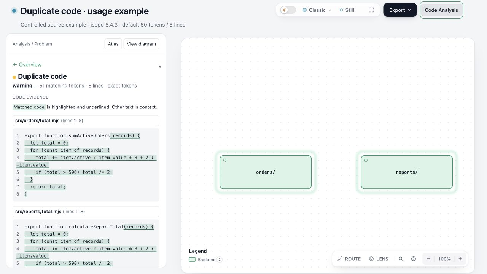
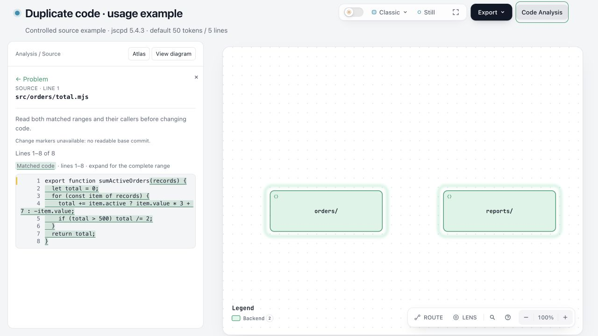

# C6 usage screenshots

These controlled public sources produce one native jscpd 5.4.3 pair: 51 matching tokens across eight lines. Both selected files were analyzed with no omissions. Settings are the product defaults: weak mode, exact identifiers, 50 tokens and five lines. The two function names differ and remain outside the recorded match.

The screenshots were captured from PR #1308 source revision `15f82fb86259248803f0b3b5dc0363ce3cb4e552`, using the same light theme, Classic preset, 100% zoom and normal 1280×720 browser viewport. The diagram explicitly groups the two source directories; it does not infer application architecture. These are agent-operated browser captures of an actual detector run, separate from human acceptance.

Use the C6 PR checkout and a separately obtained official jscpd 5.4.3 executable. Set its absolute path in `analysis.config.json`. From the Archify repository root, with the files in this directory saved under `/path/to/demo`, run:

```sh
node archify/bin/archify.mjs code-analysis check /path/to/demo/sample --language ts --config /path/to/demo/analysis.config.json --out /tmp/c6-analysis --fail-on never --json
node archify/bin/archify.mjs code-analysis serve /path/to/demo/sample --language ts --ir /path/to/demo/input.json --map /path/to/demo/map.json --config /path/to/demo/analysis.config.json --out /tmp/c6-view
```

Open the printed local URL, click **Code Analysis**, then **Duplicate code**. The repeated ranges use the same theme colour and underline. Open either path to view its recorded source location, then return to the problem. The fixture source is parsed as data and is never executed.




