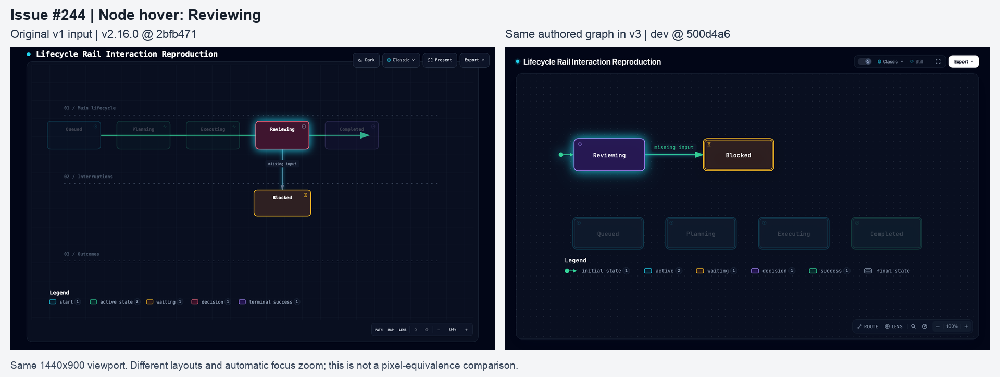
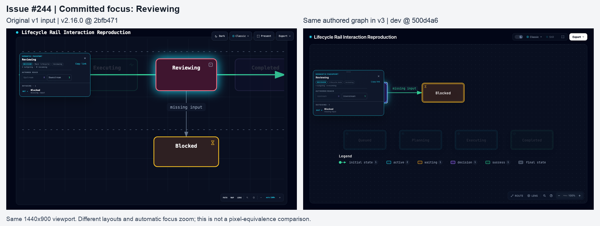
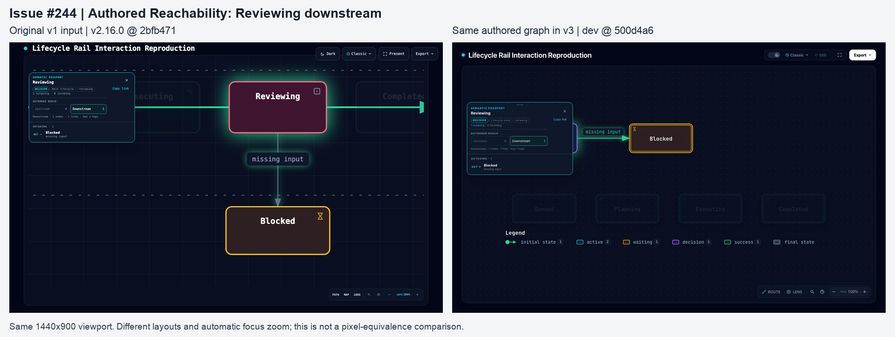
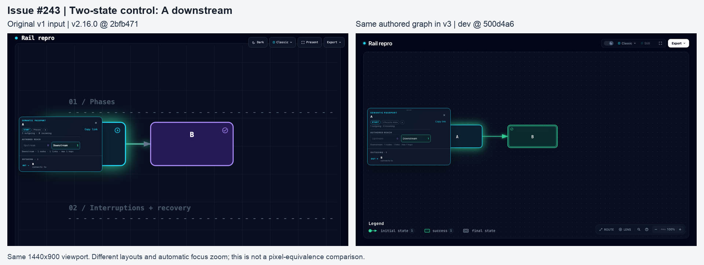

# Lifecycle #244 verification — 2026-10-27

No additional rail-hiding patch is supported by these results on current dev. The original #244 defect reproduces at its reported v2.16.0 revision; the graph-preserving v3 controls do not reproduce it. Maintainer acceptance of the v3 mapping remains separate from this evidence.

## Versions and input scope

These are Lifecycle JSON schema versions, not interchangeable Archify release numbers:

- **v1:** the fixed three-band phase map, with a decorative primary rail behind the main states. The original issue artifacts use Archify **v2.16.0**, commit `2bfb47132c057195d8dddb3e25ae966dd7c7a72e`.
- **v2:** shared column-grid layout, one row per populated lane and explicit transitions instead of an implied rail. The v2 implementation still accepted v1 and preserved its layout. See [the introducing commit](https://github.com/tt-a1i/archify/commit/e1eab5c8da1dbd1bb6997f23fe755724ffd73aee).
- **v3:** automatic layout derived from `mainPath` and authored transitions; the old renderer/grid router was removed and v1/v2 inputs are rejected. See [the breaking-change commit](https://github.com/tt-a1i/archify/commit/1dff4471e021cca25623f06e24846c751af70891). Tested dev: `500d4a65211ffe607fde6b3ce7505027b45bb59e`, Archify **3.2.1-dev.1**.

Both unchanged original JSON inputs validate and deliver at v2.16.0, and fail schema validation at current dev. The v3 controls preserve every original state and authored transition. They remove unsupported lane/column/route/viewBox fields, add `meta.output`, and set `mainPath` to `[a,b]` for #243 or `[reviewing,blocked]` for #244. No transitions were invented. #244's other four states remain disconnected. Its arrangement and initial-marker owner change, so this is **not an unchanged-input or old-layout compatibility pass**. The original five-phase order in v3 fails with four `lifecycle/main-path-gap` diagnostics, also included here.

## Results

| Check | Original v1 at v2.16.0 | Graph-preserving v3 at dev |
| --- | --- | --- |
| #244 hover / keyboard Intent Trace | Rail opacity 1; unrelated nodes 0.2; false horizontal arrow visible | No old rail drawn; only authored relationship highlighted |
| #244 relationship preview | Rail 1; unrelated nodes 0.16 | No false decorative edge |
| #244 committed focus | Rail 1; unrelated nodes 0.13 | No false decorative edge |
| #244 downstream Reach | Rail 1; unrelated nodes 0.09 | Only reviewing, blocked and one authored edge in Reach |
| #243 two-state case | Rail geometry matches, but A/B both remain opacity 1 with click A, `#focus=a` and Downstream; the reported B=0.13 symptom was not reproduced | Only A, B and one authored edge in Reach; no old rail |
| Exit and canonical export | Not part of the historical reproduction run | Direct exit and exit after export restore READ; 38 SVG exports are byte-identical to respective READ exports |

Current-dev browser matrix: 38 interaction cases plus four READ baselines, repeated for direct exit without first exporting. Covers mouse and native Tab node focus, relationship preview, committed focus, upstream/downstream Reach, cold focus/reach URLs, and disconnected Planning. Historical run: 32 observations (two fixtures, two themes, READ plus seven interaction states). Existing focused tests: **25 passed, 0 failed, 0 skipped**.

Environment: macOS 26.6.2 / Darwin 25.6.0 arm64, Node 20.20.2, Chrome 156.0.8078.48, 1440×900 @1, Classic, dark/light, reduced motion. Screenshots preserve each Viewer's native automatic focus/reach zoom. Comparison images scale full screenshots equally; layout and camera framing are not asserted to match across versions. Historical HTML retains its original Google Fonts requests. Current-dev pages made no external resource requests in the captured observations.

## Screenshots

The comparison panels show dark-theme screenshots from the completed runs; originals are alongside them. The JSON observations cover both themes.









Restoration: [#243](direct-exit/243-dark-reach-downstream-restored.png), [#244](direct-exit/244-dark-reach-downstream-restored.png).

## Reproduction

Create sibling directories named `archify-244-dev`, `archify-244-v1` and `issue-244-verification`. Copy this evidence directory into `issue-244-verification`. With the repository available locally:

```sh
git clone https://github.com/tt-a1i/archify.git archify-244-dev
git -C archify-244-dev switch --detach 500d4a65211ffe607fde6b3ce7505027b45bb59e
git -C archify-244-dev worktree add --detach ../archify-244-v1 2bfb47132c057195d8dddb3e25ae966dd7c7a72e
cd archify-244-dev
repo="$PWD"
evidence="$(cd ../issue-244-verification && pwd)"
node "$evidence/generate.mjs" "$repo"
npm run test:focus -- test/lifecycle-layout.test.mjs test/authored-reachability.test.mjs test/relationship-lens.test.mjs
ARCHIFY_CHROME='/Applications/Google Chrome.app/Contents/MacOS/Google Chrome' node "$evidence/verify-browser.mjs" "$repo"
ARCHIFY_CHROME='/Applications/Google Chrome.app/Contents/MacOS/Google Chrome' ARCHIFY_VERIFY_DIRECT_EXIT=1 node "$evidence/verify-browser.mjs" "$repo"
node "$evidence/reproduce-v1.mjs"
node "$evidence/verify-v1-browser.mjs"
```

The historical browser script borrows only CDP transport from dev; loaded HTML is generated by the historical renderer. Native pointer/Tab input drives the scenarios; semantic DOM attributes are inspected, not manually injected. Export tests call the public Viewer export action and capture its actual SVG blob.

Files include original/v3 inputs, actual HTML, receipts, DOM observations, representative SVGs, screenshots, scripts and test logs. Local absolute path prefixes in receipt/command JSON were redacted to `$EVIDENCE`, `$DEV`, `$V1`; generated HTML/input/SVG/screenshot bytes were not changed. The delivery artifact hashes were checked again after staging. `SHA256SUMS` binds the published files.

## Limits and disclosure

Codex performed investigation, automated Chrome interaction, representative screenshot inspection and drafting under `testikun`'s direction. This is Agent-operated real-browser evidence, not human acceptance or a full CI run. No product source changes are proposed. v2 behavior above comes from its introducing source/documentation, not a v2 browser run. No cross-browser, mobile, other-preset, ongoing-motion, raster/video-export or v1-to-v3 pixel-equivalence claim is made.

Two initial harness issues were corrected: waiting for a full load event on a hash-only navigation, and a cleanup click on the navigation bar accidentally opening Finder. Their local logs were retained; the affected current-dev runs were repeated with distinct navigations, neutral-title cleanup, panel-state checks, and a separate direct-exit run. Only final observations are published here.
