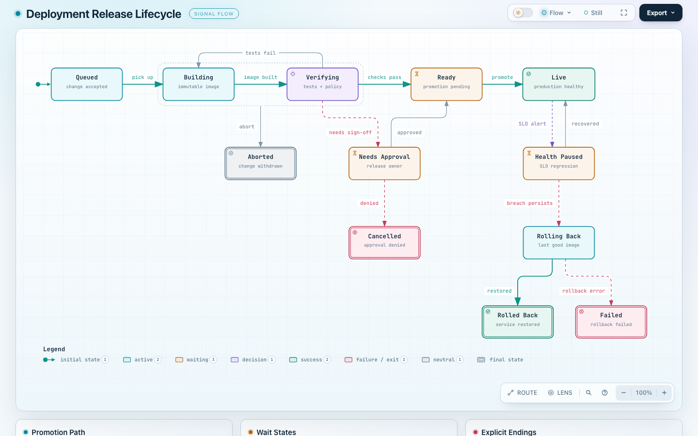
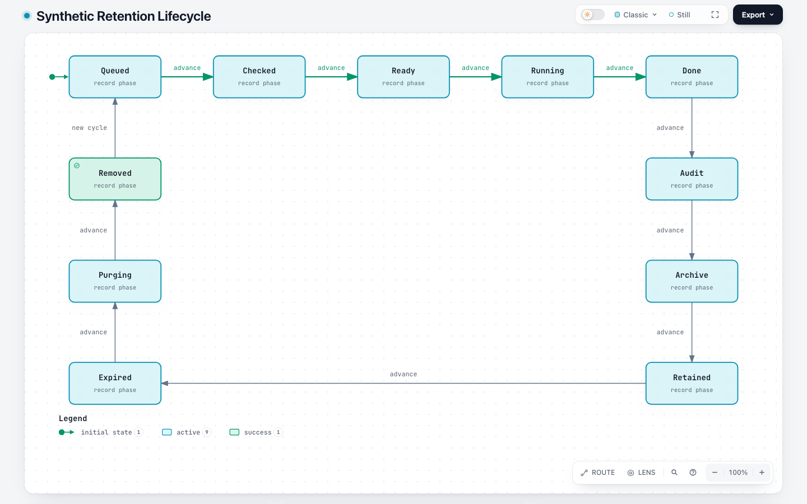
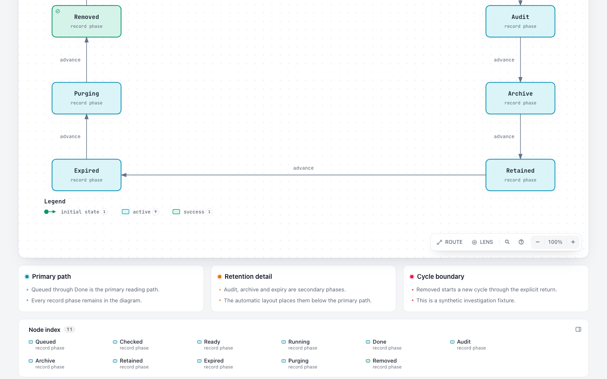
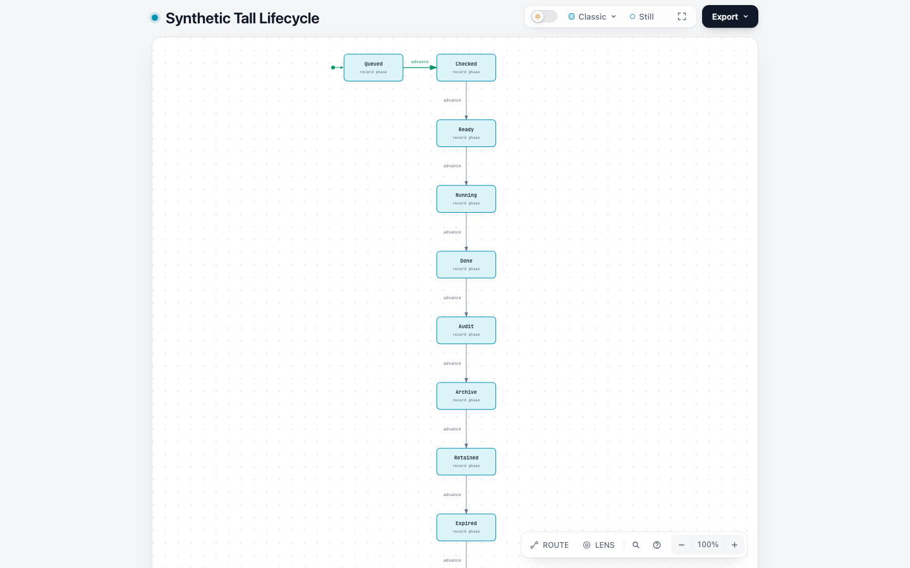

# Issue #468 — current Lifecycle investigation

**At `dev@6ca6a5c84439b57ea22e0630fe306e1d91587a6e`, the old authored-viewBox/yOffset Lifecycle path has been replaced. The original repair loop did not recur in these public/synthetic probes.** This is a bounded status investigation, not proof that every Lifecycle is readable or that the private original case has been replayed.

Issue: https://github.com/tt-a1i/archify/issues/468. Tested on 2026-10-28, Node 20.20.2, macOS arm64 / Darwin 25.6.0, Chrome 156.0.8078.48, headless, fresh temporary profile, DPR 1, `showcase`.

## What changed since the report

- [#738](https://github.com/tt-a1i/archify/pull/738) replaced Lifecycle with schema v3 and automatic `mainPath` layout. Current schema rejects authored `meta.viewBox` and state `yOffset`.
- [#485](https://github.com/tt-a1i/archify/pull/485) explicitly records that its Lifecycle half was superseded by v3; its final implementation concerns Dataflow.
- Current Lifecycle emits `data-reader-fit="intrinsic-height"`; current browser checking accepts declared readable vertical scrolling. Bottom notes/index also have a separate height policy.

Both retired-field probes fail with `schema/additionalProperties`, naming the unsupported property and advising its removal. Repeating the old height sweep would only repeat schema rejection.

## Inputs and outcomes

The reporter's private 11-state JSON was not available. All constructed inputs are synthetic; matching the 11-state/11-transition/3-card counts does not reproduce that private case.

| Input | Origin | States / transitions / cards | Outcome |
| --- | --- | --- | --- |
| `minimal` | Synthetic v3 minimum | 2 / 1 / 0 | validate, deliver, visual-check pass |
| `public-deployment` | Byte-identical copy of the pinned repository example | 12 / 15 / 3 | all pass |
| `synthetic-11-cards` | Synthetic retention cycle, five-state main path | 11 / 11 / 3 | all pass |
| `synthetic-11-no-cards` | Same JSON except `cards: []` | 11 / 11 / 0 | all pass |
| `synthetic-11-all-main` | Same card-bearing JSON except all states on mainPath | 11 / 11 / 3 | `lifecycle/too-wide`, exit 1 |
| `synthetic-tall` | Separate long-chain control, two-state main path, no return shortcut | 11 / 10 / 0 | all pass; readable scroll accepted |
| `invalid-viewbox`, `invalid-yoffset` | One unsupported field added to minimal | 2 / 1 / 0 | schema rejection, exit 1 |

For each of the five successful inputs, the actual public sequence was `validate --quality showcase --json`, `deliver --quality showcase --json`, then `visual-check --require-provenance --json`. The six browser observations per artifact were four light viewports (1440×900, 1600×1000, 1920×1080, 2048×1320) and two dark viewports (1440×900, 2048×1320). All **30 viewport/theme observations** passed the automated containment, readability, chrome and theme checks. The three expected failures remain in the logs.

The all-mainPath input reports width **2452**, budget **1395**, with a supported fix to move secondary phases off mainPath. Applying only that change for the secondary phases defined by this synthetic scenario produces **1132×638**, retaining all 11 states, 11 transitions and 3 cards. This is a constructed recovery example, not a real-agent repair-round benchmark or permission to demote required primary phases in other diagrams.

## Browser measurements and card ablation

Supplemental light measurements use the actual DOM `scrollHeight` and `getScreenCTM()` text scale, at 1440×900 and 1920×1080, Still/read, initial overview, camera scale 1. The public example retains Signal Flow; synthetic examples use Classic. Only the matching synthetic pair is a controlled style/layout comparison.

| 1440×900 light | viewBox | Actual document height | Receipt height | Minimum actual primary text | Minimum actual context/edge text |
| --- | --- | --- | --- | --- | --- |
| Minimal | 640×170 | 1001 | 900 | 18.000px | 15.000px |
| Public deployment | 1284×680 | 1163 | 900 | 12.579px | 9.434px |
| Synthetic 11 + cards | 1132×638 | 1171 | 900 | 14.035px | 10.526px |
| Synthetic 11 without cards | 1132×638 | 1060 | 900 | 14.035px | 10.526px |
| Synthetic tall, no cards | 640×1574 | 1409 | 1193 | 8.006px | 6.005px |

Removing the three cards changes neither SVG width (1324px), viewBox nor text sizes. It reduces document height by 111px; both versions already pass. At 1920×1080 the pair likewise retains identical diagram dimensions/fonts, with document heights 1351/1240px. This supports keeping the card content, not deleting it to obtain a pass.

**Receipt `scrollHeight` is not raw DOM height here.** When the notes/index rail is below the diagram, the checker subtracts its outer height and reports `cardsPx: 0`. See the [pinned measurement code](https://github.com/tt-a1i/archify/blob/6ca6a5c84439b57ea22e0630fe306e1d91587a6e/archify/bin/visual-check.mjs#L1819). Even the no-card inputs have a node index. A receipt height of 900 therefore does not prove that the whole page fits without scrolling.

The tall control still exceeds the diagram-height check after excluding the index: 1193 at 1440×900, 1259 at 1600×1000 and 1920×1080. `verticalScrollAccepted` is true, with minimum projected text 6.0046875px. At 2048×1320, the adjusted region fits; minimum projected text is 6.1875px.

The gate caps projection scale at 1, whereas supplemental actual screen font size uses the full SVG transform. These are different metrics. The ~6px context and ~8px primary labels in the tall default view remain a perceptual limitation despite the automated pass.

All expected state IDs, rendered transition endpoints and card text were present in the ten supplemental observations. Selected node/transition/card text targets could be scrolled fully into the viewport. This establishes those DOM targets' reachability, not human reading accuracy, complete keyboard traversal, screen-reader behavior, or legibility of hidden fine-detail content.

## Representative screenshots

Public repository example, 1440×900 light / Signal Flow / Still:



Synthetic 11-state diagram, 1440×900 light / Classic / Still:



Same synthetic diagram scrolled to its cards and index:



Tall synthetic control: automated pass, small text, later states below the first screen:



Full-page and bottom screenshots are supplemental files; they do not replace the official receipt-bound captures. Agent screenshot inspection occurred; all official receipts retain `visualReview: pending`. No human or screen-reader acceptance is claimed.

## Reproduction and evidence integrity

From this evidence directory, with Node, Python 3.12+ and Chrome installed:

```sh
python3 scripts/prepare-source.py
node scripts/make-inputs.mjs
node scripts/run.mjs fresh-run
node scripts/measure-browser.mjs fresh-run
```

`prepare-source.py` downloads the fixed upstream source archive and extracts the needed sources into a new `source/`; it refuses to overwrite an existing source directory. No global Archify installation is needed. Set `ARCHIFY_CHROME` if automatic Chrome discovery does not find the desired executable. Use a fresh run name; logs/receipts are not overwritten.

- [Source identity and SHA-256 manifest](evidence/source.json); [661 extracted files compared with exact Git blob IDs](evidence/source-integrity.json).
- [Baseline commands/exit codes](runs/baseline/manifest.json), [supplemental DOM measurements](runs/baseline/supplement/measurements.json).
- [Tall-control commands/exit codes](runs/tall-no-cards/manifest.json), [supplemental DOM measurements](runs/tall-no-cards/supplement/measurements.json).
- Inputs, HTML, PNGs, stdout/stderr, `.delivery.json`, `.visual-check.json` and contact sheets are included under `runs/`.
- [Publication notes](publication-notes.json) identify local-path redactions. Inputs, rendered HTML and PNGs are byte-identical to the tested artifacts. Only local filesystem strings in logs/receipts/manifests are redacted. Artifact/specification hashes and receipt identities were rechecked after preparation. Public receipts are historical records; use a fresh run to produce receipts bound to your paths.
- The public SHA-256 manifest covers the published files. Git commit links pin the bundle. Generated-source archives and the abandoned partial checkout are excluded.

One earlier tall probe retained copied cards whose prose did not match its changed topology. The final tall control removes them to isolate diagram height; the earlier run is excluded from this public comparison. A later minimal runner smoke is also excluded from the five-case count.

No product code, schema, threshold or routing change is proposed. A current real v3 input exhibiting diagnostic → suggested repair → browser failure would be needed before designing a remaining #468 repair. This does not duplicate #358/#569 projection, #356/#804 general guidance, or #618 readability work.

AI disclosure: Codex performed the investigation, scripts, browser checks, representative screenshot inspection and drafting under @testikun's direction. These are Agent-operated observations, not full CI, cross-platform/browser validation or human acceptance. This bundle records the tested SHA; it does not claim later dev revisions were retested.
