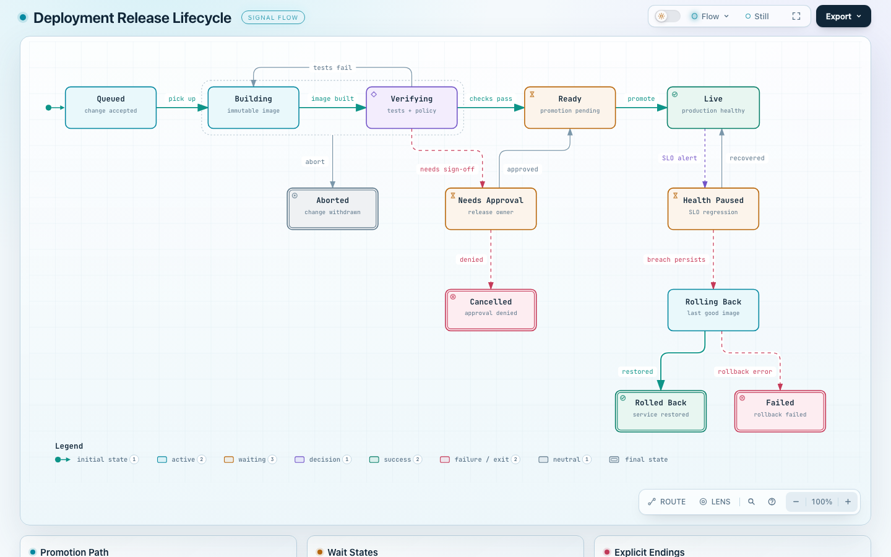
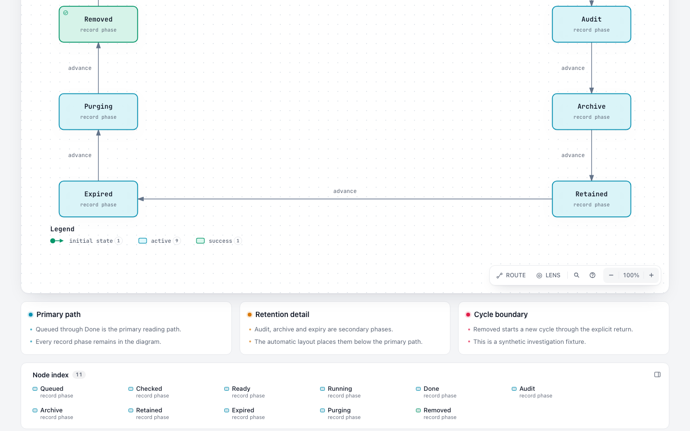
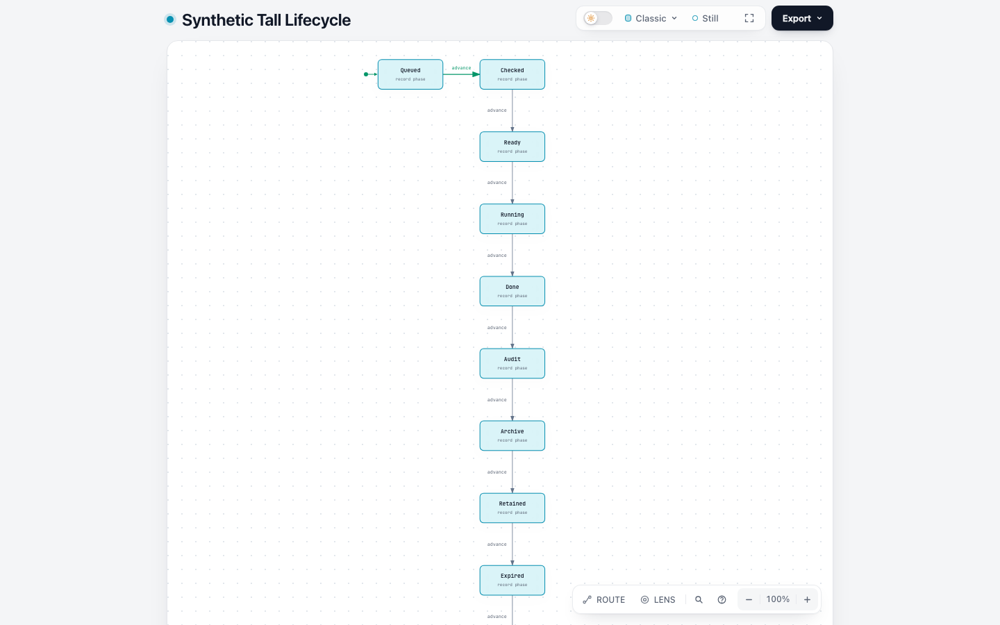

# #468：2026-11-02 最新 dev 复查

结论：在最新 `dev@63c9263e84bd3993cab8e09b3d69888857858635` 上，仍未复现原报告的 Lifecycle「静态检查建议增高，浏览器又拒绝增高」循环。本次样例没有支持再为已退役的手调 viewBox 路径增加补丁。是否关闭或重述 issue 仍由维护者决定；不宣称所有 Lifecycle 的阅读体验都已解决。

## 版本、输入与新证据

2026-11-02 重新 fetch dev，并通过 GitHub API 确认 SHA。独立 `git archive` 快照的 1,273 个普通文件逐一验证 Git blob ID，全部一致；没有运行旧 `source/`，也没有把 #918 的工作区改动带入此次运行。运行后仍无源码内容变化。

- 源码：`63c9263e84bd3993cab8e09b3d69888857858635`；包版本 `3.2.1-dev.1`。
- 上次研究源码：`6ca6a5c84439b57ea22e0630fe306e1d91587a6e`。
- Node 22.23.2，macOS arm64，Chrome 156.0.8078.74，`showcase`，独立浏览器 profile。
- 重新生成的八个输入与上次研究逐字节相同，包括当前仓库公开 deployment 例。原报告私有 JSON 仍未公开；11 状态例是合成控制，不是原例复建。
- 当前 issue 仍开放；除上次发表的研究评论外，没有新的原始输入或维护者结论。

## 结果

| 输入 | validate / deliver / visual-check | 说明 |
| --- | --- | --- |
| minimal | 0 / 0 / 0 | 最小 v3 路径 |
| public-deployment | 0 / 0 / 0 | 原样公开例，12 状态 / 15 迁移 / 3 卡片 |
| synthetic-11-cards | 0 / 0 / 0 | 合成 11 状态 / 11 迁移 / 3 卡片 |
| synthetic-11-no-cards | 0 / 0 / 0 | 只移除卡片的对照 |
| synthetic-tall | 0 / 0 / 0 | 独立高图控制，自动检查允许可读纵向滚动 |
| synthetic-11-all-main | 1 / 未运行 / 未运行 | `lifecycle/too-wide`：2452px 超出 1395px 预算 |
| invalid-viewbox | 1 / 未运行 / 未运行 | `schema/additionalProperties`，要求移除旧 `meta.viewBox` |
| invalid-yoffset | 1 / 未运行 / 未运行 | `schema/additionalProperties`，要求移除旧状态 `yOffset` |

五个有效例各有 6 个实际截图/主题观察，共 30 个：四个浅色桌面尺寸（1440×900、1600×1000、1920×1080、2048×1320）及两个深色尺寸（1440×900、2048×1320）。containment、readability、Viewer chrome 和主题记录均通过；另外补测 10 个浅色 DOM / 内容可达性观察。所有输入状态、迁移、卡片内容均保留，检查的文字均可通过页面滚动到达。

在全部 11 状态进入 mainPath 的构造反例中，当前诊断给出宽度与预算，并建议由作者调整主路径或拆图。只把次要阶段移出 mainPath、保留所有状态/关系/卡片，便得到通过的 synthetic-11-cards，仍无需在 580—630 高度之间盲试。

1440×900 下的补充真实 DOM 测量：

| 输入 | 文档实际高度 | 回执高度口径 | 最小主标签 / 次要文字 |
| --- | ---: | ---: | ---: |
| public-deployment | 1163 | 900 | 12.58 / 9.43 px |
| synthetic-11-cards | 1171 | 900 | 14.04 / 10.53 px |
| synthetic-11-no-cards | 1060 | 900 | 14.04 / 10.53 px |
| synthetic-tall | 1409 | 1193 | 8.01 / 6.00 px |

回执高度会扣除底部笔记区域，不能把 900 解读为整页所有内容已在首屏。高图仍只有约 8px / 6px 字号；这是机器门槛与舒适阅读之间的已知边界，不能用绿色检查掩盖。当前政策允许满足条件的纵向滚动，亦不等于内容缺失。

## 截图与可复现材料

本次截图全部重新生成，未复用 10 月 28 日图片：







原始命令、退出码、输入、HTML、delivery 回执、浏览器回执和截图分别位于 `runs/latest-dev/`，原始 DOM 测量为 `runs/latest-dev/supplement/measurements.json`。`evidence/source-integrity.json` 记录固定源码核验。

复跑时，在新目录准备相同源码快照和脚本，以新的 run 名称运行：

```sh
node scripts/make-inputs.mjs
ARCHIFY_CHROME='/path/to/chrome' node scripts/run.mjs another-run
ARCHIFY_CHROME='/path/to/chrome' node scripts/measure-browser.mjs another-run
```

本次没有产品补丁，没有改 schema、门槛、路由或用户安装。消融沿用同一输入只移除 cards、只调整 mainPath 的受控比较。未运行全仓库测试、跨平台/跨浏览器或屏幕阅读器检查；官方回执的 `visualReview` 仍为 pending。截图由 Codex 检视，不冒充用户或维护者人工验收。研究、脚本和说明使用 Codex（GPT-6）辅助。
