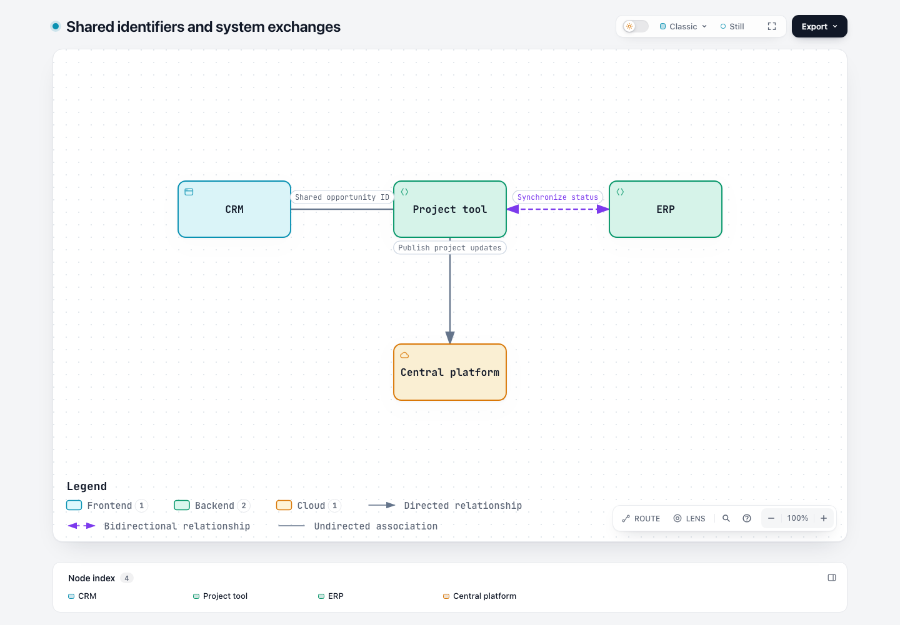

# #1139 本地实现证据

本目录存放本次候选实现的验证产物，与 `latest-dev-20261103/` 的改前复现分开。正式 Agent benchmark 已按用户授权完成；运行计划见 `../IMPLEMENTATION-PLAN.md`，逐例结果见 [benchmark 报告](../benchmark-20261104/REPORT.md)。

初次合成夹具交付被现有标签碰撞检查拒绝：`Publish project updates` 的标签进入 `ppm`。指定 bottom/top 端口后第二次仍被拒绝，随后采用诊断给出的 `labelAt: [330, 154]`。这是测试夹具布局修订，不是自然 Agent benchmark 的失败样本。

## 本地实现与验收（2026-11-04）

分支 `codex/issue-1139-relations`，工作区 [implementation](../implementation/)，基于最新远端 dev `63c9263e84bd3993cab8e09b3d69888857858635`；2026-11-04 正式运行前再次查询确认未变。测试后的候选已提交并固定为 `7ee304c5d939f1e2194c9bbbffdf86d4d7683117`，尚未推送。`candidate-files.json` 记录提交前的相同文件内容；正式版本与包摘要见 [冻结计划](../benchmark-20261104/plan.json)。

已实现 Architecture 的 `forward`／`both`／`none`、自动方向图例、Route／Reach／Focus／Intent／Lens 的对应语义、静态 Story、原生导出及 Delta 分类。默认 forward 兼容旧图。不同含义的请求和响应仍应分开。完整调用方边界、测试价值与消融见 [本地审查](LOCAL-REVIEW.md)。

[交互示例](directions.html) · [标准交付回执](final-delivery.json) · [原始测试输入](../implementation/test/fixtures/architecture-directions.json)

| 检查 | 结果与证据 |
| --- | --- |
| 新功能聚焦检查 | 6 项通过，包含默认兼容、字段边界、图例、Delta、箭头碰撞、Story；[首次通过日志](direction-unit.log)。后续增加的片段冲突检查也进入完整 Node 套件。 |
| 新功能与既有 Route 浏览器复测 | 15 项通过；包括反向路径、唯一身份、无虚构流光、分享卡、浅深色 SVG／PNG 和 Story；[日志](route-followup-browser.log)。 |
| 完整浏览器门禁 | 343 项通过，0 失败、0 跳过；[日志](full-browser.log)。 |
| 完整 Node 与生成产物检查 | 3,681 项中 3,544 通过、135 按环境跳过、2 项失败，原始结果保留在 [完整日志](full-final.log)。两项分别是新增浏览器清单打乱原分片安排、README 动图来源摘要需刷新；修复后 [分片 17 项](browser-gate-followup.log) 与 [README 14 通过／1 按环境跳过](readme-followup.log)。未把定向复测写成另一次全量全绿。 |
| 六个语言目录 | 37 项通过，包含键与占位符完整性；[日志](i18n.log)。不代表独立母语审校。 |
| 同输入兼容对照 | 15 个已有例、10 种图，base/candidate 原生 SVG 摘要逐项相同；[结果](same-input/comparison.json)、[脚本](verify-compatibility.mjs)。旧版对新字段的拒绝另记为能力不支持；[原诊断](same-input/base-new-capability.json)。 |
| 消融 | 移除方向快照保护后，回归捕获语义已变却仍能导出的问题；已恢复。移除本次未进入构建的旧 Guided Views 修改，以及改变旧契约的几何过滤；[记录](LOCAL-REVIEW.md)。 |
| 生成与打包 | 模板、validators、开发／打包例、旧手工例的 Viewer、Checkout Delta、Gallery、README 动图已刷新；使用官方 Node 22.23.2／zlib 1.3.1-e00f703 构建 ZIP；[构建日志](zip-build.log)、[动图日志](readme-build.log)。 |
| WebM 与 Story | 系统 ffmpeg 缺少动态库的初次失败保留在 [日志](webm.log)。改用已有独立 ffmpeg 7.1 后，导出／视频采样与 Story 3 项通过；随后同一命令的网站语言集成 6 通过、1 页面加载超时，因此组合命令不能记为通过；[完整原始结果](webm-followup.log)。 |

网站语言超时后，以同一 Node／Chrome 单独运行：未修改 dev 的真实浏览器用例 [1 项通过](site-language-base.log)，候选版完整网站语言集成 [7 项通过、0 跳过](site-language-candidate-followup.log)。没有提高超时、拦截请求或修改网站／测试来制造通过；初次超时与复测通过均保留，不声称这个外部加载问题已被本补丁修复。

最后的 [生成产物检查](generated-final.log) 全部通过；[第二次 canonical ZIP 构建](zip-reproducibility.log) 与工作区 `archify.zip` 逐字节一致。候选文件摘要见 [candidate-files.json](candidate-files.json)。上述修复后使用针对受影响项的复测，并复用未受影响的完整运行结果；未重复整个 Node 套件，也未运行远端 CI。

## Benchmark 状态

官方 5 项目 × 两版的 **10 次**自然生成和 **6 次**新能力专项均已完成，Codex `gpt-6.1-sol` / medium，串行、每次 20 分钟预算，无会话超时或替换重跑。16 份最终 JSON 均交叉回放、采集截图并完成逐例审查；上述确定性检查不冒充真实生成结果。额外 6 次不是规范强制次数。计划、固定条件和成功标准见 [IMPLEMENTATION-PLAN.md](../IMPLEMENTATION-PLAN.md)。

专项正确使用了无向关联与同义双向同步，并保留不同请求／决策。但 Squad 自然任务误把 CLI 命令／结果合成 `both`；OpenPI 候选及 SkillRoster 基线还出现两版一致的边界标题遮线。两条待处理问题和原始复现见 [ISSUES.md](../benchmark-20261104/ISSUES.md)。首稿、全部修订、失败命令、截图、源码核对及 token 已保留在 [benchmark 报告](../benchmark-20261104/REPORT.md) 和 [本地归档](../benchmark-20261104/bundle-notes.md)。本轮不能写成全面质量通过或速度提升；候选保持冻结，尚未推送或提交 PR。
