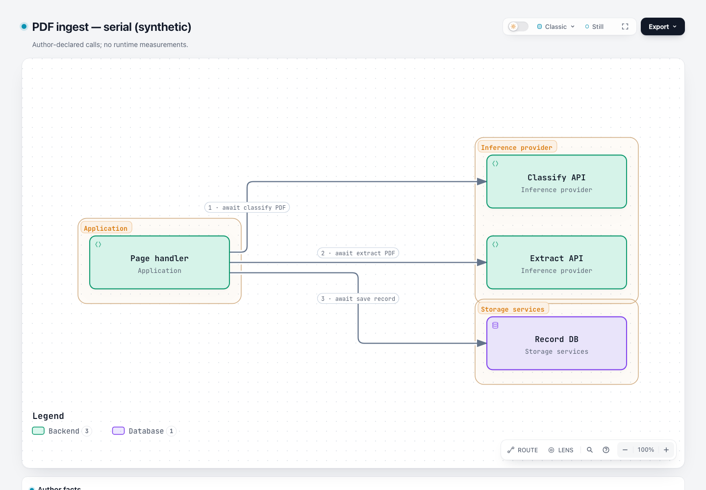
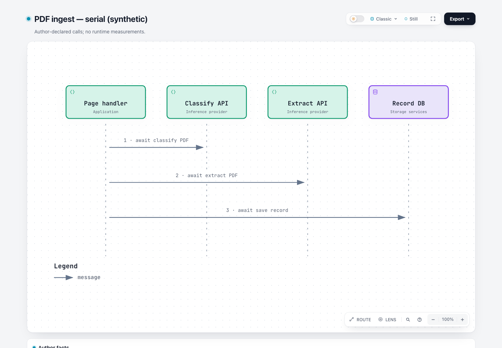
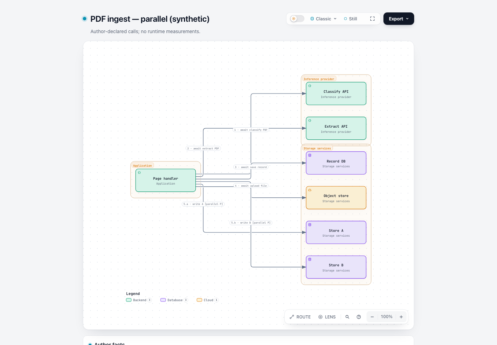
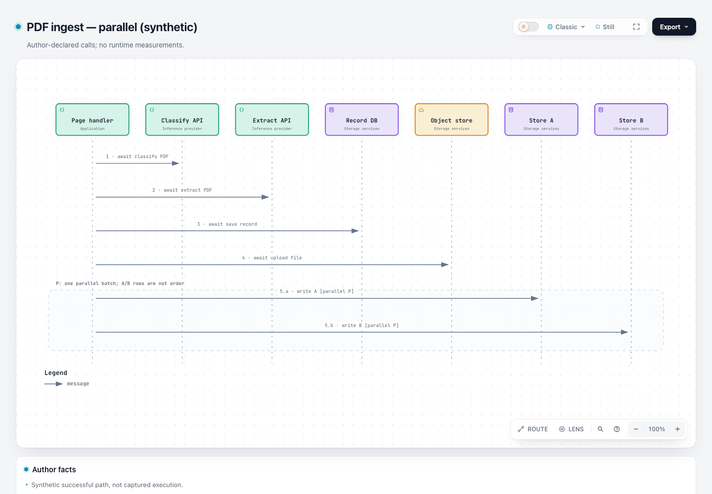
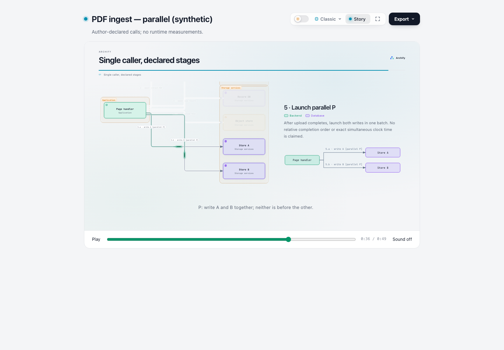
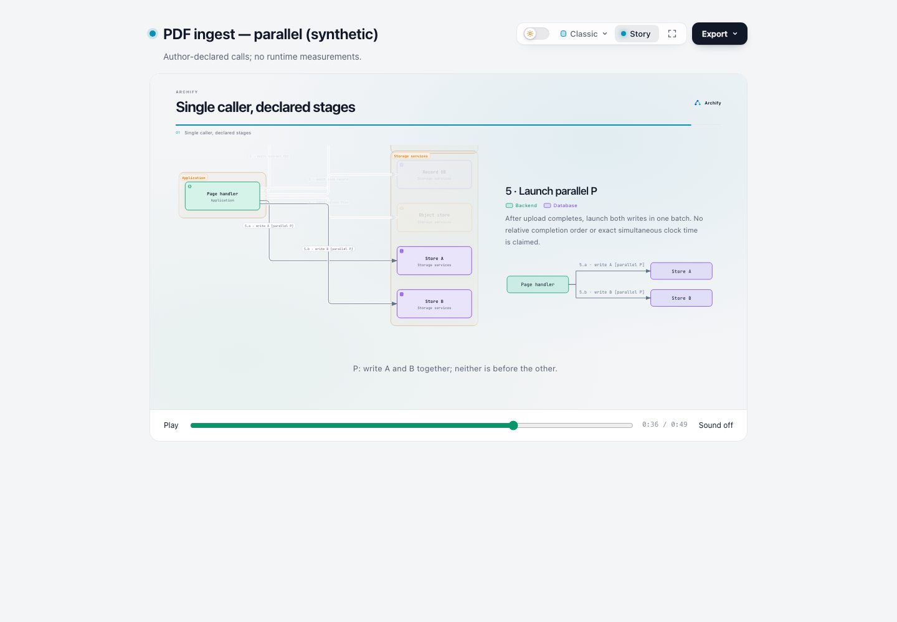

# #452：作者声明调用顺序——第一阶段研究与证据

研究日期：2026-10-28（Asia/Tokyo）。本阶段完成了最新讨论核对、固定源码复现、浏览器测量、静态导出和消融对照，没有实施产品功能。

**结论：本案例表达所需的事实，现有字段已经够用。** Architecture 的编号标签、明确的并行文字和边界可以保留静态信息；当前新增的原生 Story 已能引用同一调用方的关系，按阶段展示，并把 A/B 放在同一个并行展示阶段。建议先讨论这种现有能力的作者用法，不新增 `connections[].order`。

这不代表 #452 的全部交互诉求已经实现：**“聚焦／悬停一个节点就按其作者阶段逐步提示”仍不同于进入 Story。** 本研究也没有证明读者理解速度提高、图已经达到人工可读性验收，或原报告可以关闭。并行 Architecture 初稿有实际布局警告，下文保留它们。

> 公开副本说明：本报告的本地链接已转换，receipts 的机器路径已替换为 `$EVIDENCE`。原 checksum manifest 记录本地研究版本；当前公开文件以 [manifest-sha256.json](manifest-sha256.json) 为准。HTML、输入、截图、导出图和复现脚本保持原始字节。

## 先看产物

| 用途 | 可打开的 HTML | 最小输入 |
| --- | --- | --- |
| 三步串行，组件与边界 | [Architecture](artifacts/serial-architecture.html) | [JSON](inputs/serial-architecture.json) |
| 同一组三步事实，时间向下表达 | [Sequence](artifacts/serial-sequence.html) | [JSON](inputs/serial-sequence.json) |
| 四步串行＋A/B 并行批次 | [Architecture](artifacts/parallel-architecture.html) | [JSON](inputs/parallel-architecture.json) |
| 同一组并行案例事实，替代表达 | [Sequence](artifacts/parallel-sequence.html) | [JSON](inputs/parallel-sequence.json) |
| 去除重复说明卡的最小静态候选 | [Architecture，无 cards](artifacts/ablation-architecture-no-cards.html) | [JSON](inputs/ablation-architecture-no-cards.json) |
| 在上述候选上使用现有 Story | [Story HTML](artifacts/parallel-story.html) | [可编辑 brief](inputs/parallel-story-brief.json) |

Story HTML 初始仍是原生 Still 图。点击右上角 Still 进入 Story，再按 Play；本次证据以 Sound off 播放。进度条可以定位阶段，再切回 Still 检查完整组件图。没有制作或验证 Story 视频。

## 1. 原问题与维护者期待

[原 issue #452](https://github.com/tt-a1i/archify/issues/452) 描述同一个 page handler 依次 classify、extract、保存记录、上传文件，然后用 `Promise.all` 发起一批写入。所有箭头都从同一节点出发。原作者已用标签编号，并希望 Viewer 帮读者按顺序寻找这些箭头；换成 Sequence 又担心丢掉组件边界。

原提案的 `1`、`3.a`、`3.b` 字符串语法，以及重复、空缺等拒绝规则，是提议，**不是已批准的产品契约**。[维护者 9 月 19 日回复](https://github.com/tt-a1i/archify/issues/452#issuecomment-5739168280) 认可场景，并谈到时间线快照和扩展方向；没有逐项同意字段语法、校验规则或 hover 动画行为。[我们的认领](https://github.com/tt-a1i/archify/issues/452#issuecomment-6441386978) 仅覆盖需求与设计证据。

2026-10-28 的刷新结果：#452 仍开放、无 assignee、两条评论，尚无对认领的新回复。已读取 issue 正文、全部评论、时间线、相关搜索和当时全部 123 个开放 PR；数字关键词搜索存在无关命中，不能把它们当作专属实现。关键相关项如下。

| 项目 | 刷新后状态与影响 |
| --- | --- |
| [#1036](https://github.com/tt-a1i/archify/pull/1036) | 原生 Story walkthrough 已合入；它提供了本研究实际使用的 `via`、`trace`、`parallel` 能力。 |
| [#1045](https://github.com/tt-a1i/archify/issues/1045) | 已关闭，维护者说明 agreed native walkthrough 范围已进入 dev；它在 #452 时间线上构成交叉引用。 |
| [#1047](https://github.com/tt-a1i/archify/pull/1047) | Story opening 的 flowless-guide 计时修正，10 月 25 日已合入；不应把 #1045 的历史备注理解为当前仍未修复。此次不复用它的测试通过数。 |
| [#289](https://github.com/tt-a1i/archify/pull/289) | 仍开放，提出旧 Story/Journey 的 dwell 配置；不能将其未合并字段当成当前契约。本研究未采用它。 |

原始 GitHub 响应在 [receipts/github](receipts/github)，查询清单在 [refresh.json](receipts/github/refresh.json)。以上为发布结果评论前的讨论快照；没有重复认领或提出实现 PR。

## 2. 实际测试的是哪一版

源码固定为 **`6ca6a5c84439b57ea22e0630fe306e1d91587a6e`**，GitHub dev 提交时间为 2026-10-28 00:35:58 UTC，即 09:35:58 JST。开始刷新与结束复核的 dev SHA 相同。它不是此前认领时的 `500d4a65211ffe607fde6b3ce7505027b45bb59e`。

所有研究文件均在本目录。`source-pinned/` 是专属的稀疏检出／固定文件快照：复用了本机已有只读 Git 对象缓存，并通过固定 SHA 下载缺失文件；**262 个被选中的文件逐个核对 Git blob SHA-1**，包含实际使用的全部 `archify/` 运行文件、Viewer 源码及相关参考。[源码文件清单](receipts/source-files.json) 与 [GitHub 固定 tree](receipts/github/dev-tree.json) 可复核。没有切换共享产品分支，也没有修改 `archify-244-dev` 或用户安装。

取得源码时曾遇到 Git/HTTP 超时，最早一次运行缺少 `story/tool.mjs` 等文件。相关失败保存在 [cli-incomplete-source](receipts/cli-incomplete-source)，属于**环境准备失败，不能当产品缺陷**。最终使用的源码已核对，Story attach 与全部目标浏览器检查随后实际执行成功。

测试环境：Node `v20.20.2`，Chrome `156.0.8078.48`，桌面 viewport `1440×1000`、deviceScaleFactor `1`、light theme、Classic preset、默认 Read／100% 阅读状态、独立临时浏览器 profile。输入统一使用 `standard`；没有放宽门槛。系统减少动态效果通过 Chrome DevTools 的媒体特性仿真触发真实 CSS／运行时路径，未改用户系统设置。

## 3. 哪些是原例，哪些是合成例

| 来源 | 本研究的使用方式与限制 |
| --- | --- |
| 真实原例 | #452 公开了问题描述与零散连接片段，没有完整作者 JSON、实际仓库或执行 trace。本研究**没有复现其私有原系统**。 |
| 公开样例 | 固定源码中的 `archify/examples/cache-miss-request.sequence.json`、`web-app.architecture.json` 用来理解现有输入形式；没有把它们称为 #452 原例，也没有将它们的既有测试冒充本次结果。 |
| 合成例 | [facts.json](facts.json) 明确标注 synthetic。组件名、边界和成功路径是为比较而作出的作者声明，不是从运行程序推断的事实。 |

串行案例有 4 个组件、3 条调用。并行案例有 7 个组件、6 条调用。两种 renderer 使用相同的组件 ID、关系 ID、端点、标签含义和归属事实；没有为 Sequence 发明额外参与者、返回边、耗时或完成事件。

| 作者阶段 | 关系 ID | 明确声明 |
| --- | --- | --- |
| 1 | `classify-call` | page 调用 classify，并等待完成。 |
| 2 | `extract-call` | 阶段 1 完成后调用 extract，并等待完成。 |
| 3 | `save-record` | 阶段 2 完成后保存记录，并等待完成。串行小例到此结束。 |
| 4 | `upload-file` | 阶段 3 完成后上传文件，并等待完成。 |
| 5 / P | `write-a`、`write-b` | 阶段 4 完成后，作为同一并行批次发起；不声明 A/B 相互先后、完成顺序、精确同一时刻启动或真实耗时。 |

归属为：page 属于 Application；classify/extract 属于 Inference provider；其余目标属于 Storage services。Architecture 用 `boundaries[].wraps` 表达组成员，Sequence 用参与者 `sublabel` 保留归属文字。事实表的 `stage`、`parallelGroup`、`member` **只用于研究输入生成，不是新增的 Archify 字段**。

编号和 `await` 是作者给出的事实。组件位置、连接数组位置、普通 Live 的相位，以及截图采样时间都不提供运行时顺序证据。Sequence 的 `y` 是按已知作者事实安排的阅读几何；不能从任意现成图的上下位置反推真实程序行为。

## 4. 同一组事实的实际表达

三步串行的 Architecture：



同一组三步事实的 Sequence：



并行案例的 Architecture 初稿：



同一组事实的 Sequence；P 段的文字明确说明 A/B 两行不是先后：



| 维度 | Architecture 编号标签 | Sequence 替代表达 |
| --- | --- | --- |
| 组件身份、调用方向 | 保留 | 保留；没有变更关系端点 |
| 边界成员 | 用真实包围框保留 | 归属词保留，但没有对应的空间包围框；边界结构的视觉表达被削弱 |
| 串行顺序 | 通过编号与 `await` 保留，需要沿图寻找标签 | 通过显式标签与向下展开保留；本例前三步更容易逐行指认，这是观察而非用户实验结论 |
| 并行批次 | `5.a` / `5.b` 加 `[parallel P]` 明示 | 同样的文字加 `segments[].label` 明示；segment 是普通带标签的范围，不是一个原生并行操作符 |
| 精确时间、返回顺序、异常路径 | 未声明 | 同样未声明；没有额外绘制 return/activation 来暗示未给出的事实 |
| 静态可用性 | 编号、边界、P 标签保留 | 编号、归属文字、P 段说明保留 |

**两种表达不是无损互换的视觉形式。** Sequence 保留了归属事实的文字，但失去 Architecture 包围框的组织方式；Architecture 保留整体结构，却把寻找编号、辨认多条出边的工作交给读者。当前 Sequence 没有用结构化字段声明并行，不能只凭两个同高度箭头解决。

### 实测字号与布局限制

以下是浏览器中边标签的实际投影字号：`getComputedStyle(fontSize) × getScreenCTM()` 的缩放值，单位 CSS px。它们不是修改后的字体、静态预算推算或可读性通过线。

| 输入 | 实际 SVG viewBox | 边标签投影字号 | 当前 static check 的观察 |
| --- | --- | --- | --- |
| 串行 Architecture | `856×495` | 12.00 px | composition 无问题项 |
| 串行 Sequence | `800×480` | 14.14 px | composition 无问题项 |
| 并行 Architecture | `856×825` | 7.32 px | 3 个 label-route-clearance 警告、2 个 ambiguous-corridor 警告 |
| 并行 Sequence | `1260×660` | 9.61 px | 1 个 desktop-readability 警告，针对归属小字的静态宽度预算 |

Architecture 的并行初稿有可见的关联歧义：例如 `1 · await classify PDF` 的标签遮罩落到 extract 的横向路径附近。路由还存在两处共享走廊，都是 receipt 里明确保留的警告。**这张图可用于比较事实如何编码，不能称为已经清楚好读的最终示范。** 在后续作者用法讨论里，可以单独试用已有 `labelAt`／布局控制改善它；本次没有借此重写路由或调整任何门槛。

两种 renderer 的默认适配产生不同画布尺度，尤其竖长 Architecture 被缩小，不能把字号差异归因为图类型本身。Sequence 的静态预算警告也不能直接等同于此 viewport 的真实测量结果。需要缩放或另做布局阅读验证时，应作为独立问题处理。

## 5. 当前 Viewer：旧 issue 中哪些描述已经变化

| 原先涉及的机制 | 此 SHA 的证据 |
| --- | --- |
| `meta.views` / 旧 Story | 有效旧格式仍被接受，但当前交付没有旧 guided-view UI。本研究带 `meta.views` 的对照成功交付，导出 SVG 与不带该字段的基线逐字节相同。不是说 schema 已删除此字段。 |
| `meta.animation: "trace"` | 官方运行时说明其与 `none` 都只保留输入兼容，不再决定默认播放。本次主例省略它。新 profile 默认 Still；读者主动选择 Live 后才持续播放。 |
| hover / Focus | hover page 时，6 个不同关系 ID 都进入 intent-match；Focus 的匹配集合也包含全部 6 条，没有按 1→2→3→4→P 分组。当前 Passport 还能逐行预览单条关系，因此不能再概括成“所有关系始终同时发亮”；细节见表后说明。 |
| Architecture 普通 Live | `relay` choreography。6 条出边的实际 `--flow-delay` 全为 `0.000s`，尽管标签编号不同。它表现拓扑上的传播，不解释编号。 |
| Sequence 普通 Live | 按消息展开的 `sequence` choreography；本例 A/B 的 delay 分别为 `5.121s`、`6.721s`。因此 `[parallel P]` 和 segment 说明不会自动让普通 Live 同时展示它们。 |
| 原生 Story attachment | 已有独立 brief、显式关系引用与并行展示动作；下面进行了实际附加与播放。与退役的 `meta.views` 不是同一入口。 |

这些 delay 都是演示用调度值，**绝不是调用耗时或运行时因果**。对本次并行 Sequence，建议以 Still 阅读事实；如需演示作者声明的批次，用明确编写的 Story，而不是把普通 Live 当作调用动画。

Passport 是另一个已有的轻量替代：它列出本例的 6 条 outgoing 关系，读者可逐行聚焦或预览。主浏览器记录的 `parallel-architecture-focus` 截图中，鼠标恰好落到新出现的 Classify 行上，因此该关系更亮，另外一些路径 opacity 为 0.18；与此同时，它们仍属于 Focus 的 6 条匹配关系。补充探针把鼠标移出面板后另存 `focus-without-row-hover` 状态，并实际让关系行从 write-a 经 ArrowDown 移到 write-b。这证明现有的逐关系检查能力，**不证明 A/B 被解释成有先后的业务阶段**；它也没有把两行作为一个并行批次共同预览。此局部按键探针不是完整键盘可访问性验收。

源码依据：[motion-governor.js](https://github.com/tt-a1i/archify/blob/6ca6a5c84439b57ea22e0630fe306e1d91587a6e/viewer/motion-governor.js#L69) 的 relay 与 sequence 规划，[当前 Viewer 参考](https://github.com/tt-a1i/archify/blob/6ca6a5c84439b57ea22e0630fe306e1d91587a6e/archify/references/viewer-runtime.md#L32)，以及 [共享交付路径](https://github.com/tt-a1i/archify/blob/6ca6a5c84439b57ea22e0630fe306e1d91587a6e/archify/renderers/shared/cli.mjs#L233)。原始浏览器采样见 [browser-probes.json](receipts/browser-probes.json)。

## 6. 现有 Story 实际够不够

本次用官方 `story attach` 把 brief 加到去除 cards 的 Architecture 输入产物，没有注入自定义动画脚本，也没有修改模板。所有 point 的 anchor 都是 `page`；前四个 point 各引用一条关系，最后一个引用 `write-a` 和 `write-b`，并指定现有 `action: "parallel"`。

官方约定：[story-authoring.md](https://github.com/tt-a1i/archify/blob/6ca6a5c84439b57ea22e0630fe306e1d91587a6e/archify/references/story-authoring.md#L48)。它明确区分同时展示与真实并发执行。编译过程见 [story-plan.mjs](https://github.com/tt-a1i/archify/blob/6ca6a5c84439b57ea22e0630fe306e1d91587a6e/archify/story/story-plan.mjs#L39)。

| 关系 | 浏览器里实际 Story action 开始时刻 |
| --- | --- |
| classify-call | 8.2 s |
| extract-call | 15.2 s |
| save-record | 22.2 s |
| upload-file | 29.2 s |
| write-a | 36.2 s |
| write-b | 36.2 s |

总演示时长约 49.95 s，使用现有默认阅读时长。前面的 opening 是通用概览，不是作者调用 trace；表中是明确编写的 scene 的 action。普通与 reduced-motion 模式读取到相同的作者展示调度。浏览器还实际按 Play 运行约半秒，确认播放时间前进；截图另外通过 seek 固定在相同时刻以便比较。**固定 seek 截图本身不作为完成播放的证明。**

普通模式的并行点：



系统减少动态效果时，相同位置仍有两条关系、标题、解释和字幕：



可观察的成本是：需要单独的 Story brief 与切换入口；Story 局部聚焦时，部分完整边界退到背景或视口外，读者需切回 Still 看全图。它解决了“同一调用方有序讲述”的案例，不等同于零额外编写成本，也不等同于点一下节点就播放该节点的业务阶段。

## 7. 静态导出、Still 与 reduced motion

| 状态／输出 | 实际检查结果 | 限制 |
| --- | --- | --- |
| 新页面默认 Still | 四个主例均为 Still；采样时 `document.getAnimations()` 为 0 | 只覆盖本次独立 profile 与固定案例 |
| Live 后选择 Still | 等待 1 秒让界面过渡结束，四例动画数均为 0，全部节点／标签仍在 | 不把短暂界面过渡与业务顺序混为一谈 |
| 系统 reduce，原生 Viewer | 四例默认 Still；再点击 motion 控件仍为 Still、动画数 0 | CDP 媒体仿真，非跨浏览器或 OS 实机矩阵 |
| 系统 reduce，Story | 36 个原生 flow 元素全部 `display:none`，其动画数 0；静态关系、局部图、解释、字幕可见；用户仍可 Play／seek 浏览内容 | 不代表所有过渡都经过无障碍评审，更不代表屏幕阅读器已验证 |
| 原生 SVG | 4 个主例均实际走 Export 菜单；保留所有关系 ID、端点、编号和归属事实；Focus 状态与默认导出的 SVG **逐字节一致** | SVG 内可访问 title/desc 不等于完整的辅助技术阅读体验 |
| 原生 PNG | 4 个主例均由真实 Chrome 中的 Export 生成；不是用网页截图冒充 PNG 导出 | 只验证当前 light theme / Classic 的这些产物 |
| Story 模式下导出原生 SVG | 仍是完整 Architecture，含 7 节点、6 关系；没有播放控件、临时流光或 Focus 元素 | 与未附加 Story 的 SVG 非逐字节一致：多出 Story 的 CSS 变量／规则；去除 style 后 XML 完全一致。不能笼统宣称文件字节没变 |
| WebM / Story video / print | 未执行 | 本任务没有请求视频，未将源代码描述冒充视频或打印验证 |

可直接查看 [Architecture PNG](exports/parallel-architecture.png)、[Sequence PNG](exports/parallel-sequence.png)、[Architecture SVG](exports/parallel-architecture.svg)、[Sequence SVG](exports/parallel-sequence.svg)。四个 PNG 的实际像素尺寸分别为 `3840×2692`、`3616×2632`、`3840×4012`、`4092×2514`（串行 Architecture、串行 Sequence、并行 Architecture、并行 Sequence）。

浏览器记录在 [browser.json](receipts/browser.json)，完整归纳与校验在 [summary.json](receipts/summary.json)。导出观察脚本只截获最终下载 Blob 来保存文件；SVG 序列化、PNG 栅格化和 Viewer 行为仍由产品代码执行。

## 8. 消融与负面探针

验收目标仅为这组作者事实：同一调用方、相同调用关系与归属、声明的串行顺序、P 组内不排序，以及静态／减少动态效果时仍能读到这些声明。不以画面漂亮或某个校验器全绿替代目标。

| 对照 | 实际结果 | 决策 |
| --- | --- | --- |
| 去掉 Architecture 标签编号，保留调用文本和 P 文字 | [无编号产物](artifacts/ablation-architecture-no-numbers.html) 可交付，但图内不再明确编码各串行阶段的先后。不能用剩余数组或几何补回该事实 | 保留编号；它承担静态意义 |
| 去掉 Sequence 的 P 段及 parallel 文字，保留 `5.a` / `5.b` | [无并行说明产物](artifacts/ablation-sequence-no-parallel-prose.html) 仍可交付；静态图只有两个上下分开的消息和自定义编号。完整 HTML 的 cards 仍有解释，但导出的图失去明确并行声明 | 保留显式 P 文字；`5.a` 格式不能自带未定义的语义 |
| 删除 Architecture cards | 输出 SVG 与基线逐字节一致，关系、边界、编号、P 标签仍保留；HTML 少了重复说明 | 从最小候选删去 cards，Story 实际附加于此候选。完整事实范围留在本 README／facts.json，Story 点位文字只讲当前阶段 |
| 不附加 Story | 原生静态输出仍完整编码声明，但没有逐阶段讲述 | 静态需求不强制 Story；需要演示时再使用现有 attachment |
| 添加有效旧 `meta.views` | 接受并忽略；无旧 UI，静态 SVG 与基线完全相同 | 不再基于旧机制设计方案 |
| 添加原提案 `connections[].order` | `schema/additionalProperties` 拒绝 6 个 order 字段 | 证实未进入当前 schema，不更改校验 |
| 将 Sequence A/B 设置相同 `y` | renderer 报同高度消息共享横向空间、间距小于 28 px，另有标签重叠 | 不放宽间距规则；P 不能靠重叠箭头编码 |
| 完全反转 Architecture `connections[]` 数组 | 同样的作者 ID、文本、端点，但自动标签放置使 B 标签覆盖 Store A，校验失败 | 保留失败 receipt；数组重排会影响布局求解，不是运行时序变化。此项不用于宣称顺序不影响几何 |

三个拒绝／失败输入与原始 diagnostics 全部在 [inputs](inputs) 和 [receipts/cli](receipts/cli)。数组反转失败不是有意设计的 schema 负例，也不是原作者自然遇到的失败。

没有保留自定义 badge 系统、额外播放器、跨节点全局顺序、字母排序解析器、拒绝 gaps 的规则或自定义动画。它们不是完成当前案例所必需的设计。

## 9. 现有字段是否足够；若不足最少声明什么

**若目标是“保留组件图，并把一个已知成功路径讲清楚”，本次案例现有字段足够。** 静态部分使用现有 label、boundary、sublabel；讲述部分使用当前 Story 的关系 ID 引用和动作。这里的“足够”指表达能力，不包括图的人工可读性、作者维护成本或每个阅读入口都能自动播放。

**若必须保留“直接 Focus／hover 节点就按业务阶段提示”的交互，则仍有需要维护者确认的差距。** 在选择语法之前，最少需要讨论这些作者事实：

1. 顺序属于哪个调用方、哪个具体场景；同一组件可能有多个独立调用路径。
2. 一组有先后的阶段；每个阶段引用已有的关系 ID 集合。单条关系可构成一个阶段，多条关系可构成组内不排序的批次。
3. 阶段间“之后”的含义：前一批完成后启动，还是仅启动次序。不要把展示同时开始等同于运行时精确同时开始。

这只是最小语义讨论项，**不提出新的 schema 语法**。`3.a` / `3.b` 并非唯一可能表达；“必须连续、不能缺号、必须有字母兄弟”也不是由本案例证明的必要约束。返回关联、多场景、重复调用和跨节点全局时间线均不在本阶段实施范围。

先讨论两个选择即可：接受“静态编号＋可选现有 Story”的作者路径，还是必须把分阶段提示嵌入 Focus。只有第二种确有独立价值，才值得进一步协商新契约。当前没有足够证据批准新字段，也没有足够证据关闭原 issue。

## 10. 如何复跑与核对

公开副本不附带源码检出。请先按 [英文 README](README.md#reproduce) 取得固定 SHA 的 source-pinned/，再运行下列命令；不需要安装／更新 Archify，也不需要 npm install：

```sh
cd /path/to/downloaded/evidence
python3 scripts/make-inputs.py
python3 scripts/render.py
node scripts/browser.mjs
node scripts/browser.mjs --probes
python3 scripts/summarize.py
```

`render.py` 会检查源码 HEAD；所有输入、输出、临时浏览器 profile 和 receipts 都留在本目录。Chrome 路径不同时可设置 `ARCHIFY_CHROME`。浏览器脚本通过公共控件进行 Focus、Live/Still、Export、Story 播放，通过现有 Story API 做确定性截图采样。

各脚本职责：

- [make-inputs.py](scripts/make-inputs.py)：从同一份事实表生成两个场景、两种表达、消融与探针。
- [render.py](scripts/render.py)：运行公开 CLI 的 validate、deliver、check、story scan、story attach，保存 stdout/stderr、命令与退出码。
- [browser.mjs](scripts/browser.mjs)：真实 Chrome 截图、导出和状态／时序采样；`--probes` 单独记录 hover、普通 Live 与旧 views。
- [summarize.py](scripts/summarize.py)：检查四个主例导出关系的一致性、Still/reduce、Focus 导出不变及 Story 调度，输出 summary.json。
- [hydrate-source.py](scripts/hydrate-source.py)：按已保存的 GitHub tree 修复／核对固定版本文件；仅在需要恢复研究快照时使用。
- [refresh-github.py](scripts/refresh-github.py)：只读刷新远端。再次刷新可能看到新 dev；不要把新 SHA 自动写成旧实验的测试版本。

本次共有 8 个可交付研究输入（含 4 个主例），3 个保留失败的探针，另有成功的 Story scan／attach。主例与消融都保留了各自的 delivery receipt。命令记录在 [commands.json](receipts/cli/commands.json)。没有运行或宣称通过项目完整回归、全平台浏览器 gate、视频 gate。

[artifact-manifest.json](receipts/artifact-manifest.json) 记录最终输入、HTML、导出、截图、脚本和本报告的文件大小与 SHA-256；重新运行会覆盖本目录对应证据，因此比较旧轮次时请先保留其 manifest 和 receipts。

## 11. 证据边界与待讨论事项

本报告及样例由 Codex（GPT-6）辅助调查、生成、运行和撰写。截图已由助手查看，属于**可读性观察**。没有招募真实读者，没有做计时任务、随机分组或理解正确率实验；没有屏幕阅读器、键盘全流程、低视力用户或跨语言用户验证。`standard` 通过、关系一致与动画数为零分别证明各自有限的机器事实。

下一轮若要做用户研究，可让读者分别回答“page 的第 3 个调用是什么”“A 是否必须先于 B 完成”“Classify 属于哪个边界”，记录正确率、回看次数与主观依据；对比时应先处理本报告明确暴露的字号和标签关联问题，并平衡呈现顺序。这是后续研究建议，不是已进行的实验。

交给用户讨论的主要选择是：现有 Story 的额外编写／切换成本是否可接受，以及是否仍有必须靠节点原位分阶段提示才能满足的阅读任务。本阶段证据已经足以讨论这两个问题，尚不足以决定新 schema 或动画契约。
